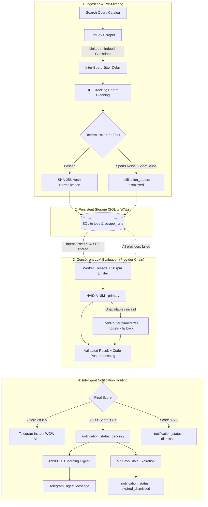

# JobSpy Coach

Autonomous 24/7 Coaching Job Discovery, LLM Evaluation & Notification Daemon.

JobSpy Coach scouts coaching vacancies across major job boards (LinkedIn, Indeed, Glassdoor), filters out sports/athletic noise and stub descriptions deterministically, evaluates matching professional coaching vacancies concurrently with large language models (NVIDIA NIM first, pinned free OpenRouter models as fallback), and delivers real-time WOW alerts and morning digests directly to Telegram.

---

## Table of Contents

- [Overview](#overview)
- [Key Features](#key-features)
- [Architecture](#architecture)
- [Prerequisites](#prerequisites)
- [Installation & Setup](#installation--setup)
- [Configuration Reference](#configuration-reference)
  - [LLM Provider Chain](#llm-provider-chain)
  - [Privacy of Local Configuration](#privacy-of-local-configuration)
  - [Model Selection and Bake-off](#model-selection-and-bake-off)
- [CLI Commands](#cli-commands)
- [Systemd Service Setup](#systemd-service-setup)
- [Testing](#testing)
- [License](#license)

---

## Overview

JobSpy Coach is specifically engineered for professional coaching, leadership development, and talent development candidates seeking opportunities across local and remote global markets.

### Targeted Roles
The roles that are searched for and rewarded are configured locally (see [Privacy of Local Configuration](#privacy-of-local-configuration)). The generic defaults aim at:
- **Career Coaching & Advisory**
- **Wellbeing & Life Coaching**
- **Corporate Training & Organizational Development (L&D)**
- **Talent & People Development**

IT, engineering, sales and project-management roles that merely list coaching as a side duty (including Scrum Master / Agile Coach roles) are rejected, and seniority alone never raises a score.

The daemon operates autonomously around the clock, continuously scraping configured job boards, deduplicating postings across providers, evaluating candidates with structured LLM reasoning against your locally configured candidate profile, and routing high-value opportunities to Telegram.

---

## Key Features

1. **Multi-Board Scraping with JobSpy**:
   - Queries LinkedIn, Indeed, and Glassdoor through a curated catalog of search terms.
   - Built-in inter-board jitter delays (`SCRAPER_JITTER_MIN_SECONDS` to `SCRAPER_JITTER_MAX_SECONDS`) and exponential backoff retry to prevent rate-limiting and IP bans.
   - URL cleaning that strips ephemeral tracking parameters (`utm_*`, `refId`, `trackingId`, `fbclid`).

2. **Deterministic Pre-Filtering**:
   - Fast, zero-cost regex and length heuristics before invoking LLMs.
   - Automatically dismisses athletic/sports roles (fitness, swimming, football, basketball coaches), pure IT/sales/driving title traps, and over-senior titles (Director, VP, Head of, Chief, Senior Manager and Polish/Ukrainian equivalents), with an exception for coaching, psychology and L&D titles.
   - Automatically drops stub descriptions (<150 characters or <30 words).

3. **Cross-Board Deduplication**:
   - Normalizes casing, diacritics, punctuation, parentheticals and corporate suffixes (`Sp. z o.o.`, `S.A.`, `LLC`, `GmbH`, `Inc.`) in the company, drops trailing regional words (`Polska`, `International`, `Group`), drops connector words (`and`, `&`, `und`) and gender markers (`(m/w/d)`) in the title, and reduces the location to its city (`Lyon Metropolitan Area` = `Lyon, Auvergne-Rhône-Alpes, France`).
   - Matching is exact on the normalized fields, never fuzzy: different roles at one company, different seniority/language variants and the same title in different cities stay separate postings.
   - Computes deterministic SHA-256 hashes (`company:title:location`) to prevent duplicate alerts when a vacancy is cross-posted across multiple boards.

4. **Concurrent, NIM-First LLM Evaluation**:
   - Evaluates vacancies against the target candidate persona through a **provider chain**: NVIDIA NIM first, then OpenRouter (pinned free models) as fallback.
   - Worker threads (`EVAL_MAX_WORKERS`) evaluate jobs concurrently while a sliding-window limiter caps NIM at `NVIDIA_RPM_LIMIT` requests per minute (default 30) **per process**.
   - Per-call retry with backoff, a circuit breaker per provider, and an OpenRouter daily budget. If every provider fails, the job simply stays `unprocessed` and is retried next cycle (`EVAL_MAX_ATTEMPTS` bounds repeated job-specific failures).
   - Generates scores from 1.0 to 10.0, concise executive summaries (`summary_uk`), rationale (`reasoning`), extracted language requirements, and pros/cons. Hard-reject and bonus-criteria adjustments are applied in code, not by the model; the model that actually answered is stored per job (`eval_model`). The language of `summary_uk` is set by the output language stated in your local `.candidate_profile.md` (English if none is stated). The bonus only applies when your local `.candidate_profile.md` contains a "Bonus criteria" section; without it the model's bonus flag is ignored. The model sets the bonus flag only when the posting text itself asks for or values a bonus criterion. WOW requires direct coaching: roles that are not flagged `role_is_direct_coaching` (corporate trainer, L&D, leadership-development and programme roles) are capped at 8.4 after the bonus, so they land in the digest, never in an instant alert.

5. **Two-Tier Telegram Dispatching**:
   - **Instant WOW Alerts**: Vacancies whose final score is $\ge 8.5$ (`WOW_SCORE_THRESHOLD`; reachable only by direct 1-on-1 coaching / psychological-support roles) trigger immediate Telegram push alerts with inline application buttons. WOW status is derived from the final score by the daemon; the model does not decide it.
   - **Daily Morning Digest**: Every day at the configured digest time (`DIGEST_TIME_CET`), qualifying vacancies ($6.5 \le \text{score} < 8.5$) are batched and delivered in formatted digest messages.
   - **Immediate Low-Score Dismissal**: Vacancies scoring $< 6.5$ (`DIGEST_SCORE_THRESHOLD`) are immediately marked `dismissed` to keep queues clean.
   - **Stale Expiration**: Stale pending postings older than 7 days are automatically transitioned to `expired_dismissed`.
   - **Defensive Telegram Safety**: Automatic HTML entity escaping, message chunking ($\le 3,800$ chars), and summary/reasoning length guards ($\le 600$ and $\le 800$ chars) ensure messages never exceed Telegram's 4,096 character limit.

6. **Robust SQLite WAL Repository**:
   - SQLite backend configured with Write-Ahead Logging (`WAL`), `synchronous = NORMAL`, and 5,000ms busy timeouts.
   - Scrape run audit logs (`scrape_runs`) recording jobs found, new jobs saved, duration, and execution status.

---

## Architecture



---

## Prerequisites

- **Python 3.10+** (tested on Python 3.10, 3.11, 3.12, 3.13, 3.14)
- **At least one LLM provider key**: an **NVIDIA NIM API key** (primary; from [build.nvidia.com](https://build.nvidia.com/)) and/or an **OpenRouter API key** plus `OPENROUTER_MODELS` (fallback; from [openrouter.ai](https://openrouter.ai/)). The app starts without keys, but evaluation raises a clear configuration error on first use until one provider is configured.
- **Telegram Bot Token & Chat ID** (create a bot with [@BotFather](https://t.me/BotFather) and get your user/group ID with [@userinfobot](https://t.me/userinfobot))

---

## Installation & Setup

### 1. Clone the Repository

```bash
git clone https://github.com/your-username/jobspy-coach.git
cd jobspy-coach
```

### 2. Create and Activate Virtual Environment

```bash
python3 -m venv .venv
source .venv/bin/activate
```

### 3. Install Package and Dependencies

```bash
# Production installation
pip install -e .

# Development installation (includes pytest, coverage, linters)
pip install -e ".[dev]"
```

### 4. Create Environment File

Copy the template and configure your secrets:

```bash
cp .env.example .env
```

Edit `.env` with your preferred editor:

```bash
nano .env
```

---

## Configuration Reference

All settings are managed via environment variables (or defined in `.env`) and validated by Pydantic:

| Environment Variable | Default Value | Description |
|----------------------|---------------|-------------|
| `APP_ENV` | `production` | Environment profile (`development`, `staging`, `production`). |
| `LOG_LEVEL` | `INFO` | Application logging verbosity (`DEBUG`, `INFO`, `WARNING`, `ERROR`). |
| `TIMEZONE` | `UTC` | Local timezone used for scheduling and digest timestamps. |
| `DB_PATH` | `data/jobs.db` | Filesystem path to SQLite database file. |
| `NVIDIA_API_KEY` | *(empty)* | NVIDIA NIM API key. NIM is enabled iff this is set. |
| `NVIDIA_BASE_URL` | `https://integrate.api.nvidia.com/v1` | NIM OpenAI-compatible endpoint. |
| `NVIDIA_MODEL` | `nvidia/nemotron-3-ultra-550b-a55b` | NIM model identifier. |
| `NVIDIA_RPM_LIMIT` | `30` | Client-side cap on NIM requests per minute, **per process**. |
| `NVIDIA_REASONING_EFFORT` | `low` | NIM reasoning effort (`low`, `medium`, `high`). |
| `NVIDIA_MAX_TOKENS` | `4096` | Completion token budget per call (retried at x1.5 if truncated). |
| `NVIDIA_TEMPERATURE` | `0.6` | Sampling temperature (do not use 0 with this model). |
| `NVIDIA_TIMEOUT_SECONDS` | `240.0` | HTTP read timeout for NIM calls. |
| `OPENROUTER_API_KEY` | *(empty)* | OpenRouter API key. |
| `OPENROUTER_MODELS` | *(empty)* | Ordered, comma-separated pinned models (e.g. free `:free` models). OpenRouter fallback is enabled iff both this and the key are set. |
| `OPENROUTER_DAILY_BUDGET` | `45` | Max OpenRouter HTTP attempts per UTC day (free tier allows about 50; resets on restart). |
| `OPENROUTER_RPM_LIMIT` | `20` | Client-side OpenRouter rate limit (requests per minute). |
| `OPENROUTER_TIMEOUT_SECONDS` | `45.0` | HTTP request timeout for OpenRouter calls. |
| `OPENROUTER_BASE_URL` | `https://openrouter.ai/api/v1` | OpenRouter OpenAI-compatible API endpoint. |
| `EVAL_MAX_WORKERS` | `8` | Worker threads evaluating jobs concurrently. |
| `EVAL_MAX_ATTEMPTS` | `5` | Job-specific failures allowed before a job is marked `failed`. Provider outages do not count. |
| `EVAL_BATCH_LIMIT` | `300` | Max unprocessed jobs evaluated per batch (also the default for `evaluate --limit`). |
| `LLM_BREAKER_FAILURES` | `3` | Consecutive failures that open a provider's circuit breaker. |
| `LLM_BREAKER_COOLDOWN_SECONDS` | `600.0` | Breaker cooldown before a single half-open probe. |
| `TELEGRAM_BOT_TOKEN` | *(required)* | Telegram Bot API token from `@BotFather`. |
| `TELEGRAM_CHAT_ID` | *(required)* | Telegram Chat ID or Channel ID receiving notifications. |
| `SCRAPE_INTERVAL_HOURS` | `6` | Hours between automatic background scrape pipeline cycles. With many LinkedIn queries a pass can take 15-30 minutes (12 s cooldown), so `12` is a reasonable choice for large query sets. |
| `DIGEST_TIME_CET` | `09:00` | Daily 24-hour time (`HH:MM`) when the morning digest is dispatched. |
| `HOURS_OLD_WINDOW` | `48` | Maximum posting age (in hours) to fetch from job boards. |
| `SCRAPER_JITTER_MIN_SECONDS` | `4.0` | Minimum delay in seconds between scraping individual job boards. |
| `SCRAPER_JITTER_MAX_SECONDS` | `9.0` | Maximum delay in seconds between scraping individual job boards. |
| `SCRAPER_RESULTS_PER_QUERY` | `10` | Target number of raw postings requested per query from each board (keep below 25 for LinkedIn). |
| `SCRAPER_ENABLED_BOARDS` | *(all configured)* | Optional comma-separated board allow-list. |
| `SCRAPER_PROXIES` | *(none)* | Optional comma-separated proxy URLs (needed for LinkedIn on datacenter IPs). |
| `WOW_SCORE_THRESHOLD` | `8.5` | Minimum final score (1-10) triggering an immediate WOW Telegram alert; additionally requires a direct-coaching role (other roles are capped at 8.4 and never alert instantly, even if this is set lower). |
| `DIGEST_SCORE_THRESHOLD` | `6.5` | Minimum final score (1-10) for the morning digest; lower scores are dismissed. |
| `DIGEST_MAX_ITEMS` | `10` | Maximum number of top vacancies included in a single daily digest. |

### LLM Provider Chain

- **NVIDIA NIM** is tried first and is enabled iff `NVIDIA_API_KEY` is set.
- **OpenRouter** is the fallback and is enabled iff `OPENROUTER_API_KEY` and a non-empty `OPENROUTER_MODELS` are set. The models are pinned via the `models` array; the random `openrouter/free` router must not be used.
- If a provider is rate-limited, out of budget, has a tripped circuit breaker, or returns an unusable answer, the next provider is tried. If none can answer, the job stays `unprocessed` and is retried next cycle.
- No providers configured: the daemon starts (so scraping still works) but evaluation raises a clear `ConfigurationError` the first time it is needed. Nothing is built at import or construction time.
- **Rate limit is per process**: the 30 rpm NIM cap is enforced inside one process. Do **not** run `jobspy-coach evaluate` while the daemon is evaluating: two processes double the effective rate and can send duplicate WOW alerts.
- **Batch latency stats**: the `Evaluation batch finished` log line reports per-job `latency[mean p95 max]` (retries included) and `inflight_peak`. Use them to judge `EVAL_MAX_WORKERS` / `NVIDIA_TIMEOUT_SECONDS`; the measured evidence behind the current defaults is in `docs/model-selection.md`.

### Privacy of Local Configuration

Everything specific to you stays in git-ignored local files and is never committed:

- `.env`: API keys, bot token, thresholds.
- `.candidate_profile.md`: your private candidate persona (read at runtime by the evaluator; a generic template is used if it is absent). Note that the profile text is sent to the configured LLM providers with each vacancy, so keep it minimal (no name or contact details).
- `queries.json`: your search queries (see `queries.example.json` for the format; the built-in defaults are location-neutral). Per query, `country_code` is required for Indeed and Glassdoor (they search one country at a time; queries without it skip those boards with a logged warning, e.g. pan-regional "Europe" queries should list only LinkedIn/Google), and the optional `google_search_term` overrides the Google Jobs query string that is otherwise derived as `<search_term> jobs near <location> <time window> [remote]`. Note that Google Jobs currently returns no data to python-jobspy from some networks (it serves a JavaScript challenge page); the scraper logs this once instead of failing silently.

### Log Hygiene

Logging goes through `configure_logging()`, which keeps `httpx`/`httpcore` at WARNING (their INFO lines contain the full Telegram API URL, including the bot token) and redacts bot-token-shaped strings and `Bearer`/`Authorization` secrets from every log record. If your bot token was ever logged, pasted or committed, rotate it (BotFather `/revoke`) and update `.env`.

### Model Selection and Bake-off

`docs/model-selection.md` records how the default models and request settings were chosen. To re-run the comparison (for example when provider behaviour changes), use the bake-off script, which reads keys from the environment or `.env` and writes raw results to the git-ignored `local/bakeoff/`:

```bash
python scripts/bakeoff.py nim --effort low --parallel 8
python scripts/bakeoff.py list-free          # free, no key needed
python scripts/bakeoff.py openrouter --candidates vendor/model:free --cases 4
```

### Sample `.env` File

```env
APP_ENV=production
LOG_LEVEL=INFO
TIMEZONE=UTC
DB_PATH=data/jobs.db

# Set a key to enable that provider; leave empty to disable it.
NVIDIA_API_KEY=
NVIDIA_MODEL=nvidia/nemotron-3-ultra-550b-a55b
NVIDIA_RPM_LIMIT=30
NVIDIA_REASONING_EFFORT=low

OPENROUTER_API_KEY=
OPENROUTER_MODELS=nvidia/nemotron-3.5-super-vl:free,google/gemma-4-31b-it:free
OPENROUTER_DAILY_BUDGET=45

EVAL_MAX_WORKERS=8
EVAL_MAX_ATTEMPTS=5
EVAL_BATCH_LIMIT=300

TELEGRAM_BOT_TOKEN=123456789:ABCdefGhIJKlmNoPQRstuVWXyz
TELEGRAM_CHAT_ID=987654321

SCRAPE_INTERVAL_HOURS=6
DIGEST_TIME_CET=09:00
HOURS_OLD_WINDOW=48
SCRAPER_RESULTS_PER_QUERY=10

WOW_SCORE_THRESHOLD=8.5
DIGEST_SCORE_THRESHOLD=6.5
DIGEST_MAX_ITEMS=10
```

---

## CLI Commands

The package exposes the command line executable `jobspy-coach` (or `python -m src.cli`):

```bash
# General CLI help
jobspy-coach --help
```

### 1. `test-telegram`
Validates Telegram bot token, chat ID, and network connectivity by delivering a verification message.
```bash
jobspy-coach test-telegram
```

### 1b. `rehash`
After upgrading to a new dedup normalization, existing rows still carry their old hashes. Recompute them and merge duplicate postings (stop the daemon first; the operation is idempotent):
```bash
jobspy-coach rehash --dry-run   # report only
jobspy-coach rehash
```
Per group of duplicates it keeps the row that already sent an alert, else an evaluated row, else the oldest. Rows that already sent an alert are never deleted.

### 1c. `cleanup-empty`
Removes stub rows with an empty description (default board `linkedin`, override with `--site`), e.g. rows saved by older versions when a LinkedIn detail fetch failed. Their dedup hash would otherwise keep suppressing the real posting. Stop the daemon first.
```bash
jobspy-coach cleanup-empty
```

#### Upgrading from a version before this change
1. Stop the daemon.
2. Optional: `jobspy-coach cleanup-empty` to drop empty-description LinkedIn stubs saved by older versions.
3. `jobspy-coach rehash --dry-run` to preview, then `jobspy-coach rehash` to recompute dedup hashes and merge duplicate postings.
4. Restart the daemon.

Until `rehash` has run, re-scraped postings can hash differently from the stored rows, so they may be re-evaluated and re-alerted.

### 2. `stats`
Displays a colorized terminal table detailing total jobs discovered, pre-filter dismissals, LLM evaluations, failed calls, instant alerts, digests sent, and pending digest candidates.
```bash
jobspy-coach stats
```

### 3. `scrape`
Executes a single one-shot scraping and evaluation cycle across all configured queries and job boards.
```bash
# Standard live run
jobspy-coach scrape

# Dry-run mode (scrapes and prints discoveries without saving to DB or sending alerts)
jobspy-coach scrape --dry-run
```

### 4. `evaluate`
Evaluates queued unprocessed vacancies currently sitting in the database independently from scraping, using the concurrent provider chain. The default limit is `EVAL_BATCH_LIMIT`.

> [!WARNING]
> Do not run `evaluate` while the daemon (`jobspy-coach run`) is evaluating. The 30 rpm cap is per process, so two processes double the request rate and can double-send WOW alerts.

```bash
# Evaluate up to EVAL_BATCH_LIMIT jobs
jobspy-coach evaluate

# Evaluate with custom limit in dry-run mode
jobspy-coach evaluate --limit 20 --dry-run
```

### 5. `digest`
Manually compiles and delivers the morning coaching vacancy digest to Telegram.
```bash
# Dispatch live digest
jobspy-coach digest

# Preview digest without sending
jobspy-coach digest --dry-run
```

### 6. `run`
Starts the long-running 24/7 background scheduler daemon. Runs an initial scraping cycle on startup, schedules recurring scraping every `SCRAPE_INTERVAL_HOURS`, and triggers the daily morning digest at `DIGEST_TIME_CET`. Handles `SIGINT` and `SIGTERM` gracefully.
```bash
jobspy-coach run
```

---

## Systemd Service Setup

To run `jobspy-coach` as a resilient system service on Linux (Ubuntu, Debian, AlmaLinux, Rocky, Arch):

### 1. Create the Service Unit File

Create `/etc/systemd/system/jobspy-coach.service` as `root` (or with `sudo`):

```ini
[Unit]
Description=JobSpy Coach Autonomous Discovery & Evaluation Daemon
After=network-online.target
Wants=network-online.target

[Service]
Type=simple
User=<YOUR_USER>
Group=<YOUR_USER>
WorkingDirectory=/path/to/jobspy-coach
EnvironmentFile=/path/to/jobspy-coach/.env
ExecStart=/path/to/jobspy-coach/.venv/bin/jobspy-coach run
Restart=always
RestartSec=30
KillSignal=SIGTERM
TimeoutStopSec=30
StandardOutput=journal
StandardError=journal

[Install]
WantedBy=multi-user.target
```

> [!NOTE]
> Adjust `User`, `Group`, `WorkingDirectory`, and paths to match your deployment environment.

> [!NOTE]
> Stopping the service can take up to `NVIDIA_TIMEOUT_SECONDS` while an LLM request is in flight. A SIGKILL after `TimeoutStopSec` is expected and harmless: in-flight jobs stay `unprocessed` and are re-evaluated next cycle (worst case, one duplicate alert).

### 2. Enable and Start the Service

```bash
# Reload systemd configuration
sudo systemctl daemon-reload

# Enable service to launch on system boot
sudo systemctl enable jobspy-coach.service

# Start the service
sudo systemctl start jobspy-coach.service

# Check service status
sudo systemctl status jobspy-coach.service
```

### 3. Monitor Daemon Logs

```bash
# Real-time streaming logs
sudo journalctl -u jobspy-coach.service -f

# View last 100 log lines
sudo journalctl -u jobspy-coach.service -n 100 --no-pager
```

---

## Testing

The project is covered by **~600 unit and end-to-end integration tests** (no network access needed). One additional `live` smoke test makes two real provider calls and is skipped by default.

### Run All Tests

```bash
# Activate virtual environment
source .venv/bin/activate

# Run full test suite
pytest

# Run tests with verbose output
pytest -v
```

### Live Smoke Test (optional, real network)

Tests marked `live` are skipped unless explicitly selected. This one needs at least one provider configured in `.env` and makes two real calls through the provider chain (it never prints keys or content):

```bash
pytest -m live -v
```

### Run Tests with Coverage Report

```bash
COVERAGE_FILE=/tmp/.coverage pytest -o cache_dir=/tmp/.pytest_cache --cov=src --cov-report=term-missing
```

### Test Suite Structure

- `tests/test_logging_config.py`: Secret redaction filter and `configure_logging()` behaviour.
- `tests/test_cli.py`: CLI command invocation, argument parsing, error exits, and context manager lifecycle.
- `tests/test_config.py`: Settings validation, aliases, default values, and environment variable overrides.
- `tests/test_daemon.py`: Scheduler execution, inter-board jitter delays, immediate low-score dismissals, transient/permanent error handling, and signal shutdown.
- `tests/test_e2e_pipeline.py`: Full autonomous pipeline lifecycle integration test from noisy multi-board scrape to WOW alerts, deduplication, dismissals, and digest delivery.
- `tests/test_providers.py`, `tests/test_chain.py`, `tests/test_rate_limiter.py`, `tests/test_circuit_breaker.py`, `tests/test_errors.py`: NIM/OpenRouter providers, fallback chain, post-processing, sliding-window limiter, circuit breaker, and error taxonomy (all with mocked transports).
- `tests/test_daemon_concurrency.py`: concurrent evaluation, single-threaded DB/Telegram invariant, outage handling, and shutdown.
- `tests/test_parsing.py`, `tests/test_prompts.py`, `tests/test_schemas.py`, `tests/test_eval_fixtures.py`: JSON extraction, generic prompts, schema validation, and persona-neutral evaluation fixtures.
- `tests/test_live_smoke.py`: optional live check (`-m live`).
- `tests/test_notifier.py`: Telegram client, 429 retry pacing, HTML entity escaping, message chunking, salary formatting, and length guard truncation.
- `tests/test_pre_filter.py`: Exhaustive regex pattern and heuristic validation across sports noise, edge cases, and short stubs.
- `tests/test_scraper.py`: JobSpy board scraping, URL sanitization, and retry backoff.
- `tests/test_storage.py`: SQLite WAL database operations, schema constraints, dedup hashing, and stats.
- `tests/test_dedup.py`: Dedup normalization (merge and non-merge cases) and the `rehash` migration.

---

## License

MIT License. Designed and maintained for Candidate Career Engineering.
