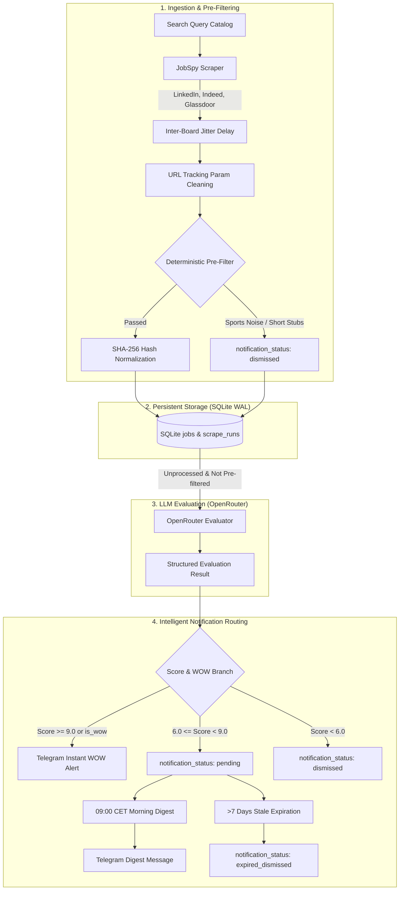

# JobSpy Coach

Autonomous 24/7 Coaching Job Discovery, LLM Evaluation & Notification Daemon.

JobSpy Coach scouts coaching vacancies across major job boards (LinkedIn, Indeed, Glassdoor), filters out sports/athletic noise and stub descriptions deterministically, evaluates matching professional coaching vacancies using large language models via OpenRouter, and delivers real-time WOW alerts and morning digests directly to Telegram.

---

## Table of Contents

- [Overview](#overview)
- [Key Features](#key-features)
- [Architecture](#architecture)
- [Prerequisites](#prerequisites)
- [Installation & Setup](#installation--setup)
- [Configuration Reference](#configuration-reference)
- [CLI Commands](#cli-commands)
- [Systemd Service Setup](#systemd-service-setup)
- [Testing](#testing)
- [License](#license)

---

## Overview

JobSpy Coach is specifically engineered for professional coaching and leadership development candidates seeking opportunities across local, regional, and remote global markets.

### Targeted Roles
- **Executive Coaching & Leadership Coaching**
- **Agile Coaching, Scrum Coaching & Transformation**
- **Career Coaching & Mentorship**
- **Corporate Training & Organizational Development (L&D)**
- **Team Coaching & Business Coaching**

The daemon operates autonomously around the clock, continuously scraping configured job boards, deduplicating postings across providers, evaluating candidates with structured LLM reasoning in Ukrainian, and routing high-value opportunities to Telegram.

---

## Key Features

1. **Multi-Board Scraping with JobSpy**:
   - Queries LinkedIn, Indeed, and Glassdoor through a curated catalog of search terms.
   - Built-in inter-board jitter delays (`SCRAPER_JITTER_MIN_SECONDS` to `SCRAPER_JITTER_MAX_SECONDS`) and exponential backoff retry to prevent rate-limiting and IP bans.
   - URL cleaning that strips ephemeral tracking parameters (`utm_*`, `refId`, `trackingId`, `fbclid`).

2. **Deterministic Pre-Filtering**:
   - Fast, zero-cost regex and length heuristics before invoking LLMs.
   - Automatically dismisses athletic/sports roles (fitness, swimming, football, basketball coaches).
   - Automatically drops stub descriptions (<150 characters or <30 words).

3. **Cross-Board Deduplication**:
   - Normalizes corporate suffixes (`Sp. z o.o.`, `LLC`, `GmbH`, `Inc.`), casing, and punctuation.
   - Computes deterministic SHA-256 hashes (`company:title:location`) to prevent duplicate alerts when a vacancy is cross-posted across multiple boards.

4. **Intelligent OpenRouter LLM Evaluation**:
   - Evaluates vacancies against the target candidate persona using OpenRouter models.
   - Generates scores from 1.0 to 10.0, concise concise executive summaries (`summary_uk`), rationale (`reasoning`), extracted language requirements, and pros/cons.
   - Enforces token-bucket rate limiting and handles transient network/server errors (leaving unprocessed jobs for subsequent retry).

5. **Two-Tier Telegram Dispatching**:
   - **Instant WOW Alerts**: Vacancies scoring $\ge 9.0$ (or marked `is_wow = True`) trigger immediate Telegram push alerts with inline application buttons.
   - **Daily Morning Digest**: Every day at 09:00 Europe/Warsaw, qualifying vacancies ($6.0 \le \text{score} < 9.0$) are batched and delivered in formatted digest messages.
   - **Immediate Low-Score Dismissal**: Vacancies scoring $< 6.0$ are immediately marked `dismissed` to keep queues clean.
   - **Stale Expiration**: Stale pending postings older than 7 days are automatically transitioned to `expired_dismissed`.
   - **Defensive Telegram Safety**: Automatic HTML entity escaping, message chunking ($\le 3,800$ chars), and summary/reasoning length guards ($\le 600$ and $\le 800$ chars) ensure messages never exceed Telegram's 4,096 character limit.

6. **Robust SQLite WAL Repository**:
   - SQLite backend configured with Write-Ahead Logging (`WAL`), `synchronous = NORMAL`, and 5,000ms busy timeouts.
   - Scrape run audit logs (`scrape_runs`) recording jobs found, new jobs saved, duration, and execution status.

---

## Architecture



---

## Prerequisites

- **Python 3.10+** (tested on Python 3.10, 3.11, 3.12, 3.13, 3.14)
- **OpenRouter API Key** (from [openrouter.ai](https://openrouter.ai/))
- **Telegram Bot Token & Chat ID** (create a bot with [@BotFather](https://t.me/BotFather) and get your user/group ID with [@userinfobot](https://t.me/userinfobot))

---

## Installation & Setup

### 1. Clone the Repository

```bash
git clone https://github.com/your-username/jobspy-coach.git
cd jobspy-coach
```

### 2. Create and Activate Virtual Environment

```bash
python3 -m venv .venv
source .venv/bin/activate
```

### 3. Install Package and Dependencies

```bash
# Production installation
pip install -e .

# Development installation (includes pytest, coverage, linters)
pip install -e ".[dev]"
```

### 4. Create Environment File

Copy the template and configure your secrets:

```bash
cp .env.example .env
```

Edit `.env` with your preferred editor:

```bash
nano .env
```

---

## Configuration Reference

All settings are managed via environment variables (or defined in `.env`) and validated by Pydantic:

| Environment Variable | Default Value | Description |
|----------------------|---------------|-------------|
| `APP_ENV` | `production` | Environment profile (`development`, `staging`, `production`). |
| `LOG_LEVEL` | `INFO` | Application logging verbosity (`DEBUG`, `INFO`, `WARNING`, `ERROR`). |
| `TIMEZONE` | `Europe/Warsaw` | Local timezone used for scheduling and digest timestamps. |
| `DB_PATH` | `data/jobs.db` | Filesystem path to SQLite database file. |
| `OPENROUTER_API_KEY` | *(required)* | OpenRouter API authentication key. |
| `OPENROUTER_MODEL` | `openrouter/free` | LLM model identifier (e.g. `google/gemini-2.5-flash`, `anthropic/claude-3.5-sonnet`). |
| `OPENROUTER_BASE_URL` | `https://openrouter.ai/api/v1` | OpenRouter OpenAI-compatible API endpoint. |
| `OPENROUTER_RPM_LIMIT` | `20` | Client-side rate limit (requests per minute) to OpenRouter. |
| `OPENROUTER_TIMEOUT_SECONDS` | `45.0` | HTTP request timeout for LLM evaluation calls. |
| `TELEGRAM_BOT_TOKEN` | *(required)* | Telegram Bot API token from `@BotFather`. |
| `TELEGRAM_CHAT_ID` | *(required)* | Telegram Chat ID or Channel ID receiving notifications. |
| `SCRAPE_INTERVAL_HOURS` | `6` | Hours between automatic background scrape pipeline cycles. |
| `DIGEST_TIME_CET` | `09:00` | Daily 24-hour time (`HH:MM`) when the morning digest is dispatched. |
| `HOURS_OLD_WINDOW` | `48` | Maximum posting age (in hours) to fetch from job boards. |
| `SCRAPER_JITTER_MIN_SECONDS` | `4.0` | Minimum delay in seconds between scraping individual job boards. |
| `SCRAPER_JITTER_MAX_SECONDS` | `9.0` | Maximum delay in seconds between scraping individual job boards. |
| `SCRAPER_RESULTS_PER_QUERY` | `25` | Target number of raw postings requested per query from each board. |
| `WOW_SCORE_THRESHOLD` | `9.0` | Minimum score (1-10) triggering an immediate WOW Telegram alert. |
| `DIGEST_SCORE_THRESHOLD` | `6.0` | Minimum score (1-10) required for a job to qualify for morning digest. |
| `DIGEST_MAX_ITEMS` | `10` | Maximum number of top vacancies included in a single daily digest. |

### Sample `.env` File

```env
APP_ENV=production
LOG_LEVEL=INFO
TIMEZONE=Europe/Warsaw
DB_PATH=data/jobs.db

OPENROUTER_API_KEY=sk-or-v1-xxxxxxxxxxxxxxxxxxxxxxxxxxxxxxxx
OPENROUTER_MODEL=openrouter/free
OPENROUTER_RPM_LIMIT=20
OPENROUTER_TIMEOUT_SECONDS=45.0

TELEGRAM_BOT_TOKEN=123456789:ABCdefGhIJKlmNoPQRstuVWXyz
TELEGRAM_CHAT_ID=987654321

SCRAPE_INTERVAL_HOURS=6
DIGEST_TIME_CET=09:00
HOURS_OLD_WINDOW=48
SCRAPER_JITTER_MIN_SECONDS=4.0
SCRAPER_JITTER_MAX_SECONDS=9.0
SCRAPER_RESULTS_PER_QUERY=25

WOW_SCORE_THRESHOLD=9.0
DIGEST_SCORE_THRESHOLD=6.0
DIGEST_MAX_ITEMS=10
```

---

## CLI Commands

The package exposes the command line executable `jobspy-coach` (or `python -m src.cli`):

```bash
# General CLI help
jobspy-coach --help
```

### 1. `test-telegram`
Validates Telegram bot token, chat ID, and network connectivity by delivering a verification message.
```bash
jobspy-coach test-telegram
```

### 2. `stats`
Displays a colorized terminal table detailing total jobs discovered, pre-filter dismissals, LLM evaluations, failed calls, instant alerts, digests sent, and pending digest candidates.
```bash
jobspy-coach stats
```

### 3. `scrape`
Executes a single one-shot scraping and evaluation cycle across all configured queries and job boards.
```bash
# Standard live run
jobspy-coach scrape

# Dry-run mode (scrapes and prints discoveries without saving to DB or sending alerts)
jobspy-coach scrape --dry-run
```

### 4. `evaluate`
Evaluates queued unprocessed vacancies currently sitting in the database independently from scraping.
```bash
# Evaluate up to 50 jobs
jobspy-coach evaluate

# Evaluate with custom limit in dry-run mode
jobspy-coach evaluate --limit 20 --dry-run
```

### 5. `digest`
Manually compiles and delivers the morning coaching vacancy digest to Telegram.
```bash
# Dispatch live digest
jobspy-coach digest

# Preview digest without sending
jobspy-coach digest --dry-run
```

### 6. `run`
Starts the long-running 24/7 background scheduler daemon. Runs an initial scraping cycle on startup, schedules recurring scraping every `SCRAPE_INTERVAL_HOURS`, and triggers the daily morning digest at `DIGEST_TIME_CET`. Handles `SIGINT` and `SIGTERM` gracefully.
```bash
jobspy-coach run
```

---

## Systemd Service Setup

To run `jobspy-coach` as a resilient system service on Linux (Ubuntu, Debian, AlmaLinux, Rocky, Arch):

### 1. Create the Service Unit File

Create `/etc/systemd/system/jobspy-coach.service` as `root` (or with `sudo`):

```ini
[Unit]
Description=JobSpy Coach Autonomous Discovery & Evaluation Daemon
After=network-online.target
Wants=network-online.target

[Service]
Type=simple
User=btema2
Group=btema2
WorkingDirectory=/home/btema2/smart-things/code/jobspy-coach
EnvironmentFile=/home/btema2/smart-things/code/jobspy-coach/.env
ExecStart=/home/btema2/smart-things/code/jobspy-coach/.venv/bin/jobspy-coach run
Restart=always
RestartSec=30
KillSignal=SIGTERM
TimeoutStopSec=30
StandardOutput=journal
StandardError=journal

[Install]
WantedBy=multi-user.target
```

> [!NOTE]
> Adjust `User`, `Group`, `WorkingDirectory`, and paths to match your deployment environment.

### 2. Enable and Start the Service

```bash
# Reload systemd configuration
sudo systemctl daemon-reload

# Enable service to launch on system boot
sudo systemctl enable jobspy-coach.service

# Start the service
sudo systemctl start jobspy-coach.service

# Check service status
sudo systemctl status jobspy-coach.service
```

### 3. Monitor Daemon Logs

```bash
# Real-time streaming logs
sudo journalctl -u jobspy-coach.service -f

# View last 100 log lines
sudo journalctl -u jobspy-coach.service -n 100 --no-pager
```

---

## Testing

The project is thoroughly tested with **135+ unit and end-to-end integration tests** achieving **98% code coverage**.

### Run All Tests

```bash
# Activate virtual environment
source .venv/bin/activate

# Run full test suite
pytest

# Run tests with verbose output
pytest -v
```

### Run Tests with Coverage Report

```bash
COVERAGE_FILE=/tmp/.coverage pytest -o cache_dir=/tmp/.pytest_cache --cov=src --cov-report=term-missing
```

### Test Suite Structure

- `tests/test_cli.py`: CLI command invocation, argument parsing, error exits, and context manager lifecycle.
- `tests/test_config.py`: Settings validation, aliases, default values, and environment variable overrides.
- `tests/test_daemon.py`: Scheduler execution, inter-board jitter delays, immediate low-score dismissals, transient/permanent error handling, and signal shutdown.
- `tests/test_e2e_pipeline.py`: Full autonomous pipeline lifecycle integration test from noisy multi-board scrape to WOW alerts, deduplication, dismissals, and digest delivery.
- `tests/test_evaluator.py`: OpenRouter LLM client, structured JSON parsing, prompt formatting, and rate limiter.
- `tests/test_notifier.py`: Telegram client, 429 retry pacing, HTML entity escaping, message chunking, salary formatting, and length guard truncation.
- `tests/test_pre_filter.py`: Exhaustive regex pattern and heuristic validation across sports noise, edge cases, and short stubs.
- `tests/test_scraper.py`: JobSpy board scraping, URL sanitization, and retry backoff.
- `tests/test_storage.py`: SQLite WAL database operations, schema constraints, dedup hashing, and stats.

---

## License

MIT License. Designed and maintained for Candidate Career Engineering.
