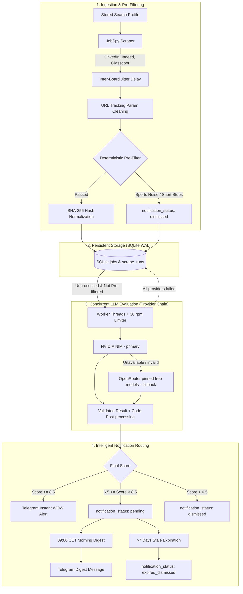

# JobSpy Coach

Autonomous 24/7 Coaching Job Discovery, LLM Evaluation & Notification Daemon.

JobSpy Coach scouts coaching vacancies across major job boards (LinkedIn, Indeed, Glassdoor), filters out sports/athletic noise and stub descriptions deterministically, evaluates matching professional coaching vacancies concurrently with large language models (NVIDIA NIM first, pinned free OpenRouter models as fallback), and delivers real-time WOW alerts and morning digests directly to Telegram.

---

## Table of Contents

- [Overview](#overview)
- [Key Features](#key-features)
- [Architecture](#architecture)
- [Prerequisites](#prerequisites)
- [Installation & Setup](#installation--setup)
- [Telegram Bot](#telegram-bot)
  - [Talking to the bot](#talking-to-the-bot)
  - [Setup interview and CV](#setup-interview-and-cv)
- [Configuration Reference](#configuration-reference)
  - [LLM Provider Chain](#llm-provider-chain)
  - [Privacy of Local Configuration](#privacy-of-local-configuration)
  - [Model Selection and Bake-off](#model-selection-and-bake-off)
- [CLI Commands](#cli-commands)
- [Systemd Service Setup](#systemd-service-setup)
- [Testing](#testing)
- [License](#license)

---

## Overview

JobSpy Coach is specifically engineered for professional coaching, leadership development, and talent development candidates seeking opportunities across local and remote global markets.

### Targeted Roles
The roles that are searched for and rewarded are configured locally (see [Privacy of Local Configuration](#privacy-of-local-configuration)). The generic defaults aim at:
- **Career Coaching & Advisory**
- **Wellbeing & Life Coaching**
- **Corporate Training & Organizational Development (L&D)**
- **Talent & People Development**

IT, engineering, sales and project-management roles that merely list coaching as a side duty (including Scrum Master / Agile Coach roles) are rejected, and seniority alone never raises a score.

The daemon operates autonomously around the clock, continuously scraping configured job boards, deduplicating postings across providers, evaluating candidates with structured LLM reasoning against your locally configured candidate profile, and routing high-value opportunities to Telegram.

---

## Key Features

1. **Multi-Board Scraping with JobSpy**:
   - Queries LinkedIn, Indeed, Glassdoor and Google Jobs for the search terms of your stored profile (roles x markets x boards, plus any pinned queries).
   - Built-in inter-board jitter delays (`SCRAPER_JITTER_MIN_SECONDS` to `SCRAPER_JITTER_MAX_SECONDS`) and exponential backoff retry to prevent rate-limiting and IP bans.
   - URL cleaning that strips ephemeral tracking parameters (`utm_*`, `refId`, `trackingId`, `fbclid`).

2. **Deterministic Pre-Filtering**:
   - Fast, zero-cost regex and length heuristics before invoking LLMs.
   - Automatically dismisses athletic/sports roles (fitness, swimming, football, basketball coaches), pure IT/sales/driving title traps, and over-senior titles (Director, VP, Head of, Chief, Senior Manager and Polish/Ukrainian equivalents), with an exception for coaching, psychology and L&D titles.
   - Automatically drops stub descriptions (<150 characters or <30 words).

3. **Cross-Board Deduplication**:
   - Normalizes casing, diacritics, punctuation, parentheticals and corporate suffixes (`Sp. z o.o.`, `S.A.`, `LLC`, `GmbH`, `Inc.`) in the company, drops trailing regional words (`Polska`, `International`, `Group`), drops connector words (`and`, `&`, `und`) and gender markers (`(m/w/d)`) in the title, and reduces the location to its city (`Lyon Metropolitan Area` = `Lyon, Auvergne-Rhône-Alpes, France`).
   - Matching is exact on the normalized fields, never fuzzy: different roles at one company, different seniority/language variants and the same title in different cities stay separate postings.
   - Computes deterministic SHA-256 hashes (`company:title:location`) to prevent duplicate alerts when a vacancy is cross-posted across multiple boards.

4. **Concurrent, NIM-First LLM Evaluation**:
   - Evaluates vacancies against the target candidate persona through a **provider chain**: NVIDIA NIM first, then OpenRouter (pinned free models) as fallback.
   - Worker threads (`EVAL_MAX_WORKERS`) evaluate jobs concurrently while a sliding-window limiter caps NIM at `NVIDIA_RPM_LIMIT` requests per minute (default 30) **per process**.
   - Per-call retry with backoff, a circuit breaker per provider, and an OpenRouter daily budget. If every provider fails, the job simply stays `unprocessed` and is retried next cycle (`EVAL_MAX_ATTEMPTS` bounds repeated job-specific failures).
   - Generates scores from 1.0 to 10.0, concise executive summaries (`summary`), rationale (`reasoning`), extracted language requirements, and pros/cons. Hard-reject and bonus adjustments are applied in code, not by the model; the model that actually answered is stored per job (`eval_model`). The scoring rubric is a template filled from your stored profile: the persona, the core-role and adjacent-role definitions, the dealbreakers, the bonus criteria and points, the output language and the WOW / digest thresholds all live in the profile and are applied per cycle, so a profile change takes effect on the next cycle without restarting the daemon. The persona lives in the stored profile: a legacy `.candidate_profile.md` is imported once, and later edits to that file no longer change scoring (change the profile with `profile export` / `profile import`). The bonus applies only when the profile has bonus criteria; the model sets the bonus flag only when the posting text itself asks for or values one. WOW requires a core role (the profile's core-role definition): other roles are capped just below the WOW threshold (8.4 with the default threshold) after the bonus, so they land in the digest, never in an instant alert; with no core-role definition the cap is off. Without a stored profile the fallback prompt is built from `.candidate_profile.md` and the bonus is off, even if that prompt still lists bonus criteria. Models that answer with the older `summary_uk` / `role_is_direct_coaching` keys are still accepted.

5. **Two-Tier Telegram Dispatching**:
   - **Instant WOW Alerts**: Vacancies whose final score is at or above the profile's WOW threshold (default 8.5; reachable only by core roles, e.g. direct 1-on-1 coaching) trigger immediate Telegram push alerts with inline application buttons. WOW status is derived from the final score by the daemon; the model does not decide it.
   - **Daily Morning Digest**: Every day at the configured digest time (`DIGEST_TIME_CET`), qualifying vacancies (score from the profile's digest threshold, default 6.5, up) are batched and delivered in formatted digest messages.
   - **Immediate Low-Score Dismissal**: Vacancies scoring below the profile's digest threshold (default 6.5) are immediately marked `dismissed` to keep queues clean.
   - **Stale Expiration**: Stale pending postings older than 7 days are automatically transitioned to `expired_dismissed`.
   - **Defensive Telegram Safety**: Automatic HTML entity escaping, message chunking ($\le 3,800$ chars), and summary/reasoning length guards ($\le 600$ and $\le 800$ chars) ensure messages never exceed Telegram's 4,096 character limit.

6. **Robust SQLite WAL Repository**:
   - SQLite backend configured with Write-Ahead Logging (`WAL`), `synchronous = NORMAL`, and 5,000ms busy timeouts.
   - Scrape run audit logs (`scrape_runs`) recording jobs found, new jobs saved, duration, and execution status.

---

## Architecture



---

## Prerequisites

- **Python 3.10+** (tested on Python 3.10, 3.11, 3.12, 3.13, 3.14)
- **At least one LLM provider key**: an **NVIDIA NIM API key** (primary; from [build.nvidia.com](https://build.nvidia.com/)) and/or an **OpenRouter API key** plus `OPENROUTER_MODELS` (fallback; from [openrouter.ai](https://openrouter.ai/)). The app starts without keys, but evaluation raises a clear configuration error on first use until one provider is configured.
- **Telegram bot token** (create a bot with [@BotFather](https://t.me/BotFather)). `jobspy-coach init` pairs your Telegram account with the bot, so you do not need to look up a chat ID (an existing `TELEGRAM_CHAT_ID` in `.env` is adopted as the paired chat).

---

## Installation & Setup

### 1. Clone the Repository

```bash
git clone https://github.com/your-username/jobspy-coach.git
cd jobspy-coach
```

### 2. Create and Activate Virtual Environment

```bash
python3 -m venv .venv
source .venv/bin/activate
```

### 3. Install Package and Dependencies

```bash
# Production installation
pip install -e .

# Development installation (includes pytest, coverage, linters)
pip install -e ".[dev]"
```

The dependencies include `pypdf` (`>=6.1`), which reads the text layer of a CV you send to the bot as a PDF (see [Setup interview and CV](#setup-interview-and-cv)). An existing install picks it up with `pip install -e .` after updating.

### 4. Run the Setup (`init`)

```bash
jobspy-coach init
```

`init` is interactive and replaces hand-editing `.env`:

1. It asks for the Telegram bot token and the LLM key(s) (NVIDIA NIM and/or OpenRouter) with **hidden input**; secrets are never accepted as command-line arguments. Each credential is checked with one call (a rejected one is asked again, at most 3 tries; if the network is down it is saved with a warning). The values are merged into your existing `.env` without touching other lines, and the file is set to mode 600. A value already in `.env` is offered for keeping (and is checked too).
2. It creates an empty, **paused** starter profile unless a profile already exists (an imported one is left alone).
3. It pairs your Telegram account (see [Telegram Bot](#telegram-bot)): it prints a one-time code, or adopts an existing `TELEGRAM_CHAT_ID`.
4. It offers to start the daemon.

Options: `--skip-credentials` (do not prompt for or write credentials), `--no-start` / `--start` (do not ask about starting the daemon), `--language CODE` (output language of the starter profile, default `en`). Other settings (schedule, boards, limits) keep their defaults; `.env.example` lists them if you want to change one.

### 5. Create Your Search Profile

The search queries and the candidate persona live in a stored, versioned profile (in the SQLite database), not in `.env`.

- **Existing install** (you already have `queries.json` and/or `.candidate_profile.md` in the project directory): nothing to do. The first `jobspy-coach` command you run imports them automatically (the files are left untouched; the import happens once). A broken `queries.json` stops every command with a message naming the file and the entry to fix; there is no fallback to built-in queries.
- **New install**: `init` created an empty, paused profile. Build it from Telegram (`/setup` runs a short interview and can read your CV; or `/add_role`, `/add_market`; then `/resume`; see [Telegram Bot](#telegram-bot)) or with `jobspy-coach profile export`, edit the YAML file (it is written under the git-ignored `local/`), and `jobspy-coach profile import <file>`. Check the result with `jobspy-coach profile preview` or `/preview`.

`jobspy-coach run` refuses to start without a profile (`no profile, run \`jobspy-coach init\``, with the backticks). There are no built-in default queries.

---

## Telegram Bot

The daemon contains a private Telegram bot that reads and changes your stored profile. It runs as a background thread inside `jobspy-coach run` (it starts before the first scrape cycle, so it answers during a cycle) and needs only the bot token.

### Pairing and security

- **Setup**: `jobspy-coach init` asks for the token, then pairs. If `TELEGRAM_CHAT_ID` is already set in `.env` (an existing install), that chat is adopted as the paired one, because the local `.env` is the trust anchor; the poller also adopts it on its first start, so an existing install gets the bot without re-running `init`. Otherwise `init` prints a one-time 8-character code. Open your bot in a **private chat** and send `/start <code>`; the bot stores your user id and chat id, writes `TELEGRAM_CHAT_ID` into `.env` (the alerts use the same value) and replies `Paired`.
- The code is single-use and valid for 15 minutes. After 5 wrong codes pairing is locked until the daemon restarts (a warning is logged); a new code from `jobspy-coach init` only works **after you restart the daemon**. With `TELEGRAM_BOT_POLLING=false` `init` issues no code (nobody would receive `/start`). `init` on an already paired install says `Already paired` and issues no code (use `bot unpair` first to pair another account). The daemon must be running when you send `/start <code>`.
- **Only the paired user is served.** Every update is checked, including button presses: it must come from the paired user id in the paired private chat. Strangers, groups and forwarded messages are dropped without a reply and logged without their content.
- **Lost or changed account**: `jobspy-coach bot unpair` forgets the pairing and blanks `TELEGRAM_CHAT_ID` in `.env`; restart the daemon, then run `init` and send the new code. Alerts stop until you pair again.
- Commands are applied immediately through the same validated, versioned operations as `profile import`: each shows a one-line-per-change diff and bumps the profile version; `/undo` and `/restore` bring a previous version back. A command is executed at most once: the update offset is saved before it runs, so a restart cannot replay an `/undo`, and a mutating command older than 15 minutes is ignored (send it again). Free text goes through a language model and a confirmation step (see [Talking to the bot](#talking-to-the-bot)); without an LLM key, unknown text gets a hint to send `/help`.
- Replies are English only (alert and digest texts follow the profile's `output_language`), are split below Telegram's limit, and escape every term you typed.

### Commands

| Group | Commands |
|---|---|
| Read | `/help`, `/profile`, `/roles`, `/markets`, `/exclusions`, `/preview`, `/dropped` |
| Change | `/add_role <name> [= synonym, synonym]`, `/remove_role <name>`, `/add_market <country> [remote] [remote_only]`, `/exclude <term> [prefix]`, `/threshold wow\|digest <n>`, `/pause`, `/resume`, `/run_now`, `/digest` |
| Setup | `/setup` (a short interview with an LLM, a CV can answer several questions at once; step by step with inline buttons when no LLM is configured), `/setup guided` (always step by step: role, synonyms, market, remote preference, confirm) |
| Confirm | `/ok` (apply the pending proposal), `/cancel` (discard it, and anything in flight) |
| Safety | `/undo` (repeat to toggle), `/history`, `/restore <n>`, `/requeue [thresholds]` |
| Insight | `/stats`, `/test <role> [linkedin]` |

- Country names are resolved from a built-in table; an ambiguous name gets a reply asking which one. `/add_market` also accepts the regions `europe` and `worldwide` (LinkedIn and Google only; they have no country for Indeed or Glassdoor).
- `/pause` stops scraping only (evaluation and digests continue). `/resume` is refused while the profile has no enabled query and otherwise starts a cycle at once. `/run_now` starts a cycle and answers that one is running if it is. `/requeue` is refused while a cycle or the digest runs.
- **Run report**: after a cycle started by `/run_now` or `/resume` (also a resume you confirmed in chat), the bot sends one short report when the cycle ends: searches with results, empty and failed (and boards skipped because a market has no country), new jobs to evaluate and jobs dropped by the title rules, up to 3 problems per board (for example `linkedin: blocked (429)`, `linkedin: detail pages blocked`, `google: no data returned`), jobs evaluated and WOW alerts sent, jobs left for the next cycle or not scored (and why), and how many jobs wait for the digest, with the hint to send `/digest`. If the cycle fails, the report says `The cycle stopped: ...`. Scheduled cycles send no report. If a cycle was already running, `/run_now` says so and sends no report.
- **`/digest`** sends the jobs that are waiting for the morning digest now (the same messages, without the update notice) and then one line: `Sent <N> jobs`, `Sent <k> of <m> messages; some jobs may be missing`, `Sending failed; the jobs stay waiting` or `Nothing is waiting`, plus `<K> more waiting, send /digest again` when more than `DIGEST_MAX_ITEMS` jobs wait. Jobs it sends do not appear in the next morning digest. It answers `A digest is already running.` while one runs and `The daemon is not ready yet, try again in a minute.` during the first cycle after a start. A running scrape cycle does not block it.
- `/stats` shows the last 7 days per role: calls, new jobs and relevant jobs (evaluated with a score at or above the digest threshold). Failed calls are counted separately from empty results, so a blocked board is not blamed on the query.
- `/test <role>` is a small trial search: at most one per 5 minutes, at most 3 calls with 5 results each, only on the boards enabled in `SCRAPER_ENABLED_BOARDS` (LinkedIn only when you add the word `linkedin`), and it never saves anything. It reports rows, new postings, the pre-filtered share and example titles. It does **not** measure relevance.

### Talking to the bot

With an LLM key configured (`NVIDIA_API_KEY` and/or `OPENROUTER_API_KEY`), you can change the profile by writing to the bot in plain language instead of using commands. Examples (placeholders, write your own):

- `add the role <ROLE> with the synonyms <SYNONYM>, <SYNONYM>`
- `also search in <COUNTRY>, remote only`
- `exclude titles with <TERM>`
- `raise the WOW threshold to 9`
- `pause searching`
- a longer description of what you are looking for (for example from a CV summary, without names and contact details)

How it works:

- The bot sends your text to the language model, which answers with a structured change over a fixed set of operations (add, remove or modify roles, synonyms, markets and exclusion rules; thresholds; persona and role definitions; enable or disable items; pause or resume). It cannot touch your bot token, the paired chat, the providers or any setting outside the profile.
- **Nothing is applied until you confirm.** The bot shows the change as a diff that is written by code, not by the model (a persona or definition change is shown in full, with the button `Apply persona change`). Press **Confirm** or **Cancel**, or send `/ok` or `/cancel`. A plain `ok` / `yes` or `no` also works while a proposal is waiting. Only one proposal is pending at a time: a new request replaces the old one (you are told). If the profile changed in the meantime (for example by another command), the proposal is refused and you send your request again. A proposal expires after 24 hours.
- If the request is unclear the bot asks one short question (at most two rounds); your next message is read as the answer.
- Several messages sent within 3 seconds are merged into one request, up to 3 messages and 12,000 characters in total. A longer text is dropped as a whole with the hint to send it as a file: a `.txt` or `.md` file of up to 20 KB (UTF-8) is read as one request, and its caption is added to it. A PDF starts the setup interview with your CV (see below).
- The bot answers `Working on it...` at once and, after 20 seconds, `Still working; this can take a few minutes.` Commands keep working meanwhile. A quick failure of NVIDIA NIM (a timeout, a server error or a rate limit) is retried once when enough time is left; then the OpenRouter models are tried. At most 60 model calls per hour are made (the cap counts every attempt, retries included), and the chat may use at most 15 of the shared OpenRouter daily budget per day, so the evaluation keeps its fallback.
- **When the model fails**, the bot says why, in its own words, never the model's: `The model timed out`, `The model is rate-limited`, `No model is reachable`, `The model's answer could not be used` or `Too many model requests this hour` (`... today` for the OpenRouter share), with when to try again, and a **Retry** button that sends the same request again without you retyping it (the text is kept in memory only, for at most 24 hours; `/cancel` drops it).
- Without any LLM key the bot says so and the commands and `/setup guided` keep working.

#### Setup interview and CV

**`/setup`** with an LLM runs a short interview instead of asking for one long description:

1. If you have not yet acknowledged the privacy notice (below), the bot shows it first and asks nothing until you do. `No` starts the step-by-step questions instead.
2. The bot asks 6 to 8 short questions, one at a time: the roles you want (with other names for them), the countries or remote work, your working languages, the seniority you aim for, what to avoid, and what a posting could value (credentials, languages, background). Short answers are taken as they are. A longer answer is checked by the model, which can ask one short follow-up question when it is vague, and notices when it already answered a later question (that question is then skipped). Answer `no` or `skip` to skip a question; `yes` alone gets `Which ones?`. An answer is at most 2,000 characters.
3. When every question has an answer (or after 8 questions) the bot drafts the profile and shows it as a proposal, exactly like any other change: nothing is applied until you press **Confirm** (or **Apply persona change**). If the draft fails, your answers are kept and you get **Retry**; if a value cannot be used (for example an unknown country) the bot asks that question again.

The buttons under the first message: **Draft now** (draft from what you said so far), **Step-by-step questions instead** (the fixed question flow without a model, the same as `/setup guided`; your answers are discarded) and **Cancel**. `/cancel` also stops the interview. `/setup` again starts a new interview; it also discards a pending proposal and an open question (you are told). With an empty profile the draft builds a new profile; when you already have roles or markets, it extends the existing profile (it keeps your roles, markets and texts unless you say otherwise), and the diff shows every change.

**CV.** You can send your CV at any point of the interview, or at any time to start one: as a **PDF with a text layer** (exported from a word processor; a scanned image has no text and is refused), or as a `.txt` / `.md` file. One CV can answer several questions at once; the interview then asks only what is missing.

- Limits: a PDF of at most 5 MB and 10 pages; text files up to 20 KB; at most 20,000 characters of text are used. Password-protected PDFs are refused (a PDF with only an owner password opens). There is no OCR and no `.docx`.
- The PDF is read on your machine in a separate, time- and memory-limited process. Before anything is sent, the contact block at the top (everything before the first heading such as `Experience`, or the first 6 lines) is removed, and e-mail addresses, phone numbers, web links (`http`/`www` addresses, links with a path, profile sites such as LinkedIn or GitHub, link shorteners) and `@handles` are masked. Names and street addresses elsewhere in the text cannot be recognised, so remove them yourself if you can.
- The bot first shows what it read (`Read <N> pages, <M> characters. First lines: ...`, already masked) with **Send** and **Cancel**. Nothing is sent to a model before you press **Send** and have acknowledged the privacy notice. A caption on the upload is used as an extra answer.
- The CV text is kept only in memory until the model has read it, and never in the database or the log. The facts the model notes from it are stored like your answers (below). If reading fails, the CV is kept for **Retry** and you can keep answering meanwhile.

**Privacy of free text.** Before the first use the bot explains what happens and asks you to acknowledge it: what you write is sent to NVIDIA NIM and, when that is unavailable, to free models on OpenRouter (whose logging and training policies may differ from NVIDIA's and which you cannot control), together with your stored profile (persona and role definitions, not masked; the model needs it to propose changes, and it is sent with every free-text request). Leave out names, addresses and phone numbers. Obvious e-mail addresses and phone numbers are masked on your machine before sending (`[email]`, `[phone]`; interview answers and CVs also get links and `@handles` masked), but this is best effort and cannot recognise names or street addresses. The notice also covers CVs and the interview; it was extended for them, so a chat that acknowledged the earlier notice is asked once more. Do not forward messages from other people or job ads to the bot: forwarded messages are rejected on purpose, so paste the text or upload a file instead. Your messages are never written to the log. The text of a request is kept only in memory and, while the bot waits for the answer to a question, in the local database for at most 24 hours; it is deleted when you confirm, cancel, replace the proposal or it expires. During the setup interview your answers and the facts noted from your CV are stored, masked, in the local database for at most 24 hours counted from your first stored answer (answering later does not extend it); they are deleted when the draft proposal is shown, or when you cancel, switch to step-by-step questions, start `/setup` again or the 24 hours pass. The CV text itself is never stored (the 24-hour purge runs while the daemon is running; anything left behind while it was stopped is removed on its next start). `jobspy-coach bot unpair` also clears the pending proposal, the chat state and your acknowledgement, so a newly paired account is asked again (restart the daemon afterwards).

### One consumer per bot token

Telegram lets only one program call `getUpdates` for a bot token at a time. If a second poller starts (another instance of this daemon, or another bot program using the same token) or a webhook is set, Telegram answers HTTP 409 and the daemon logs one warning and backs off (it keeps sending alerts). Give this daemon its own bot token, or set `TELEGRAM_BOT_POLLING=false` to run only the alert sender and leave the polling to the other program (then there is no bot and no pairing).

---

## Configuration Reference

All settings are managed via environment variables (or defined in `.env`) and validated by Pydantic:

| Environment Variable | Default Value | Description |
|----------------------|---------------|-------------|
| `APP_ENV` | `production` | Environment profile (`development`, `staging`, `production`). |
| `LOG_LEVEL` | `INFO` | Application logging verbosity (`DEBUG`, `INFO`, `WARNING`, `ERROR`). |
| `TIMEZONE` | `UTC` | Local timezone used for scheduling and digest timestamps. |
| `DB_PATH` | `data/jobs.db` | Filesystem path to SQLite database file. |
| `NVIDIA_API_KEY` | *(empty)* | NVIDIA NIM API key. NIM is enabled iff this is set. |
| `NVIDIA_BASE_URL` | `https://integrate.api.nvidia.com/v1` | NIM OpenAI-compatible endpoint. |
| `NVIDIA_MODEL` | `nvidia/nemotron-3-ultra-550b-a55b` | NIM model identifier. |
| `NVIDIA_RPM_LIMIT` | `30` | Client-side cap on NIM requests per minute, **per process**. |
| `NVIDIA_REASONING_EFFORT` | `low` | NIM reasoning effort (`low`, `medium`, `high`). |
| `NVIDIA_MAX_TOKENS` | `4096` | Completion token budget per call (retried at x1.5 if truncated). |
| `NVIDIA_TEMPERATURE` | `0.6` | Sampling temperature (do not use 0 with this model). |
| `NVIDIA_TIMEOUT_SECONDS` | `240.0` | HTTP read timeout for NIM calls. |
| `OPENROUTER_API_KEY` | *(empty)* | OpenRouter API key. |
| `OPENROUTER_MODELS` | *(empty)* | Ordered, comma-separated pinned models (e.g. free `:free` models). OpenRouter fallback is enabled iff both this and the key are set. |
| `OPENROUTER_DAILY_BUDGET` | `45` | Max OpenRouter HTTP attempts per UTC day (free tier allows about 50; resets on restart). |
| `OPENROUTER_RPM_LIMIT` | `20` | Client-side OpenRouter rate limit (requests per minute). |
| `OPENROUTER_TIMEOUT_SECONDS` | `45.0` | HTTP request timeout for OpenRouter calls. |
| `OPENROUTER_BASE_URL` | `https://openrouter.ai/api/v1` | OpenRouter OpenAI-compatible API endpoint. |
| `EVAL_MAX_WORKERS` | `8` | Worker threads evaluating jobs concurrently. |
| `EVAL_MAX_ATTEMPTS` | `5` | Job-specific failures allowed before a job is marked `failed`. Provider outages do not count. |
| `EVAL_BATCH_LIMIT` | `300` | Max unprocessed jobs evaluated per batch (also the default for `evaluate --limit`). |
| `LLM_BREAKER_FAILURES` | `3` | Consecutive failures that open a provider's circuit breaker. |
| `LLM_BREAKER_COOLDOWN_SECONDS` | `600.0` | Breaker cooldown before a single half-open probe. |
| `TELEGRAM_BOT_TOKEN` | *(required)* | Telegram Bot API token from `@BotFather` (written by `init`). |
| `TELEGRAM_CHAT_ID` | *(set by pairing)* | Chat receiving notifications. Written by `init` / `/start <code>`; an existing value is adopted as the paired chat; `bot unpair` blanks it. |
| `TELEGRAM_BOT_POLLING` | `true` | Run the Telegram bot (long polling) inside the daemon. Set `false` when another program polls the same token. |
| `SCRAPE_INTERVAL_HOURS` | `6` | Hours between automatic background scrape pipeline cycles. With many LinkedIn queries a pass can take 15-30 minutes (12 s cooldown), so `12` is a reasonable choice for large query sets. |
| `DIGEST_TIME_CET` | `09:00` | Daily 24-hour time (`HH:MM`) when the morning digest is dispatched. |
| `HOURS_OLD_WINDOW` | `48` | Maximum posting age (in hours) to fetch from job boards. Indeed always uses at least 168 h, because narrower windows starve niche queries. |
| `SCRAPER_JITTER_MIN_SECONDS` | `4.0` | Minimum delay in seconds between scraping individual job boards. |
| `SCRAPER_JITTER_MAX_SECONDS` | `9.0` | Maximum delay in seconds between scraping individual job boards. |
| `SCRAPER_RESULTS_PER_QUERY` | `10` | Target number of raw postings requested per query from each board (keep below 25 for LinkedIn). |
| `SCRAPER_ENABLED_BOARDS` | *(all configured)* | Optional comma-separated board allow-list. |
| `SCRAPER_PROXIES` | *(none)* | Optional comma-separated proxy URLs (needed for LinkedIn on datacenter IPs). |
| `WOW_SCORE_THRESHOLD` | `8.5` | Seed for the profile's WOW threshold at import (legacy import, `init`) and fallback when there is no profile. The live value is the profile's `wow_threshold` (`profile export` / `profile import`). |
| `DIGEST_SCORE_THRESHOLD` | `6.5` | Seed for the profile's digest threshold at import and fallback when there is no profile. The live value is the profile's `digest_threshold`; lower scores are dismissed. |
| `DIGEST_MAX_ITEMS` | `10` | Maximum number of top vacancies included in a single daily digest. |

### LLM Provider Chain

- **NVIDIA NIM** is tried first and is enabled iff `NVIDIA_API_KEY` is set.
- **OpenRouter** is the fallback and is enabled iff `OPENROUTER_API_KEY` and a non-empty `OPENROUTER_MODELS` are set. The models are pinned via the `models` array; the random `openrouter/free` router must not be used.
- If a provider is rate-limited, out of budget, has a tripped circuit breaker, or returns an unusable answer, the next provider is tried. If none can answer, the job stays `unprocessed` and is retried next cycle.
- No providers configured: the daemon starts (so scraping still works) but evaluation raises a clear `ConfigurationError` the first time it is needed. Nothing is built at import or construction time.
- **Free text uses the same providers** (`NVIDIA_API_KEY` / `OPENROUTER_API_KEY`) through a separate path: chat requests take rate-limit slots with priority and ignore the batch circuit breakers. Each request has a per-attempt timeout and an overall deadline (free text 120 s / 240 s, an interview step or CV reading 90 s / 150 s, the profile draft 180 s / 300 s); NIM gets at most one retry after a timeout, server error or rate limit, and only when a retry of at least 30 s still leaves 60 s of the deadline for the OpenRouter fallback; OpenRouter is never retried. Chat is capped at 60 model calls per hour and may spend at most 15 of `OPENROUTER_DAILY_BUDGET` per day. These limits are built in, not settings. See [Talking to the bot](#talking-to-the-bot).
- **Rate limit is per process**: the 30 rpm NIM cap is enforced inside one process. Do **not** run `jobspy-coach evaluate` while the daemon is evaluating: two processes double the effective rate and can send duplicate WOW alerts.
- **Batch latency stats**: the `Evaluation batch finished` log line reports per-job `latency[mean p95 max]` (retries included) and `inflight_peak`. Use them to judge `EVAL_MAX_WORKERS` / `NVIDIA_TIMEOUT_SECONDS`; the measured evidence behind the current defaults is in `docs/model-selection.md`.

### Privacy of Local Configuration

Everything specific to you stays in git-ignored local files and is never committed:

- `.env`: API keys, bot token, and the import seeds for the thresholds (the stored profile's thresholds are what scoring uses).
- `.candidate_profile.md` (legacy, optional): your private candidate persona. It is only read once, to import it into the stored profile; **after the import the persona lives in the profile in the SQLite database** (`data/jobs.db`, git-ignored; also in its last 10 stored profile versions), and editing the file no longer changes scoring. Edit the profile with the Telegram bot or with `jobspy-coach profile export`, edit the YAML, `jobspy-coach profile import <file>`. A generic template is used if the profile has no persona. Treat `data/jobs.db` as private data. Note that the profile text is sent to the configured LLM providers with each vacancy, so keep it minimal (no name or contact details). Text you write to the bot is sent to them too, after your acknowledgement (see [Talking to the bot](#talking-to-the-bot)).
- `queries.json` (legacy, optional): your former search queries (see `queries.example.json` for the format). It is only read once, to import it into the stored profile (1:1, as pinned queries); afterwards the stored profile is the source of truth and the file is no longer used. Per query, `country_code` is required for Indeed and Glassdoor (they search one country at a time; queries without it skip those boards with a logged warning, e.g. pan-regional "Europe" queries should list only LinkedIn/Google), and the optional `google_search_term` overrides the Google Jobs query string that is otherwise derived as `<search_term> jobs near <location> <time window> [remote]`. Note that Google Jobs currently returns no data to python-jobspy from some networks (it serves a JavaScript challenge page); the scraper logs this once instead of failing silently.
- `local/profile-export.yaml` (`profile-export*.yaml` is git-ignored): the YAML export of your profile; it contains private data, so `profile export` refuses paths that git would not ignore unless you pass `--force`.

### Log Hygiene

Logging goes through `configure_logging()`, which keeps `httpx`/`httpcore` at WARNING (their INFO lines contain the full Telegram API URL, including the bot token) and redacts bot-token-shaped strings and `Bearer`/`Authorization` secrets from every log record. If your bot token was ever logged, pasted or committed, rotate it (BotFather `/revoke`) and update `.env`.

### Model Selection and Bake-off

`docs/model-selection.md` records how the default models and request settings were chosen. To re-run the comparison (for example when provider behaviour changes), use the bake-off script, which reads keys from the environment or `.env` and writes raw results to the git-ignored `local/bakeoff/`:

```bash
python scripts/bakeoff.py nim --effort low --parallel 8
python scripts/bakeoff.py list-free          # free, no key needed
python scripts/bakeoff.py openrouter --candidates vendor/model:free --cases 4
```

### Sample `.env` File

```env
APP_ENV=production
LOG_LEVEL=INFO
TIMEZONE=UTC
DB_PATH=data/jobs.db

# Set a key to enable that provider; leave empty to disable it.
NVIDIA_API_KEY=
NVIDIA_MODEL=nvidia/nemotron-3-ultra-550b-a55b
NVIDIA_RPM_LIMIT=30
NVIDIA_REASONING_EFFORT=low

OPENROUTER_API_KEY=
OPENROUTER_MODELS=nvidia/nemotron-3.5-super-vl:free,google/gemma-4-31b-it:free
OPENROUTER_DAILY_BUDGET=45

EVAL_MAX_WORKERS=8
EVAL_MAX_ATTEMPTS=5
EVAL_BATCH_LIMIT=300

# `jobspy-coach init` writes the token, the LLM keys and (when pairing) TELEGRAM_CHAT_ID
TELEGRAM_BOT_TOKEN=123456789:ABCdefGhIJKlmNoPQRstuVWXyz
TELEGRAM_CHAT_ID=987654321
TELEGRAM_BOT_POLLING=true

SCRAPE_INTERVAL_HOURS=6
DIGEST_TIME_CET=09:00
HOURS_OLD_WINDOW=48
SCRAPER_RESULTS_PER_QUERY=10

# Import seeds for the profile's thresholds (and the no-profile fallback); the stored profile decides afterwards
WOW_SCORE_THRESHOLD=8.5
DIGEST_SCORE_THRESHOLD=6.5
DIGEST_MAX_ITEMS=10
```

---

## CLI Commands

The package exposes the command line executable `jobspy-coach` (or `python -m src.cli`):

```bash
# General CLI help
jobspy-coach --help
```

### 0. `init` and `profile`
Every command first imports a legacy `queries.json` / `.candidate_profile.md` if no stored profile exists yet (see Create Your Search Profile).
```bash
jobspy-coach init                       # interactive: credentials (hidden), Telegram pairing, paused starter profile, optional daemon start
jobspy-coach init --skip-credentials --no-start --language en   # no credential prompts, do not start the daemon
jobspy-coach bot unpair                 # forget the paired Telegram account and blank TELEGRAM_CHAT_ID (restart the daemon after)
jobspy-coach profile preview            # compiled queries, calls per cycle, estimated duration, warnings
jobspy-coach profile export             # writes local/profile-export.yaml (--path PATH, --force)
jobspy-coach profile import FILE.yaml   # validated, versioned (the last 10 versions are kept); prints the diff
```
A paused profile stops scraping only; evaluation and digests continue. Thresholds, bonus, the non-core cap, role definitions, output language and the title rules stored in the profile are what scoring and the pre-filter use, per cycle; the `.env` thresholds only seed a new profile.

**Title rules.** The profile's rules (`block`, `soft`, `seniority`, `rescue`; plus a seniority table built from your target level) drop titles before any LLM call: block rules always drop, a rescue term saves a soft or seniority hit. User terms are literal words (match mode `exact` or `prefix`, 3 to 60 characters, at most 500 rules); no domain terms ship for a new profile, and an imported legacy setup keeps today's rules. When `profile import` changes a rule, it prints a backtest against your stored job titles (how many would now be dropped or pass, with sample titles); with fewer than 200 stored jobs it says `backtest not meaningful` instead.

Jobs dropped by the rules or dismissed by score keep their dedup hash, so a change never revives them by itself. Use `requeue` for that (see below).

### 0b. `requeue`
After changing rules or thresholds (stop the daemon first):
```bash
jobspy-coach requeue --dry-run              # re-run the rules over pre-filtered jobs, report only
jobspy-coach requeue                        # jobs that now pass go back to the evaluation queue
jobspy-coach requeue --thresholds --dry-run # re-score evaluated jobs under the profile thresholds, bonus and cap
jobspy-coach requeue --thresholds
```
`requeue` only revives jobs created in the last 7 days (older ones would expire before any digest; they are counted as `too old`), and jobs with a stub description stay dropped. `--dry-run` is read-only (it never initialises or migrates the database). `requeue --thresholds` makes no LLM call, looks at the same 7-day window (older jobs are counted as `too old`): it recomputes the final score from the stored raw score and flags, skips and counts jobs evaluated before those were stored, never touches jobs that already got an alert or a digest, and never sends an instant alert (a job that now qualifies joins the next digest).

### 1. `test-telegram`
Validates Telegram bot token, chat ID, and network connectivity by delivering a verification message.
```bash
jobspy-coach test-telegram
```

### 1b. `rehash`
After upgrading to a new dedup normalization, existing rows still carry their old hashes. Recompute them and merge duplicate postings (stop the daemon first; the operation is idempotent):
```bash
jobspy-coach rehash --dry-run   # report only
jobspy-coach rehash
```
Per group of duplicates it keeps the row that already sent an alert, else an evaluated row, else the oldest. Rows that already sent an alert are never deleted.

### 1c. `cleanup-empty`
Removes stub rows with an empty description (default board `linkedin`, override with `--site`), e.g. rows saved by older versions when a LinkedIn detail fetch failed. Their dedup hash would otherwise keep suppressing the real posting. Stop the daemon first.
```bash
jobspy-coach cleanup-empty
```

#### Upgrading from a version before this change
1. Stop the daemon.
2. Optional: `jobspy-coach cleanup-empty` to drop empty-description LinkedIn stubs saved by older versions.
3. `jobspy-coach rehash --dry-run` to preview, then `jobspy-coach rehash` to recompute dedup hashes and merge duplicate postings.
4. Restart the daemon.

Until `rehash` has run, re-scraped postings can hash differently from the stored rows, so they may be re-evaluated and re-alerted.

### 2. `stats`
Displays a colorized terminal table detailing total jobs discovered, pre-filter dismissals, LLM evaluations, failed calls, instant alerts, digests sent, and pending digest candidates.
```bash
jobspy-coach stats
```

### 3. `scrape`
Executes a single one-shot scraping and evaluation cycle across all configured queries and job boards.
```bash
# Standard live run
jobspy-coach scrape

# Dry-run mode (scrapes and prints discoveries without saving to DB or sending alerts)
jobspy-coach scrape --dry-run
```

### 4. `evaluate`
Evaluates queued unprocessed vacancies currently sitting in the database independently from scraping, using the concurrent provider chain. The default limit is `EVAL_BATCH_LIMIT`.

> [!WARNING]
> Do not run `evaluate` while the daemon (`jobspy-coach run`) is evaluating. The 30 rpm cap is per process, so two processes double the request rate and can double-send WOW alerts.

```bash
# Evaluate up to EVAL_BATCH_LIMIT jobs
jobspy-coach evaluate

# Evaluate with custom limit in dry-run mode
jobspy-coach evaluate --limit 20 --dry-run
```

### 5. `digest`
Manually compiles and delivers the morning coaching vacancy digest to Telegram.
```bash
# Dispatch live digest
jobspy-coach digest

# Preview digest without sending
jobspy-coach digest --dry-run
```

### 6. `run`
Starts the long-running 24/7 background scheduler daemon (requires a stored profile). Runs an initial scraping cycle on startup, schedules recurring scraping every `SCRAPE_INTERVAL_HOURS`, and triggers the daily morning digest at `DIGEST_TIME_CET`. Handles `SIGINT` and `SIGTERM` gracefully.
```bash
jobspy-coach run
```

---

## Systemd Service Setup

To run `jobspy-coach` as a resilient system service on Linux (Ubuntu, Debian, AlmaLinux, Rocky, Arch):

### 1. Create the Service Unit File

Create `/etc/systemd/system/jobspy-coach.service` as `root` (or with `sudo`):

```ini
[Unit]
Description=JobSpy Coach Autonomous Discovery & Evaluation Daemon
After=network-online.target
Wants=network-online.target

[Service]
Type=simple
User=<YOUR_USER>
Group=<YOUR_USER>
WorkingDirectory=/path/to/jobspy-coach
EnvironmentFile=/path/to/jobspy-coach/.env
ExecStart=/path/to/jobspy-coach/.venv/bin/jobspy-coach run
Restart=always
RestartSec=30
KillSignal=SIGTERM
TimeoutStopSec=30
StandardOutput=journal
StandardError=journal

[Install]
WantedBy=multi-user.target
```

> [!NOTE]
> Adjust `User`, `Group`, `WorkingDirectory`, and paths to match your deployment environment.

> [!NOTE]
> Stopping the service can take up to `NVIDIA_TIMEOUT_SECONDS` while an LLM request is in flight. A SIGKILL after `TimeoutStopSec` is expected and harmless: in-flight jobs stay `unprocessed` and are re-evaluated next cycle (worst case, one duplicate alert).

### 2. Enable and Start the Service

```bash
# Reload systemd configuration
sudo systemctl daemon-reload

# Enable service to launch on system boot
sudo systemctl enable jobspy-coach.service

# Start the service
sudo systemctl start jobspy-coach.service

# Check service status
sudo systemctl status jobspy-coach.service
```

### 3. Monitor Daemon Logs

```bash
# Real-time streaming logs
sudo journalctl -u jobspy-coach.service -f

# View last 100 log lines
sudo journalctl -u jobspy-coach.service -n 100 --no-pager
```

---

## Testing

The project is covered by **2,329 unit and end-to-end integration tests** (no network access needed). One additional `live` smoke test makes two real provider calls and is skipped by default.

### Run All Tests

```bash
# Activate virtual environment
source .venv/bin/activate

# Run full test suite
pytest

# Run tests with verbose output
pytest -v
```

### Live Smoke Test (optional, real network)

Tests marked `live` are skipped unless explicitly selected. This one needs at least one provider configured in `.env` and makes two real calls through the provider chain (it never prints keys or content):

```bash
pytest -m live -v
```

### Run Tests with Coverage Report

```bash
COVERAGE_FILE=/tmp/.coverage pytest -o cache_dir=/tmp/.pytest_cache --cov=src --cov-report=term-missing
```

### Test Suite Structure

- `tests/test_logging_config.py`: Secret redaction filter and `configure_logging()` behaviour.
- `tests/test_cli.py`: CLI command invocation, argument parsing, error exits, and context manager lifecycle.
- `tests/test_config.py`: Settings validation, aliases, default values, and environment variable overrides.
- `tests/test_daemon.py`: Scheduler execution, inter-board jitter delays, immediate low-score dismissals, transient/permanent error handling, and signal shutdown.
- `tests/test_e2e_pipeline.py`: Full autonomous pipeline lifecycle integration test from noisy multi-board scrape to WOW alerts, deduplication, dismissals, and digest delivery.
- `tests/test_providers.py`, `tests/test_chain.py`, `tests/test_rate_limiter.py`, `tests/test_circuit_breaker.py`, `tests/test_errors.py`: NIM/OpenRouter providers, fallback chain, post-processing, sliding-window limiter, circuit breaker, and error taxonomy (all with mocked transports).
- `tests/test_daemon_concurrency.py`: concurrent evaluation, single-threaded DB/Telegram invariant, outage handling, and shutdown.
- `tests/test_parsing.py`, `tests/test_prompts.py`, `tests/test_schemas.py`, `tests/test_eval_fixtures.py`: JSON extraction, generic prompts, schema validation, and persona-neutral evaluation fixtures.
- `tests/test_live_smoke.py`: optional live check (`-m live`).
- `tests/test_notifier.py`: Telegram client, 429 retry pacing, HTML entity escaping, message chunking, salary formatting, and length guard truncation.
- `tests/test_pre_filter.py`: Exhaustive regex pattern and heuristic validation across sports noise, edge cases, and short stubs.
- `tests/test_scraper.py`: JobSpy board scraping, URL sanitization, and retry backoff.
- `tests/test_storage.py`: SQLite WAL database operations, schema constraints, dedup hashing, and stats.
- `tests/test_dedup.py`: Dedup normalization (merge and non-merge cases) and the `rehash` migration.
- `tests/test_bot_*.py`, `tests/test_countries.py`, `tests/test_envfile.py`, `tests/test_bootstrap.py`, `tests/test_i18n.py`, `tests/test_daemon_bot.py`: Telegram bot client, state, pairing and auth, poller (offset-before-execute, staleness, back-off), commands, wizard, stats, `/test`, `init`, `.env` merging, language tables and daemon wiring (fake Telegram, no network).
- `tests/test_bot_e2e.py`: the whole bot loop against a fake Telegram server (pairing, a stranger in a group, a command, `/undo` and its re-delivery, `/stats`, shutdown).
- `tests/test_chat_llm.py`, `tests/test_translator.py`, `tests/test_conversation*.py`, `tests/test_onboarding.py`, `tests/test_privacy.py`, `tests/fake_llm.py`: the free-text layer (chat LLM path and limits, translator schema and injection defences, debounce, consent, proposals and confirmation, onboarding, masking) with scripted fake LLM transports.
- `tests/test_llm_e2e.py`: a free-text change end to end (fake Telegram and fake LLM: consent, masking, NIM timeout then OpenRouter, confirmation, a replayed button, a clarification round, and an injection attempt), plus the setup interview (consent first, answers typed during a model call, draft in both modes, `/cancel` during a call) and a full CV run.
- `tests/test_interview.py`, `tests/test_cv.py`: the interview engine (slots, answer rules, follow-ups, the question cap, turn / extract / draft prompts) and CV reading (the PDF child process with hostile files: hang, decompression bomb, encrypted, scanned, too many pages; masking and the preview).
- `tests/test_daemon_report.py`: the run report after `/run_now` and `/digest` with a real `DaemonService` and fake scraper and notifier.

---

## License

MIT License. Designed and maintained for Candidate Career Engineering.
