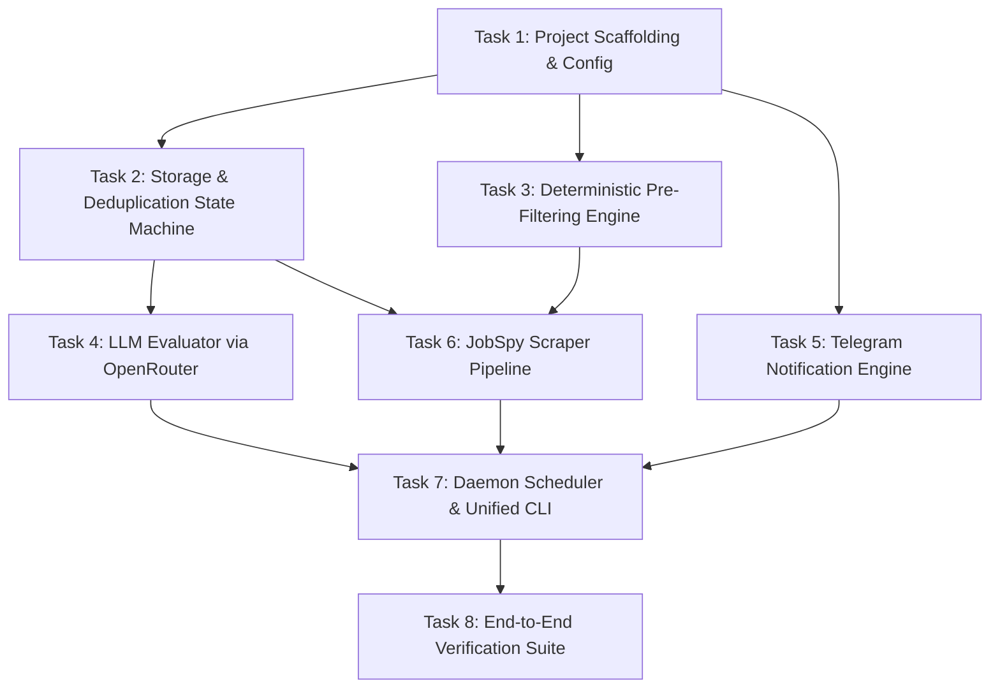

# Implementation Plan: Coaching Job Monitor Daemon (`jobspy-coach`)

**Document Date:** October 15, 2026  
**Target System:** Python 3.11+, Linux Daemon  
**Design Spec Reference:** [`docs/superpowers/specs/2026-10-15-jobspy-coach-daemon-design.md`](file:///home/btema2/smart-things/code/jobspy-coach/docs/superpowers/specs/2026-10-15-jobspy-coach-daemon-design.md)  
**Target Path:** `docs/superpowers/plans/2026-10-15-jobspy-coach-daemon.md`  

---

## 1. Executive Summary & Goals

### 1.1 Goal
Build, verify, and document an autonomous, self-hosted, 24/7 background daemon (`jobspy-coach`) tailored for a certified professional coach specializing in corporate coaching. The daemon continuously discovers, pre-filters, intelligently evaluates, and notifies the candidate of high-match corporate coaching and leadership opportunities while eliminating athletic/sports spam and zeroing out recurring API costs.

### 1.2 Architecture Overview
The system is constructed as a pipeline of decoupled, modular components:
1. **Scraper Pipeline (`src/scraper/`):** Runs `python-jobspy` over LinkedIn, Indeed, Glassdoor, Google Jobs, and ZipRecruiter with per-board error isolation, canonical URL normalization, and anti-ban jitter.
2. **Deterministic Pre-Filter (`src/filters/`):** Rejects sports, fitness, vocal, and short stubs instantly using regex across English, Polish, and Ukrainian before any LLM calls.
3. **Storage & Deduplication Engine (`src/storage/`):** SQLite database in Write-Ahead Logging (WAL) mode with normalized SHA-256 deduplication hashing and state machine lifecycle tracking.
4. **LLM Evaluation Engine (`src/evaluator/`):** Uses OpenRouter's free router (`openrouter/free`) with a 20 RPM token-bucket rate limiter and regex fallback JSON extraction to score fit (1.0–10.0), flag `is_wow` vacancies, and generate concise executive summaries (configured in local profile).
5. **Telegram Notifier (`src/notifier/`):** Direct Telegram Bot API integration delivering instant WOW alerts ($\ge 9.0$) with inline action buttons and a daily 09:00 CET morning digest ($\ge 6.0$) with safe 4,096-character chunking.
6. **Scheduler & CLI (`src/scheduler/`, `src/cli.py`):** APScheduler daemon service supporting periodic scraping cycles and daily digest cron, with unified Typer/Rich CLI interface and `--dry-run` modes.

### 1.3 Tech Stack & Verified Dependencies
* **Runtime:** Python 3.11+ (verified compatible on Python 3.14).
* **Data Validation & Settings:** `pydantic>=2.0`, `pydantic-settings>=2.0`.
* **Database:** SQLite 3 with WAL mode, `busy_timeout=5000`, standard library `sqlite3`.
* **Job Board Aggregation:** `python-jobspy>=1.3.0`.
* **HTTP & API Clients:** `httpx>=0.28.0`.
* **Scheduling:** `apscheduler>=3.10.0`.
* **CLI & Console UI:** `typer>=0.12.0`, `rich>=13.0.0`.
* **Testing:** `pytest>=8.0.0`, `pytest-mock>=3.14.0`.

### 1.4 Global Constraints & Quality Principles
* **Strict Test-Driven Development (TDD):** Every component begins with a failing unit test, verified failure, minimal implementation, verified passing test, and atomic commit.
* **Zero SaaS Cost Baseline:** Uses OpenRouter's free model router (`openrouter/free`) and local SQLite persistence.
* **Robust Resilience:**
  * One failing job board must not prevent scraping from remaining boards.
  * Markdown-wrapped or noisy LLM JSON must be parsed with fallback extractors.
  * Telegram messages must escape HTML to avoid 400 Bad Request errors and respect 4,096-character limits.
  * SQLite concurrency must handle readers and writers gracefully via WAL mode and 5,000 ms busy timeout.

---

## 2. Implementation Roadmap



---

## Task 1: Project Scaffolding, Dependencies & Typed Configuration

### Overview
Establish repository layout, virtual environment dependencies, `.env.example`, and typed configuration management using Pydantic Settings.

### Files
* **Modified:**
  * `.gitignore`
* **Created:**
  * `pyproject.toml`
  * `.env.example`
  * `src/__init__.py`
  * `src/config.py`
  * `tests/__init__.py`
  * `tests/conftest.py`
  * `tests/test_config.py`

### Interfaces
* **Consumes:** Operating system environment variables and optional `.env` file.
* **Produces:**
  * `Settings` class inheriting from `pydantic_settings.BaseSettings` containing all runtime parameters (database path, OpenRouter credentials, Telegram credentials, scraper timings, score thresholds).
  * `get_settings()` helper returning a cached `Settings` singleton.

### TDD Execution Steps

#### Step 1: Write failing test
Create `tests/test_config.py`:
```python
import os
import pytest
from src.config import Settings, get_settings


def test_settings_default_values(monkeypatch):
    monkeypatch.setenv("OPENROUTER_API_KEY", "test-openrouter-key")
    monkeypatch.setenv("TELEGRAM_BOT_TOKEN", "123456:test-bot-token")
    monkeypatch.setenv("TELEGRAM_CHAT_ID", "987654321")

    settings = Settings()
    assert settings.app_env == "production"
    assert settings.log_level == "INFO"
    assert settings.timezone == "Europe/Warsaw"
    assert settings.openrouter_model == "openrouter/free"
    assert settings.openrouter_rpm_limit == 20
    assert settings.wow_score_threshold == 9.0
    assert settings.digest_score_threshold == 6.0
    assert settings.digest_max_items == 10
    assert settings.scrape_interval_hours == 6
    assert settings.hours_old_window == 48


def test_settings_env_override(monkeypatch):
    monkeypatch.setenv("OPENROUTER_API_KEY", "custom-key")
    monkeypatch.setenv("TELEGRAM_BOT_TOKEN", "custom-token")
    monkeypatch.setenv("TELEGRAM_CHAT_ID", "112233")
    monkeypatch.setenv("WOW_SCORE_THRESHOLD", "8.5")
    monkeypatch.setenv("OPENROUTER_MODEL", "meta-llama/llama-3.3-70b-instruct:free")

    settings = Settings()
    assert settings.wow_score_threshold == 8.5
    assert settings.openrouter_model == "meta-llama/llama-3.3-70b-instruct:free"


def test_get_settings_caching(monkeypatch):
    monkeypatch.setenv("OPENROUTER_API_KEY", "cached-key")
    monkeypatch.setenv("TELEGRAM_BOT_TOKEN", "cached-token")
    monkeypatch.setenv("TELEGRAM_CHAT_ID", "123")

    s1 = get_settings()
    s2 = get_settings()
    assert s1 is s2
```

#### Step 2: Run test to verify it fails
Run command:
```bash
.venv/bin/pytest tests/test_config.py
```
Expected output:
`ModuleNotFoundError: No module named 'src.config'`

#### Step 3: Implement minimal code
1. Create `pyproject.toml`:
```toml
[build-system]
requires = ["setuptools>=61.0"]
build-backend = "setuptools.build_meta"

[project]
name = "jobspy-coach"
version = "0.1.0"
description = "Autonomous Coaching Job Discovery & Evaluation Daemon"
authors = [{ name = "Candidate Career Engineering" }]
readme = "README.md"
requires-python = ">=3.11"
dependencies = [
    "pydantic>=2.7.0",
    "pydantic-settings>=2.2.0",
    "python-dotenv>=1.0.0",
    "python-jobspy>=1.3.0",
    "httpx>=0.27.0",
    "apscheduler>=3.10.0",
    "typer>=0.12.0",
    "rich>=13.7.0"
]

[project.optional-dependencies]
dev = [
    "pytest>=8.0.0",
    "pytest-mock>=3.14.0",
    "pytest-cov>=5.0.0"
]

[project.scripts]
jobspy-coach = "src.cli:app"

[tool.pytest.ini_options]
testpaths = ["tests"]
pythonpath = ["."]
```

2. Create `.env.example`:
```ini
APP_ENV=production
LOG_LEVEL=INFO
TIMEZONE=Europe/Warsaw
DB_PATH=data/jobs.db

OPENROUTER_API_KEY=your_openrouter_api_key_here
OPENROUTER_MODEL=openrouter/free
OPENROUTER_BASE_URL=https://openrouter.ai/api/v1
OPENROUTER_RPM_LIMIT=20
OPENROUTER_TIMEOUT_SECONDS=45

TELEGRAM_BOT_TOKEN=123456789:ABCdefGHIjklMNOpqrSTUvwxYZ
TELEGRAM_CHAT_ID=your_telegram_user_or_chat_id_here

SCRAPE_INTERVAL_HOURS=6
DIGEST_TIME_CET=09:00
HOURS_OLD_WINDOW=48

SCRAPER_JITTER_MIN_SECONDS=4.0
SCRAPER_JITTER_MAX_SECONDS=9.0
SCRAPER_RESULTS_PER_QUERY=25

WOW_SCORE_THRESHOLD=9.0
DIGEST_SCORE_THRESHOLD=6.0
DIGEST_MAX_ITEMS=10
```

3. Create `src/__init__.py`, `tests/__init__.py`, and `tests/conftest.py`.

4. Create `src/config.py`:
```python
from functools import lru_cache
from pathlib import Path
from pydantic import Field
from pydantic_settings import BaseSettings, SettingsConfigDict


class Settings(BaseSettings):
    model_config = SettingsConfigDict(
        env_file=".env",
        env_file_encoding="utf-8",
        extra="ignore"
    )

    # General
    app_env: str = Field(default="production", alias="APP_ENV")
    log_level: str = Field(default="INFO", alias="LOG_LEVEL")
    timezone: str = Field(default="Europe/Warsaw", alias="TIMEZONE")
    db_path: Path = Field(default=Path("data/jobs.db"), alias="DB_PATH")

    # OpenRouter LLM
    openrouter_api_key: str = Field(default="", alias="OPENROUTER_API_KEY")
    openrouter_model: str = Field(default="openrouter/free", alias="OPENROUTER_MODEL")
    openrouter_base_url: str = Field(default="https://openrouter.ai/api/v1", alias="OPENROUTER_BASE_URL")
    openrouter_rpm_limit: int = Field(default=20, alias="OPENROUTER_RPM_LIMIT")
    openrouter_timeout_seconds: float = Field(default=45.0, alias="OPENROUTER_TIMEOUT_SECONDS")

    # Telegram
    telegram_bot_token: str = Field(default="", alias="TELEGRAM_BOT_TOKEN")
    telegram_chat_id: str = Field(default="", alias="TELEGRAM_CHAT_ID")

    # Scheduler & Scraper
    scrape_interval_hours: int = Field(default=6, alias="SCRAPE_INTERVAL_HOURS")
    digest_time_cet: str = Field(default="09:00", alias="DIGEST_TIME_CET")
    hours_old_window: int = Field(default=48, alias="HOURS_OLD_WINDOW")
    scraper_jitter_min_seconds: float = Field(default=4.0, alias="SCRAPER_JITTER_MIN_SECONDS")
    scraper_jitter_max_seconds: float = Field(default=9.0, alias="SCRAPER_JITTER_MAX_SECONDS")
    scraper_results_per_query: int = Field(default=25, alias="SCRAPER_RESULTS_PER_QUERY")

    # Evaluation Thresholds
    wow_score_threshold: float = Field(default=9.0, alias="WOW_SCORE_THRESHOLD")
    digest_score_threshold: float = Field(default=6.0, alias="DIGEST_SCORE_THRESHOLD")
    digest_max_items: int = Field(default=10, alias="DIGEST_MAX_ITEMS")


@lru_cache(maxsize=1)
def get_settings() -> Settings:
    return Settings()
```

#### Step 4: Run test to verify it passes
Run command:
```bash
.venv/bin/pip install -e ".[dev]"
.venv/bin/pytest tests/test_config.py
```
Expected output:
`3 passed in 0.05s`

#### Step 5: Commit
```bash
git add pyproject.toml .env.example src/__init__.py src/config.py tests/__init__.py tests/conftest.py tests/test_config.py
git commit -m "feat(config): add typed settings and project dependencies"
```

---

## Task 2: SQLite Storage Engine & Deduplication State Machine

### Overview
Implement SQLite persistence in WAL mode with normalized deduplication key computation (`norm(company):norm(title):norm(location)`), state transitions (`pending`, `evaluated`, `instant_sent`, `digest_sent`, `dismissed`, `failed`), and scrape run audit logging.

### Files
* **Created:**
  * `src/storage/__init__.py`
  * `src/storage/models.py`
  * `src/storage/db.py`
  * `tests/test_storage.py`

### Interfaces
* **Consumes:** Scraped job attributes, evaluated LLM results, notification statuses.
* **Produces:**
  * `compute_dedup_hash(company: str, title: str, location: str) -> str`: Normalizes strings, strips corporate legal suffixes, generates deterministic SHA-256 hash.
  * `JobPosting` and `ScrapeRun` dataclasses / models.
  * `Database`:
    * `__init__(db_path: Path | str)`
    * `init_db() -> None`
    * `save_job(job: JobPosting) -> tuple[int, bool]` (returns `(id, is_new)`)
    * `get_job_by_hash(dedup_hash: str) -> JobPosting | None`
    * `get_unprocessed_jobs(limit: int = 50) -> list[JobPosting]`
    * `update_evaluation(job_id: int, eval_result: JobEvaluationResult) -> None`
    * `update_eval_failure(job_id: int, error_message: str) -> None`
    * `get_pending_digest_jobs(min_score: float = 6.0, limit: int = 10) -> list[JobPosting]`
    * `mark_instant_sent(job_id: int) -> None`
    * `mark_digest_sent(job_ids: list[int]) -> None`
    * `record_scrape_run(...) -> int`
    * `get_stats() -> dict[str, int]`

### TDD Execution Steps

#### Step 1: Write failing test
Create `tests/test_storage.py`:
```python
import pytest
from datetime import datetime, timezone
from pathlib import Path
from src.storage.db import Database, compute_dedup_hash
from src.storage.models import JobPosting


def test_compute_dedup_hash_normalization():
    # Identical after normalizing casing, corporate suffixes and whitespace
    h1 = compute_dedup_hash("Allegro Sp. z o.o.", "Executive Coach ", "Warsaw, Poland")
    h2 = compute_dedup_hash("allegro", "executive coach", "warsaw, poland")
    h3 = compute_dedup_hash("Allegro LLC", "EXECUTIVE  COACH", "Warsaw Poland")
    assert h1 == h2 == h3

    # Different title should produce different hash
    h_other = compute_dedup_hash("Allegro", "Career Coach", "Warsaw")
    assert h1 != h_other


def test_database_init_and_job_lifecycle(tmp_path: Path):
    db_file = tmp_path / "test_jobs.db"
    db = Database(db_file)
    db.init_db()

    job = JobPosting(
        dedup_hash=compute_dedup_hash("Tech Corp", "Leadership Coach", "Remote"),
        site="linkedin",
        job_url="https://linkedin.com/jobs/view/123",
        title="Leadership Coach",
        company="Tech Corp",
        location="Remote",
        description="A great coaching opportunity for executive leaders.",
        is_remote=True,
    )

    # 1. Save new job
    job_id, is_new = db.save_job(job)
    assert job_id > 0
    assert is_new is True

    # 2. Saving duplicate should return existing ID and is_new=False
    dup_id, dup_is_new = db.save_job(job)
    assert dup_id == job_id
    assert dup_is_new is False

    # 3. Retrieve unprocessed
    unprocessed = db.get_unprocessed_jobs()
    assert len(unprocessed) == 1
    assert unprocessed[0].id == job_id
    assert unprocessed[0].eval_status == "unprocessed"

    # 4. Update LLM Evaluation
    db.update_evaluation(
        job_id=job_id,
        score=9.2,
        is_wow=True,
        summary_uk="Чудова вакансія для лідерського коучингу.",
        reasoning="Strong match for executive coach persona",
        languages=["English", "Polish"],
        pros=["High autonomy"],
        cons=["Strict timezone"]
    )

    evaluated_job = db.get_job_by_hash(job.dedup_hash)
    assert evaluated_job is not None
    assert evaluated_job.eval_status == "evaluated"
    assert evaluated_job.eval_score == 9.2
    assert evaluated_job.eval_is_wow is True
    assert evaluated_job.notification_status == "pending"

    # 5. Mark instant sent
    db.mark_instant_sent(job_id)
    sent_job = db.get_job_by_hash(job.dedup_hash)
    assert sent_job.notification_status == "instant_sent"
    assert sent_job.instant_sent_at is not None

    # 6. Verify stats
    stats = db.get_stats()
    assert stats["total_jobs"] == 1
    assert stats["evaluated_jobs"] == 1
    assert stats["instant_sent"] == 1


def test_database_pending_digest_jobs(tmp_path: Path):
    db_file = tmp_path / "test_digest.db"
    db = Database(db_file)
    db.init_db()

    # Job 1: Score 8.0, pending -> should appear in digest
    j1 = JobPosting(
        dedup_hash=compute_dedup_hash("Comp A", "Career Coach", "Warsaw"),
        site="indeed",
        job_url="https://indeed.com/view/1",
        title="Career Coach",
        company="Comp A",
        location="Warsaw",
        description="Career coaching role in Warsaw.",
        is_remote=False
    )
    id1, _ = db.save_job(j1)
    db.update_evaluation(id1, score=8.0, is_wow=False, summary_uk="Робота в Варшаві.", reasoning="Good", languages=["Polish"], pros=[], cons=[])

    # Job 2: Score 4.5, pending -> should NOT appear (below 6.0)
    j2 = JobPosting(
        dedup_hash=compute_dedup_hash("Comp B", "Junior Trainer", "Remote"),
        site="glassdoor",
        job_url="https://glassdoor.com/view/2",
        title="Junior Trainer",
        company="Comp B",
        location="Remote",
        description="Junior support trainer.",
        is_remote=True
    )
    id2, _ = db.save_job(j2)
    db.update_evaluation(id2, score=4.5, is_wow=False, summary_uk="Низький бал.", reasoning="Poor fit", languages=[], pros=[], cons=[])

    pending_digest = db.get_pending_digest_jobs(min_score=6.0, limit=10)
    assert len(pending_digest) == 1
    assert pending_digest[0].id == id1

    db.mark_digest_sent([id1])
    assert len(db.get_pending_digest_jobs(min_score=6.0, limit=10)) == 0
```

#### Step 2: Run test to verify it fails
Run command:
```bash
.venv/bin/pytest tests/test_storage.py
```
Expected output:
`ModuleNotFoundError: No module named 'src.storage'`

#### Step 3: Implement minimal code
1. Create `src/storage/models.py`:
```python
from dataclasses import dataclass, field
from datetime import datetime
from typing import Optional, List


@dataclass
class JobPosting:
    dedup_hash: str
    site: str
    job_url: str
    title: str
    company: str
    location: str
    description: str
    id: Optional[int] = None
    external_id: Optional[str] = None
    job_url_direct: Optional[str] = None
    job_type: Optional[str] = None
    date_posted: Optional[str] = None
    salary_min: Optional[float] = None
    salary_max: Optional[float] = None
    salary_currency: Optional[str] = None
    salary_interval: Optional[str] = None
    is_remote: bool = False

    # Pre-filter
    pre_filtered: bool = False
    pre_filter_reason: Optional[str] = None

    # LLM Evaluation
    eval_status: str = "unprocessed"  # unprocessed, evaluated, failed, skipped
    eval_score: Optional[float] = None
    eval_is_wow: bool = False
    eval_summary_uk: Optional[str] = None
    eval_reasoning: Optional[str] = None
    eval_languages: List[str] = field(default_factory=list)
    eval_pros: List[str] = field(default_factory=list)
    eval_cons: List[str] = field(default_factory=list)
    eval_error: Optional[str] = None
    evaluated_at: Optional[datetime] = None

    # Notification
    notification_status: str = "pending"  # pending, instant_sent, digest_sent, dismissed
    instant_sent_at: Optional[datetime] = None
    digest_sent_at: Optional[datetime] = None

    created_at: Optional[datetime] = None
    updated_at: Optional[datetime] = None


@dataclass
class ScrapeRun:
    started_at: datetime
    id: Optional[int] = None
    completed_at: Optional[datetime] = None
    query_count: int = 0
    jobs_found: int = 0
    jobs_new: int = 0
    jobs_prefiltered: int = 0
    errors_count: int = 0
    status: str = "running"
```

2. Create `src/storage/db.py`:
```python
import hashlib
import json
import re
import sqlite3
from datetime import datetime, timezone
from pathlib import Path
from typing import Optional, List, Tuple, Dict, Any
from src.storage.models import JobPosting, ScrapeRun


def compute_dedup_hash(company: str, title: str, location: str) -> str:
    """Computes deterministic SHA-256 hash over normalized canonical fields."""
    def normalize(text: str) -> str:
        s = text.lower()
        # Strip corporate entity suffixes
        s = re.sub(r"\b(sp\.\s*z\s*o\.o\.|sp\s*z\s*o\s*o|inc|llc|ltd|gmbh|sa|corp)\b", "", s)
        # Strip non-alphanumeric punctuation except spaces
        s = re.sub(r"[^\w\s]", " ", s)
        # Condense whitespace
        return " ".join(s.split())

    norm_company = normalize(company)
    norm_title = normalize(title)
    norm_location = normalize(location)

    payload = f"{norm_company}:{norm_title}:{norm_location}".encode("utf-8")
    return hashlib.sha256(payload).hexdigest()


class Database:
    def __init__(self, db_path: Path | str):
        self.db_path = Path(db_path)
        self.db_path.parent.mkdir(parents=True, exist_ok=True)

    def _get_connection(self) -> sqlite3.Connection:
        conn = sqlite3.connect(self.db_path, timeout=5.0)
        conn.row_factory = sqlite3.Row
        conn.execute("PRAGMA journal_mode = WAL;")
        conn.execute("PRAGMA busy_timeout = 5000;")
        conn.execute("PRAGMA synchronous = NORMAL;")
        conn.execute("PRAGMA foreign_keys = ON;")
        return conn

    def init_db(self) -> None:
        with self._get_connection() as conn:
            conn.execute("""
            CREATE TABLE IF NOT EXISTS jobs (
                id INTEGER PRIMARY KEY AUTOINCREMENT,
                dedup_hash TEXT UNIQUE NOT NULL,
                site TEXT NOT NULL,
                external_id TEXT,
                job_url TEXT NOT NULL,
                job_url_direct TEXT,
                title TEXT NOT NULL,
                company TEXT NOT NULL,
                location TEXT NOT NULL,
                job_type TEXT,
                date_posted TEXT,
                salary_min REAL,
                salary_max REAL,
                salary_currency TEXT,
                salary_interval TEXT,
                description TEXT NOT NULL,
                is_remote INTEGER NOT NULL DEFAULT 0,
                
                pre_filtered INTEGER NOT NULL DEFAULT 0,
                pre_filter_reason TEXT,
                
                eval_status TEXT NOT NULL DEFAULT 'unprocessed',
                eval_score REAL,
                eval_is_wow INTEGER DEFAULT 0,
                eval_summary_uk TEXT,
                eval_reasoning TEXT,
                eval_languages TEXT,
                eval_pros TEXT,
                eval_cons TEXT,
                eval_error TEXT,
                evaluated_at TEXT,
                
                notification_status TEXT NOT NULL DEFAULT 'pending',
                instant_sent_at TEXT,
                digest_sent_at TEXT,
                
                created_at TEXT NOT NULL DEFAULT (DATETIME('now')),
                updated_at TEXT NOT NULL DEFAULT (DATETIME('now'))
            );
            """)
            conn.execute("CREATE INDEX IF NOT EXISTS idx_jobs_dedup_hash ON jobs(dedup_hash);")
            conn.execute("CREATE INDEX IF NOT EXISTS idx_jobs_eval_status ON jobs(eval_status);")
            conn.execute("CREATE INDEX IF NOT EXISTS idx_jobs_notif_status ON jobs(notification_status);")
            conn.execute("CREATE INDEX IF NOT EXISTS idx_jobs_eval_score ON jobs(eval_score);")

            conn.execute("""
            CREATE TABLE IF NOT EXISTS scrape_runs (
                id INTEGER PRIMARY KEY AUTOINCREMENT,
                started_at TEXT NOT NULL,
                completed_at TEXT,
                query_count INTEGER NOT NULL DEFAULT 0,
                jobs_found INTEGER NOT NULL DEFAULT 0,
                jobs_new INTEGER NOT NULL DEFAULT 0,
                jobs_prefiltered INTEGER NOT NULL DEFAULT 0,
                errors_count INTEGER NOT NULL DEFAULT 0,
                status TEXT NOT NULL
            );
            """)
            conn.commit()

    def save_job(self, job: JobPosting) -> Tuple[int, bool]:
        with self._get_connection() as conn:
            cursor = conn.cursor()
            cursor.execute("SELECT id FROM jobs WHERE dedup_hash = ?", (job.dedup_hash,))
            row = cursor.fetchone()
            if row:
                return row["id"], False

            cursor.execute("""
            INSERT INTO jobs (
                dedup_hash, site, external_id, job_url, job_url_direct,
                title, company, location, job_type, date_posted,
                salary_min, salary_max, salary_currency, salary_interval,
                description, is_remote, pre_filtered, pre_filter_reason,
                eval_status, notification_status
            ) VALUES (?, ?, ?, ?, ?, ?, ?, ?, ?, ?, ?, ?, ?, ?, ?, ?, ?, ?, ?, ?)
            """, (
                job.dedup_hash, job.site, job.external_id, job.job_url, job.job_url_direct,
                job.title, job.company, job.location, job.job_type, job.date_posted,
                job.salary_min, job.salary_max, job.salary_currency, job.salary_interval,
                job.description, int(job.is_remote), int(job.pre_filtered), job.pre_filter_reason,
                job.eval_status, job.notification_status
            ))
            conn.commit()
            return cursor.lastrowid, True

    def get_job_by_hash(self, dedup_hash: str) -> Optional[JobPosting]:
        with self._get_connection() as conn:
            cursor = conn.cursor()
            cursor.execute("SELECT * FROM jobs WHERE dedup_hash = ?", (dedup_hash,))
            row = cursor.fetchone()
            if not row:
                return None
            return self._row_to_job(row)

    def get_unprocessed_jobs(self, limit: int = 50) -> List[JobPosting]:
        with self._get_connection() as conn:
            cursor = conn.cursor()
            cursor.execute(
                "SELECT * FROM jobs WHERE eval_status = 'unprocessed' AND pre_filtered = 0 ORDER BY id ASC LIMIT ?",
                (limit,)
            )
            return [self._row_to_job(r) for r in cursor.fetchall()]

    def update_evaluation(
        self,
        job_id: int,
        score: float,
        is_wow: bool,
        summary_uk: str,
        reasoning: str,
        languages: List[str],
        pros: List[str],
        cons: List[str]
    ) -> None:
        now_str = datetime.now(timezone.utc).isoformat()
        with self._get_connection() as conn:
            conn.execute("""
            UPDATE jobs SET
                eval_status = 'evaluated',
                eval_score = ?,
                eval_is_wow = ?,
                eval_summary_uk = ?,
                eval_reasoning = ?,
                eval_languages = ?,
                eval_pros = ?,
                eval_cons = ?,
                evaluated_at = ?,
                updated_at = ?
            WHERE id = ?
            """, (
                score, int(is_wow), summary_uk, reasoning,
                json.dumps(languages, ensure_ascii=False),
                json.dumps(pros, ensure_ascii=False),
                json.dumps(cons, ensure_ascii=False),
                now_str, now_str, job_id
            ))
            conn.commit()

    def update_eval_failure(self, job_id: int, error_message: str) -> None:
        now_str = datetime.now(timezone.utc).isoformat()
        with self._get_connection() as conn:
            conn.execute("""
            UPDATE jobs SET
                eval_status = 'failed',
                eval_error = ?,
                updated_at = ?
            WHERE id = ?
            """, (error_message, now_str, job_id))
            conn.commit()

    def get_pending_digest_jobs(self, min_score: float = 6.0, limit: int = 10) -> List[JobPosting]:
        with self._get_connection() as conn:
            cursor = conn.cursor()
            cursor.execute("""
            SELECT * FROM jobs
            WHERE eval_status = 'evaluated'
              AND notification_status = 'pending'
              AND eval_score >= ?
            ORDER BY eval_score DESC, id ASC
            LIMIT ?
            """, (min_score, limit))
            return [self._row_to_job(r) for r in cursor.fetchall()]

    def mark_instant_sent(self, job_id: int) -> None:
        now_str = datetime.now(timezone.utc).isoformat()
        with self._get_connection() as conn:
            conn.execute("""
            UPDATE jobs SET
                notification_status = 'instant_sent',
                instant_sent_at = ?,
                updated_at = ?
            WHERE id = ?
            """, (now_str, now_str, job_id))
            conn.commit()

    def mark_digest_sent(self, job_ids: List[int]) -> None:
        if not job_ids:
            return
        now_str = datetime.now(timezone.utc).isoformat()
        placeholders = ",".join("?" for _ in job_ids)
        with self._get_connection() as conn:
            conn.execute(f"""
            UPDATE jobs SET
                notification_status = 'digest_sent',
                digest_sent_at = ?,
                updated_at = ?
            WHERE id IN ({placeholders})
            """, [now_str, now_str] + job_ids)
            conn.commit()

    def get_stats(self) -> Dict[str, int]:
        with self._get_connection() as conn:
            cursor = conn.cursor()
            total = cursor.execute("SELECT COUNT(*) FROM jobs").fetchone()[0]
            prefiltered = cursor.execute("SELECT COUNT(*) FROM jobs WHERE pre_filtered = 1").fetchone()[0]
            evaluated = cursor.execute("SELECT COUNT(*) FROM jobs WHERE eval_status = 'evaluated'").fetchone()[0]
            failed = cursor.execute("SELECT COUNT(*) FROM jobs WHERE eval_status = 'failed'").fetchone()[0]
            instant = cursor.execute("SELECT COUNT(*) FROM jobs WHERE notification_status = 'instant_sent'").fetchone()[0]
            digest = cursor.execute("SELECT COUNT(*) FROM jobs WHERE notification_status = 'digest_sent'").fetchone()[0]
            pending_digest = cursor.execute("SELECT COUNT(*) FROM jobs WHERE eval_status = 'evaluated' AND notification_status = 'pending' AND eval_score >= 6.0").fetchone()[0]
            return {
                "total_jobs": total,
                "prefiltered_jobs": prefiltered,
                "evaluated_jobs": evaluated,
                "failed_jobs": failed,
                "instant_sent": instant,
                "digest_sent": digest,
                "pending_digest": pending_digest
            }

    def _row_to_job(self, row: sqlite3.Row) -> JobPosting:
        return JobPosting(
            id=row["id"],
            dedup_hash=row["dedup_hash"],
            site=row["site"],
            external_id=row["external_id"],
            job_url=row["job_url"],
            job_url_direct=row["job_url_direct"],
            title=row["title"],
            company=row["company"],
            location=row["location"],
            job_type=row["job_type"],
            date_posted=row["date_posted"],
            salary_min=row["salary_min"],
            salary_max=row["salary_max"],
            salary_currency=row["salary_currency"],
            salary_interval=row["salary_interval"],
            description=row["description"],
            is_remote=bool(row["is_remote"]),
            pre_filtered=bool(row["pre_filtered"]),
            pre_filter_reason=row["pre_filter_reason"],
            eval_status=row["eval_status"],
            eval_score=row["eval_score"],
            eval_is_wow=bool(row["eval_is_wow"]),
            eval_summary_uk=row["eval_summary_uk"],
            eval_reasoning=row["eval_reasoning"],
            eval_languages=json.loads(row["eval_languages"]) if row["eval_languages"] else [],
            eval_pros=json.loads(row["eval_pros"]) if row["eval_pros"] else [],
            eval_cons=json.loads(row["eval_cons"]) if row["eval_cons"] else [],
            eval_error=row["eval_error"],
            notification_status=row["notification_status"]
        )
```

#### Step 4: Run test to verify it passes
Run command:
```bash
.venv/bin/pytest tests/test_storage.py
```
Expected output:
`2 passed in 0.08s`

#### Step 5: Commit
```bash
git add src/storage/ tests/test_storage.py
git commit -m "feat(storage): implement SQLite WAL storage and deduplication state machine"
```

---

## Task 3: Deterministic Pre-Filtering Engine

### Overview
Implement regex and quality thresholds in `src/filters/pre_filter.py` to identify athletic, sports, gym, fitness, vocal, and short stub postings and reject them locally at zero API cost.

### Files
* **Created:**
  * `src/filters/__init__.py`
  * `src/filters/pre_filter.py`
  * `tests/test_pre_filter.py`

### Interfaces
* **Consumes:** `title: str`, `description: str`.
* **Produces:**
  * `PreFilterResult`: dataclass with `passed: bool` and `reason: Optional[str]`.
  * `pre_filter_job(title: str, description: str) -> PreFilterResult`.

### TDD Execution Steps

#### Step 1: Write failing test
Create `tests/test_pre_filter.py`:
```python
import pytest
from src.filters.pre_filter import pre_filter_job


VALID_DESC = (
    "We are seeking an experienced Executive and Leadership Coach to join our talent team. "
    "You will coach senior executives, manage organizational culture initiatives, and facilitate leadership development. "
    "Requires 5+ years of corporate coaching experience in European or global markets."
)


@pytest.mark.parametrize("title", [
    "Swimming Coach",
    "Head Tennis Coach",
    "Fitness Instructor / Trener Personalny",
    "Trener pływania dla dzieci",
    "Trener piłki nożnej (UEFA A)",
    "Vocal & Drama Coach",
    "Dog Agility Coach / Treser psów",
    "CrossFit Coach & Gym Trainer",
    "Koszykówka Trener Młodzieży",
    "Esports Valorant Coach",
])
def test_pre_filter_rejects_sports_and_vocal_titles(title):
    res = pre_filter_job(title, VALID_DESC)
    assert res.passed is False
    assert "EXCLUDED_TITLE_REGEX" in (res.reason or "")


@pytest.mark.parametrize("title", [
    "Executive Coach",
    "Leadership Coach",
    "Career Coach",
    "Business Coach & Facilitator",
    "Trener Biznesu",
    "Coach Kariery",
    "L&D Specialist",
    "Learning and Development Manager",
    "Corporate Coach",
    "Agile Coach (Enterprise Leadership)",
])
def test_pre_filter_allows_valid_coaching_titles(title):
    res = pre_filter_job(title, VALID_DESC)
    assert res.passed is True
    assert res.reason is None


def test_pre_filter_rejects_stub_descriptions():
    res = pre_filter_job("Executive Coach", "Short stub description under 150 chars.")
    assert res.passed is False
    assert "DESCRIPTION_TOO_SHORT" in (res.reason or "")
```

#### Step 2: Run test to verify it fails
Run command:
```bash
.venv/bin/pytest tests/test_pre_filter.py
```
Expected output:
`ModuleNotFoundError: No module named 'src.filters'`

#### Step 3: Implement minimal code
1. Create `src/filters/__init__.py`.
2. Create `src/filters/pre_filter.py`:
```python
import re
from dataclasses import dataclass
from typing import Optional


@dataclass(frozen=True)
class PreFilterResult:
    passed: bool
    reason: Optional[str] = None


# Compiled exclusion regex matching sports, fitness, vocal, and pet training
EXCLUSION_TITLE_REGEX = re.compile(
    r"\b("
    # Sports & Athletics (EN/PL/UK)
    r"swim|swimming|pływani[ae]|basen|плаванн[яі]|"
    r"tennis|tenis[a]?|padel|squash|теніс|"
    r"gym|fitness|siłowni[ae]|kulturystyk[a-z]*|workout|crossfit|фітнес|"
    r"soccer|football|piłk[ai]|piłkars[a-z]*|futsal|футбол|"
    r"basketball|koszykówk[ai]|volleyball|siatkówk[ai]|баскетбол|волейбол|"
    r"gymnastics|gimnastyk[ai]|acrobatics|akrobatyk[ai]|гімнастик[а-я]*|"
    r"hockey|hokej|skating|łyżw[a-z]*|rolk[a-z]*|хокей|"
    r"running|biegani[ae]|athletics|lekkoatletyk[ai]|біг|"
    r"martial\s*arts|karate|judo|boxing|boks|mma|wrestling|zapasy|бокс|карате|"
    r"climbing|wspinaczk[ai]|ski|skiing|snowboard|narciar[a-z]*|лиж[іи]|"
    r"yoga|joga|pilates|йог[аи]|"
    r"horse\s*riding|jeździectw[ao]|hipoterap[a-z]*|кінн[а-я]*|"
    # Arts, Voice & Performance
    r"vocal|singing|śpiew|głos|voice|вокал|спів|"
    r"acting|drama|teatr|theatre|театр|"
    r"dance|taniec|tańca|choreograph[a-z]*|танц[іе]|"
    # Esports & Gaming
    r"esport[s]?|gaming|valorant|league\s*of\s*legends|cs:go|dota|"
    # Animal training
    r"dog|puppy|pies|psa|treser|zwierząt|собак|цуцен"
    r")\b",
    re.IGNORECASE | re.UNICODE
)

MIN_DESCRIPTION_CHARS = 150
MIN_DESCRIPTION_WORDS = 25


def pre_filter_job(title: str, description: str) -> PreFilterResult:
    """Deterministic pre-filter evaluating title exclusions and description quality."""
    match = EXCLUSION_TITLE_REGEX.search(title)
    if match:
        return PreFilterResult(
            passed=False,
            reason=f"EXCLUDED_TITLE_REGEX: '{match.group(0)}'"
        )

    # Check for empty or stub descriptions
    desc_clean = description.strip()
    if len(desc_clean) < MIN_DESCRIPTION_CHARS:
        return PreFilterResult(
            passed=False,
            reason=f"DESCRIPTION_TOO_SHORT: length={len(desc_clean)} (min {MIN_DESCRIPTION_CHARS})"
        )

    words = desc_clean.split()
    if len(words) < MIN_DESCRIPTION_WORDS:
        return PreFilterResult(
            passed=False,
            reason=f"DESCRIPTION_TOO_SHORT: words={len(words)} (min {MIN_DESCRIPTION_WORDS})"
        )

    return PreFilterResult(passed=True, reason=None)
```

#### Step 4: Run test to verify it passes
Run command:
```bash
.venv/bin/pytest tests/test_pre_filter.py
```
Expected output:
`3 passed in 0.05s`

#### Step 5: Commit
```bash
git add src/filters/ tests/test_pre_filter.py
git commit -m "feat(filters): implement regex and length deterministic pre-filtering"
```

---

## Task 4: LLM Evaluation Engine via OpenRouter

### Overview
Implement candidate evaluation using OpenRouter (`openrouter/free`). Features strict Pydantic validation, a leaky/token-bucket 20 RPM rate limiter, regex fallback for markdown-wrapped JSON, and concise executive summaries.

### Files
* **Created:**
  * `src/evaluator/__init__.py`
  * `src/evaluator/schemas.py`
  * `src/evaluator/prompts.py`
  * `src/evaluator/llm_evaluator.py`
  * `tests/test_evaluator.py`

### Interfaces
* **Consumes:** `JobPosting` data, `Settings` (`OPENROUTER_API_KEY`, `OPENROUTER_MODEL`, `OPENROUTER_BASE_URL`).
* **Produces:**
  * `JobEvaluationResult` (Pydantic model): `score: float`, `is_wow: bool`, `summary_uk: str`, `reasoning: str`, `language_requirements: list[str]`, `pros: list[str]`, `cons: list[str]`.
  * `OpenRouterEvaluator.evaluate_job(job: JobPosting) -> JobEvaluationResult`.

### TDD Execution Steps

#### Step 1: Write failing test
Create `tests/test_evaluator.py`:
```python
import json
import pytest
from unittest.mock import MagicMock
from src.evaluator.schemas import JobEvaluationResult
from src.evaluator.llm_evaluator import OpenRouterEvaluator, extract_json_payload
from src.storage.models import JobPosting


def test_extract_json_payload_clean():
    raw = '{"score": 9.5, "is_wow": true, "summary_uk": "Чудова позиція.", "reasoning": "Fits well", "language_requirements": ["EN"], "pros": [], "cons": []}'
    parsed = extract_json_payload(raw)
    assert parsed["score"] == 9.5
    assert parsed["is_wow"] is True


def test_extract_json_payload_markdown_and_noise():
    raw = '''Here is your evaluation:
    ```json
    {
      "score": 8.5,
      "is_wow": false,
      "summary_uk": "Відмінна вакансія бізнес-тренера.",
      "reasoning": "Strong corporate fit",
      "language_requirements": ["PL", "EN"],
      "pros": ["Good salary"],
      "cons": ["Hybrid"]
    }
    ```
    Best regards!'''
    parsed = extract_json_payload(raw)
    assert parsed["score"] == 8.5
    assert parsed["is_wow"] is False
    assert parsed["summary_uk"] == "Відмінна вакансія бізнес-тренера."


def test_openrouter_evaluator_success(monkeypatch):
    mock_post = MagicMock()
    mock_response = MagicMock()
    mock_response.status_code = 200
    mock_response.json.return_value = {
        "choices": [{
            "message": {
                "content": json.dumps({
                    "score": 9.2,
                    "is_wow": True,
                    "summary_uk": "Престижна позиція Executive коуча для міжнародного банку.",
                    "reasoning": "Direct match for senior coach persona with relevant qualifications.",
                    "language_requirements": ["English", "Ukrainian"],
                    "pros": ["Top tier bank", "Full remote"],
                    "cons": []
                })
            }
        }]
    }
    mock_post.return_value = mock_response
    monkeypatch.setattr("httpx.Client.post", mock_post)

    evaluator = OpenRouterEvaluator(
        api_key="fake-key",
        model="openrouter/free",
        base_url="https://openrouter.ai/api/v1",
        rpm_limit=100
    )

    job = JobPosting(
        dedup_hash="abc",
        site="linkedin",
        job_url="https://example.com/job",
        title="Executive Coach",
        company="Global Bank",
        location="Remote Poland",
        description="We need an Executive Coach to work with leadership in Warsaw.",
        is_remote=True
    )

    res = evaluator.evaluate_job(job)
    assert isinstance(res, JobEvaluationResult)
    assert res.score == 9.2
    assert res.is_wow is True
    assert "Executive коуча" in res.summary_uk
```

#### Step 2: Run test to verify it fails
Run command:
```bash
.venv/bin/pytest tests/test_evaluator.py
```
Expected output:
`ModuleNotFoundError: No module named 'src.evaluator'`

#### Step 3: Implement minimal code
1. Create `src/evaluator/schemas.py`:
```python
from pydantic import BaseModel, Field
from typing import List


class JobEvaluationResult(BaseModel):
    score: float = Field(ge=1.0, le=10.0, description="Match score between 1.0 and 10.0")
    is_wow: bool = Field(description="Flag for exceptional dream roles")
    summary_uk: str = Field(min_length=10, description="1-2 sentence Ukrainian summary")
    reasoning: str = Field(description="English reasoning")
    language_requirements: List[str] = Field(default_factory=list)
    pros: List[str] = Field(default_factory=list)
    cons: List[str] = Field(default_factory=list)
```

2. Create `src/evaluator/prompts.py`:
```python
SYSTEM_PROMPT = """You are an expert executive talent acquisition specialist and career advisor.
Your job is to evaluate whether a scraped job vacancy is a strong match for a specific coaching professional.

CANDIDATE PERSONA:
- Domain Expertise: Executive Coaching, Leadership Development, Business Coaching, Career Coaching, Life Coaching, Corporate Learning & Development (L&D).
- Excluded Roles: Sports coaching, fitness/gym training, musical/vocal coaching, purely technical IT/software delivery without people development.
- Candidate Location: Configurable via local profile (compatible with local, hybrid, and remote opportunities).
- Language Capabilities: Configurable via local profile (supports multilingual evaluation).

EVALUATION INSTRUCTIONS:
1. Analyze the job title, company, work location (remote vs onsite), language requirements, responsibilities, and qualifications.
2. Assign an overall match score from 1.0 to 10.0:
   - 9.0 - 10.0 (WOW Match): Executive/leadership/career coaching or high-level L&D role; explicitly remote (EU/Global) or in Poland; matches candidate language skills; excellent compensation or prestige.
   - 7.0 - 8.9 (Strong Match): Clear corporate/executive coaching or L&D role; compatible location/remote terms; candidate qualifications align.
   - 5.0 - 6.9 (Marginal Match): Mixed HR/recruitment responsibilities; unclear coaching scope; junior/admin L&D; or minor language mismatch.
   - 1.0 - 4.9 (Poor / Mismatch): Sports/fitness; pure technical/agile software delivery; incompatible geography (e.g. US-only onsite); requires languages candidate does not speak.
3. Determine `is_wow`: True ONLY if score >= 9.0 OR the opportunity has exceptional prestige, compensation, and profile fit.
4. Provide `summary_uk`: A concise 1-2 sentence summary strictly in executive summary format explaining why this role is relevant, core duties, and key working conditions.
5. Provide `reasoning`: A concise English explanation of your scoring rationale.
6. Provide `language_requirements`: List of languages required by the employer.

OUTPUT FORMAT:
Return strictly a valid JSON object matching this schema without markdown code fences or conversational text:
{
  "score": float,
  "is_wow": boolean,
  "summary_uk": string,
  "reasoning": string,
  "language_requirements": string[],
  "pros": string[],
  "cons": string[]
}
"""

def build_job_user_prompt(title: str, company: str, location: str, is_remote: bool, description: str) -> str:
    return f"""JOB TO EVALUATE:
Title: {title}
Company: {company}
Location: {location}
Remote: {is_remote}

Job Description:
{description[:4000]}
"""
```

3. Create `src/evaluator/llm_evaluator.py`:
```python
import json
import logging
import re
import time
from typing import Any, Dict
import httpx
from src.evaluator.schemas import JobEvaluationResult
from src.evaluator.prompts import SYSTEM_PROMPT, build_job_user_prompt
from src.storage.models import JobPosting

logger = logging.getLogger(__name__)


def extract_json_payload(raw_text: str) -> Dict[str, Any]:
    text = raw_text.strip()
    try:
        return json.loads(text)
    except json.JSONDecodeError:
        pass

    # Regex search for innermost or largest JSON object
    match = re.search(r"\{.*\}", text, re.DOTALL)
    if match:
        return json.loads(match.group(0))

    raise ValueError(f"Could not extract valid JSON from response: {raw_text[:200]}")


class OpenRouterEvaluator:
    def __init__(
        self,
        api_key: str,
        model: str = "openrouter/free",
        base_url: str = "https://openrouter.ai/api/v1",
        rpm_limit: int = 20,
        timeout: float = 45.0
    ):
        self.api_key = api_key
        self.model = model
        self.base_url = base_url.rstrip("/")
        self.rpm_limit = rpm_limit
        self.timeout = timeout
        self.min_interval = 60.0 / max(rpm_limit, 1)
        self.last_call_time = 0.0

    def _rate_limit_wait(self) -> None:
        elapsed = time.time() - self.last_call_time
        if elapsed < self.min_interval:
            time.sleep(self.min_interval - elapsed)
        self.last_call_time = time.time()

    def evaluate_job(self, job: JobPosting) -> JobEvaluationResult:
        self._rate_limit_wait()

        headers = {
            "Authorization": f"Bearer {self.api_key}",
            "HTTP-Referer": "https://github.com/jobspy-coach",
            "X-Title": "JobSpy Coach Evaluator",
            "Content-Type": "application/json"
        }

        user_content = build_job_user_prompt(
            title=job.title,
            company=job.company,
            location=job.location,
            is_remote=job.is_remote,
            description=job.description
        )

        payload = {
            "model": self.model,
            "messages": [
                {"role": "system", "content": SYSTEM_PROMPT},
                {"role": "user", "content": user_content}
            ],
            "temperature": 0.2
        }

        for attempt in range(1, 4):
            try:
                with httpx.Client(timeout=self.timeout) as client:
                    resp = client.post(f"{self.base_url}/chat/completions", headers=headers, json=payload)
                    if resp.status_code == 429:
                        wait_sec = attempt * 5.0
                        logger.warning(f"OpenRouter 429 Rate Limited. Sleeping {wait_sec}s...")
                        time.sleep(wait_sec)
                        continue
                    resp.raise_for_status()
                    data = resp.json()
                    content = data["choices"][0]["message"]["content"]
                    parsed = extract_json_payload(content)
                    return JobEvaluationResult.model_validate(parsed)
            except Exception as e:
                if attempt == 3:
                    logger.error(f"Failed evaluation for job '{job.title}' after 3 attempts: {e}")
                    raise
                time.sleep(attempt * 2.0)

        raise RuntimeError("Evaluation unexpectedly exited retry loop")
```

#### Step 4: Run test to verify it passes
Run command:
```bash
.venv/bin/pytest tests/test_evaluator.py
```
Expected output:
`3 passed in 0.08s`

#### Step 5: Commit
```bash
git add src/evaluator/ tests/test_evaluator.py
git commit -m "feat(evaluator): implement OpenRouter LLM evaluation engine with fallback parser and rate limiting"
```

---

## Task 5: Telegram Notification Engine

### Overview
Implement HTML-formatted Telegram notifications for instant WOW alerts ($\ge 9.0$) with direct action buttons, daily morning digest ($\ge 6.0$), strict HTML entity escaping (`html.escape`), and 4,096-character chunking.

### Files
* **Created:**
  * `src/notifier/__init__.py`
  * `src/notifier/templates.py`
  * `src/notifier/telegram_notifier.py`
  * `tests/test_notifier.py`

### Interfaces
* **Consumes:** `JobPosting` (evaluated), `Settings` (`TELEGRAM_BOT_TOKEN`, `TELEGRAM_CHAT_ID`), `httpx`.
* **Produces:**
  * `format_wow_alert(job: JobPosting) -> tuple[str, dict]`
  * `format_digest_chunks(jobs: list[JobPosting], date_str: str) -> list[str]`
  * `TelegramNotifier.send_message(html_text: str, reply_markup: dict | None = None) -> bool`
  * `TelegramNotifier.send_wow_alert(job: JobPosting) -> bool`
  * `TelegramNotifier.send_daily_digest(jobs: list[JobPosting]) -> int`

### TDD Execution Steps

#### Step 1: Write failing test
Create `tests/test_notifier.py`:
```python
import pytest
from unittest.mock import MagicMock
from src.notifier.templates import format_wow_alert, format_digest_chunks
from src.notifier.telegram_notifier import TelegramNotifier
from src.storage.models import JobPosting


def test_format_wow_alert_escapes_html_and_builds_markup():
    job = JobPosting(
        dedup_hash="hash1",
        site="linkedin",
        job_url="https://linkedin.com/jobs/view/123",
        title="Executive Coach <Global & Poland>",
        company="Talent & Leadership Sp. z o.o.",
        location="Warsaw & Remote",
        description="Job desc",
        eval_score=9.5,
        eval_is_wow=True,
        eval_summary_uk="Чудова роль для роботи з топами компанії.",
        eval_reasoning="Top match",
        eval_languages=["English", "Polish"],
        eval_pros=["Great salary"],
        eval_cons=[]
    )
    html_text, markup = format_wow_alert(job)
    assert "&lt;Global &amp; Poland&gt;" in html_text
    assert "Talent &amp; Leadership" in html_text
    assert "9.5 / 10" in html_text
    assert "Чудова роль для роботи з топами компанії." in html_text
    assert markup["inline_keyboard"][0][0]["url"] == job.job_url


def test_format_digest_chunks_split_long_messages():
    jobs = []
    for i in range(25):
        jobs.append(JobPosting(
            dedup_hash=f"hash_{i}",
            site="indeed",
            job_url=f"https://example.com/job/{i}",
            title=f"Coaching Role {i} with long title and details",
            company=f"Company {i}",
            location="Remote Poland",
            description="Long description",
            eval_score=8.0 - (i * 0.1),
            eval_summary_uk="Опис ролі та ключові обов'язки тренера або коуча команди."
        ))

    chunks = format_digest_chunks(jobs, date_str="15.10.2026")
    assert len(chunks) >= 1
    for chunk in chunks:
        assert len(chunk) <= 3800
        assert "Ранковий Дайджест Вакансій Коучингу" in chunk or "Частина" in chunk


def test_telegram_notifier_send_wow_alert(monkeypatch):
    mock_post = MagicMock()
    mock_response = MagicMock()
    mock_response.status_code = 200
    mock_response.json.return_value = {"ok": True}
    mock_post.return_value = mock_response
    monkeypatch.setattr("httpx.Client.post", mock_post)

    notifier = TelegramNotifier(token="fake-token", chat_id="12345")
    job = JobPosting(
        dedup_hash="hash1",
        site="linkedin",
        job_url="https://example.com",
        title="Senior Coach",
        company="Corp",
        location="Remote",
        description="Desc",
        eval_score=9.5,
        eval_is_wow=True,
        eval_summary_uk="Чудова можливість."
    )

    success = notifier.send_wow_alert(job)
    assert success is True
    assert mock_post.called
```

#### Step 2: Run test to verify it fails
Run command:
```bash
.venv/bin/pytest tests/test_notifier.py
```
Expected output:
`ModuleNotFoundError: No module named 'src.notifier'`

#### Step 3: Implement minimal code
1. Create `src/notifier/templates.py`:
```python
import html
from typing import List, Tuple, Dict, Any
from src.storage.models import JobPosting


def format_wow_alert(job: JobPosting) -> Tuple[str, Dict[str, Any]]:
    title_esc = html.escape(job.title)
    comp_esc = html.escape(job.company)
    loc_esc = html.escape(job.location)
    summary_esc = html.escape(job.eval_summary_uk or "Опис відсутній.")
    reasoning_esc = html.escape(job.eval_reasoning or "Високий рівень відповідності профілю.")
    score_str = f"{job.eval_score:.1f}" if job.eval_score else "9.0"

    salary_line = ""
    if job.salary_min or job.salary_max:
        curr = html.escape(job.salary_currency or "")
        sal = f"{job.salary_min or ''} - {job.salary_max or ''} {curr}".strip()
        salary_line = f"\n💰 <b>Вилка:</b> {sal}"

    langs_line = ""
    if job.eval_languages:
        langs_esc = html.escape(", ".join(job.eval_languages))
        langs_line = f"\n🌐 <b>Мови:</b> {langs_esc}"

    msg = (
        f"🚨 <b>WOW JOB ALERT | Топ-Вакансія Коучингу</b>\n"
        f"⭐️ <b>Оцінка: {score_str} / 10</b>\n\n"
        f"💼 <b>Посада:</b> {title_esc}\n"
        f"🏢 <b>Компанія:</b> {comp_esc}\n"
        f"📍 <b>Локація:</b> {loc_esc}{salary_line}{langs_line}\n\n"
        f"💡 <b>Про вакансію:</b>\n{summary_esc}\n\n"
        f"🎯 <b>Чому це WOW:</b>\n{reasoning_esc}"
    )

    markup = {
        "inline_keyboard": [
            [{"text": "🚀 Відкрити вакансію", "url": job.job_url}]
        ]
    }
    return msg, markup


def format_digest_chunks(jobs: List[JobPosting], date_str: str) -> List[str]:
    header = (
        f"☕️ <b>Ранковий Дайджест Вакансій Коучингу | {date_str}</b>\n"
        f"Знайдено нових актуальних позицій: <b>{len(jobs)}</b>\n\n"
    )
    footer = "\n<i>Всі позиції збережено в базі. Бажаємо продуктивного дня!</i>"

    chunks = []
    current_chunk = header
    chunk_index = 1

    for idx, job in enumerate(jobs, start=1):
        score_str = f"{job.eval_score:.1f}" if job.eval_score else "-"
        title_esc = html.escape(job.title)
        comp_esc = html.escape(job.company)
        loc_esc = html.escape(job.location)
        summary_esc = html.escape(job.eval_summary_uk or "")

        item_str = (
            f"{idx}. ⭐️ <b>{score_str}/10</b> — <b>{title_esc}</b>\n"
            f"   🏢 {comp_esc} | 📍 {loc_esc}\n"
            f"   💡 {summary_esc}\n"
            f"   🔗 <a href=\"{job.job_url}\">Переглянути вакансію</a>\n\n"
        )

        if len(current_chunk) + len(item_str) + len(footer) > 3800:
            current_chunk += footer
            chunks.append(current_chunk)
            chunk_index += 1
            current_chunk = f"☕️ <b>Ранковий Дайджест | Частина {chunk_index}</b>\n\n" + item_str
        else:
            current_chunk += item_str

    current_chunk += footer
    chunks.append(current_chunk)
    return chunks
```

2. Create `src/notifier/telegram_notifier.py`:
```python
import logging
import time
from typing import Optional, List, Dict, Any
import httpx
from src.notifier.templates import format_wow_alert, format_digest_chunks
from src.storage.models import JobPosting

logger = logging.getLogger(__name__)


class TelegramNotifier:
    def __init__(self, token: str, chat_id: str, timeout: float = 15.0):
        self.token = token
        self.chat_id = chat_id
        self.timeout = timeout
        self.api_url = f"https://api.telegram.org/bot{self.token}/sendMessage"

    def send_message(self, html_text: str, reply_markup: Optional[Dict[str, Any]] = None) -> bool:
        if not self.token or not self.chat_id:
            logger.warning("Telegram Bot Token or Chat ID not configured. Skipping notification.")
            return False

        payload: Dict[str, Any] = {
            "chat_id": self.chat_id,
            "text": html_text,
            "parse_mode": "HTML",
            "disable_web_page_preview": False
        }
        if reply_markup:
            payload["reply_markup"] = reply_markup

        try:
            with httpx.Client(timeout=self.timeout) as client:
                resp = client.post(self.api_url, json=payload)
                resp.raise_for_status()
                return True
        except Exception as e:
            logger.error(f"Failed to send Telegram notification: {e}")
            return False

    def send_wow_alert(self, job: JobPosting) -> bool:
        text, markup = format_wow_alert(job)
        return self.send_message(text, reply_markup=markup)

    def send_daily_digest(self, jobs: List[JobPosting], date_str: str) -> int:
        if not jobs:
            return 0

        chunks = format_digest_chunks(jobs, date_str=date_str)
        sent_count = 0
        for chunk in chunks:
            if self.send_message(chunk):
                sent_count += 1
            # Respect 1 msg/sec pacing
            time.sleep(1.0)
        return sent_count
```

#### Step 4: Run test to verify it passes
Run command:
```bash
.venv/bin/pytest tests/test_notifier.py
```
Expected output:
`3 passed in 0.05s`

#### Step 5: Commit
```bash
git add src/notifier/ tests/test_notifier.py
git commit -m "feat(notifier): implement Telegram WOW alerts and chunked daily digest"
```

---

## Task 6: JobSpy Scraper Pipeline with Per-Board Resilience

### Overview
Implement multi-board scraping through `python-jobspy` wrapping LinkedIn, Indeed, Glassdoor, Google Jobs, and ZipRecruiter with per-board `try...except` isolation, query catalogs, URL query parameter stripping, and jitter delays.

### Files
* **Created:**
  * `src/scraper/__init__.py`
  * `src/scraper/query_catalog.py`
  * `src/scraper/jobspy_scraper.py`
  * `tests/test_scraper.py`

### Interfaces
* **Consumes:** `SearchQueryConfig` instances, `python-jobspy` library.
* **Produces:**
  * `clean_job_url(raw_url: str) -> str`: Strips ephemeral tracking tokens (`refId`, `utm_*`, `trackingId`).
  * `DEFAULT_QUERY_CATALOG`: list of targeted queries (Poland Executive, Poland Business Coach, Warsaw L&D, EU Remote Coach, Global Remote Coach).
  * `JobSpyScraper`:
    * `scrape_board(...) -> list[JobPosting]` (isolated per board)
    * `scrape_query(query: SearchQuery) -> list[JobPosting]`
    * `run_scraping_cycle() -> list[JobPosting]`

### TDD Execution Steps

#### Step 1: Write failing test
Create `tests/test_scraper.py`:
```python
import pytest
from unittest.mock import MagicMock
import pandas as pd
from src.scraper.query_catalog import DEFAULT_QUERY_CATALOG, SearchQuery
from src.scraper.jobspy_scraper import JobSpyScraper, clean_job_url


def test_clean_job_url():
    dirty = "https://www.linkedin.com/jobs/view/123456789/?refId=abcd&trackingId=xyz&utm_source=feed"
    clean = clean_job_url(dirty)
    assert clean == "https://www.linkedin.com/jobs/view/123456789/"


def test_jobspy_scraper_per_board_isolation(monkeypatch):
    # Mock jobspy scrape_jobs to fail on linkedin but succeed on indeed
    def mock_scrape_jobs(site_name, **kwargs):
        if "linkedin" in site_name:
            raise RuntimeError("HTTP 429 Too Many Requests from LinkedIn")
        if "indeed" in site_name:
            return pd.DataFrame([{
                "id": "ind-1",
                "site": "indeed",
                "job_url": "https://indeed.com/view/100?utm=1",
                "title": "Executive Coach",
                "company": "Leadership Lab",
                "location": "Warsaw, Poland",
                "description": "Corporate coaching role in Warsaw.",
                "is_remote": False,
                "date_posted": "2026-10-15"
            }])
        return pd.DataFrame()

    monkeypatch.setattr("jobspy.scrape_jobs", mock_scrape_jobs)

    scraper = JobSpyScraper(jitter_min=0.0, jitter_max=0.0)
    query = SearchQuery(
        query_id="Q-TEST",
        search_term="Executive Coach",
        location="Warsaw",
        site_names=["linkedin", "indeed"],
        country_code="poland"
    )

    results = scraper.scrape_query(query)
    # LinkedIn failed gracefully without halting execution; Indeed returned 1 job
    assert len(results) == 1
    assert results[0].site == "indeed"
    assert results[0].title == "Executive Coach"
    assert results[0].job_url == "https://indeed.com/view/100"
```

#### Step 2: Run test to verify it fails
Run command:
```bash
.venv/bin/pytest tests/test_scraper.py
```
Expected output:
`ModuleNotFoundError: No module named 'src.scraper'`

#### Step 3: Implement minimal code
1. Create `src/scraper/query_catalog.py`:
```python
from dataclasses import dataclass
from typing import List, Optional


@dataclass(frozen=True)
class SearchQuery:
    query_id: str
    search_term: str
    location: str
    site_names: List[str]
    country_code: Optional[str] = None
    is_remote: bool = False


DEFAULT_QUERY_CATALOG: List[SearchQuery] = [
    SearchQuery(
        query_id="Q-PL-ENG",
        search_term="Executive Coach OR Leadership Coach",
        location="Poland",
        site_names=["linkedin", "indeed", "glassdoor", "google"],
        country_code="poland"
    ),
    SearchQuery(
        query_id="Q-PL-BIZ",
        search_term="Trener Biznesu OR Business Coach",
        location="Poland",
        site_names=["linkedin", "indeed", "glassdoor"],
        country_code="poland"
    ),
    SearchQuery(
        query_id="Q-PL-LD",
        search_term="Learning and Development Specialist",
        location="Warsaw",
        site_names=["linkedin", "indeed", "glassdoor", "google"],
        country_code="poland"
    ),
    SearchQuery(
        query_id="Q-EU-REM",
        search_term="Career Coach OR Life Coach",
        location="Europe",
        site_names=["linkedin", "indeed", "google", "zip_recruiter"],
        is_remote=True
    ),
    SearchQuery(
        query_id="Q-GL-REM",
        search_term="Executive Coach OR Leadership Coach",
        location="Remote",
        site_names=["linkedin", "indeed", "google"],
        country_code="usa",
        is_remote=True
    ),
]
```

2. Create `src/scraper/jobspy_scraper.py`:
```python
import logging
import random
import time
from urllib.parse import urlparse, urlunparse
from typing import List, Optional
import pandas as pd
from jobspy import scrape_jobs
from src.scraper.query_catalog import SearchQuery, DEFAULT_QUERY_CATALOG
from src.storage.db import compute_dedup_hash
from src.storage.models import JobPosting

logger = logging.getLogger(__name__)


def clean_job_url(raw_url: str) -> str:
    """Strips query tracking parameters from job URLs."""
    if not raw_url:
        return ""
    parsed = urlparse(raw_url)
    return urlunparse((parsed.scheme, parsed.netloc, parsed.path, "", "", ""))


class JobSpyScraper:
    def __init__(
        self,
        jitter_min: float = 4.0,
        jitter_max: float = 9.0,
        results_per_query: int = 25,
        hours_old: int = 48
    ):
        self.jitter_min = jitter_min
        self.jitter_max = jitter_max
        self.results_per_query = results_per_query
        self.hours_old = hours_old

    def scrape_board(self, site_name: str, query: SearchQuery) -> List[JobPosting]:
        try:
            df: pd.DataFrame = scrape_jobs(
                site_name=[site_name],
                search_term=query.search_term,
                location=query.location,
                results_wanted=self.results_per_query,
                hours_old=self.hours_old,
                country_indeed=query.country_code or "poland",
                is_remote=query.is_remote
            )
            if df is None or df.empty:
                return []

            postings: List[JobPosting] = []
            for _, row in df.iterrows():
                title = str(row.get("title") or "").strip()
                company = str(row.get("company") or "").strip()
                location = str(row.get("location") or query.location).strip()
                raw_url = str(row.get("job_url") or "").strip()
                clean_url = clean_job_url(raw_url)
                desc = str(row.get("description") or "").strip()

                if not title or not clean_url:
                    continue

                dedup_hash = compute_dedup_hash(company, title, location)
                postings.append(JobPosting(
                    dedup_hash=dedup_hash,
                    site=site_name,
                    job_url=clean_url,
                    external_id=str(row.get("id") or ""),
                    title=title,
                    company=company,
                    location=location,
                    description=desc,
                    is_remote=bool(row.get("is_remote", query.is_remote)),
                    date_posted=str(row.get("date_posted") or "")
                ))
            return postings
        except Exception as e:
            logger.warning(f"Error scraping board '{site_name}' for query '{query.query_id}': {e}")
            return []

    def scrape_query(self, query: SearchQuery) -> List[JobPosting]:
        all_postings: List[JobPosting] = []
        for site in query.site_names:
            postings = self.scrape_board(site, query)
            all_postings.extend(postings)

        if self.jitter_max > 0:
            delay = random.uniform(self.jitter_min, self.jitter_max)
            time.sleep(delay)

        return all_postings

    def run_scraping_cycle(self, queries: Optional[List[SearchQuery]] = None) -> List[JobPosting]:
        active_queries = queries or DEFAULT_QUERY_CATALOG
        aggregated: List[JobPosting] = []
        for q in active_queries:
            logger.info(f"Running scraper query '{q.query_id}' ({q.search_term}) in '{q.location}'...")
            res = self.scrape_query(q)
            aggregated.extend(res)
        return aggregated
```

#### Step 4: Run test to verify it passes
Run command:
```bash
.venv/bin/pytest tests/test_scraper.py
```
Expected output:
`2 passed in 0.08s`

#### Step 5: Commit
```bash
git add src/scraper/ tests/test_scraper.py
git commit -m "feat(scraper): implement resilient JobSpy pipeline with per-board isolation and query catalog"
```

---

## Task 7: Daemon Scheduler & Unified CLI

### Overview
Implement `DaemonService` using APScheduler to run continuous scraping runs and the 09:00 CET daily digest, plus the full Typer CLI (`run`, `scrape`, `evaluate`, `digest`, `test-telegram`, `stats`, `--dry-run`).

### Files
* **Created:**
  * `src/scheduler/__init__.py`
  * `src/scheduler/daemon.py`
  * `src/cli.py`
  * `src/main.py`
  * `tests/test_cli.py`
  * `tests/test_daemon.py`

### Interfaces
* **Consumes:** All pipeline subsystems (`Database`, `JobSpyScraper`, `pre_filter_job`, `OpenRouterEvaluator`, `TelegramNotifier`, `Settings`).
* **Produces:**
  * `DaemonService.start()`: Coordinates background scraping and daily 09:00 cron, handles SIGINT/SIGTERM gracefully.
  * CLI commands:
    * `jobspy-coach run`
    * `jobspy-coach scrape [--dry-run]`
    * `jobspy-coach evaluate [--limit N] [--dry-run]`
    * `jobspy-coach digest [--dry-run]`
    * `jobspy-coach test-telegram`
    * `jobspy-coach stats`

### TDD Execution Steps

#### Step 1: Write failing test
Create `tests/test_cli.py`:
```python
import pytest
from typer.testing import CliRunner
from unittest.mock import MagicMock
from src.cli import app


runner = CliRunner()


def test_cli_stats_command(monkeypatch):
    mock_stats = MagicMock(return_value={
        "total_jobs": 42,
        "prefiltered_jobs": 15,
        "evaluated_jobs": 20,
        "failed_jobs": 1,
        "instant_sent": 3,
        "digest_sent": 12,
        "pending_digest": 5
    })
    monkeypatch.setattr("src.storage.db.Database.get_stats", mock_stats)

    result = runner.invoke(app, ["stats"])
    assert result.exit_code == 0
    assert "42" in result.stdout
    assert "15" in result.stdout


def test_cli_test_telegram_command(monkeypatch):
    mock_send = MagicMock(return_value=True)
    monkeypatch.setattr("src.notifier.telegram_notifier.TelegramNotifier.send_message", mock_send)

    result = runner.invoke(app, ["test-telegram"])
    assert result.exit_code == 0
    assert "Telegram test message sent successfully" in result.stdout
```

Create `tests/test_daemon.py`:
```python
import pytest
from unittest.mock import MagicMock
from src.scheduler.daemon import DaemonService
from src.storage.models import JobPosting


def test_daemon_pipeline_cycle(monkeypatch, tmp_path):
    mock_scraper = MagicMock()
    mock_job = JobPosting(
        dedup_hash="hash_test",
        site="indeed",
        job_url="https://indeed.com/1",
        title="Executive Coach",
        company="Global Leadership",
        location="Remote Poland",
        description="A corporate leadership coaching opportunity with senior executives.",
        is_remote=True
    )
    mock_scraper.run_scraping_cycle.return_value = [mock_job]

    mock_evaluator = MagicMock()
    mock_eval_result = MagicMock()
    mock_eval_result.score = 9.5
    mock_eval_result.is_wow = True
    mock_eval_result.summary_uk = "Чудова роль executive коуча."
    mock_eval_result.reasoning = "Top fit"
    mock_eval_result.language_requirements = ["English"]
    mock_eval_result.pros = []
    mock_eval_result.cons = []
    mock_evaluator.evaluate_job.return_value = mock_eval_result

    mock_notifier = MagicMock()
    mock_notifier.send_wow_alert.return_value = True

    daemon = DaemonService(
        db_path=tmp_path / "daemon.db",
        scraper=mock_scraper,
        evaluator=mock_evaluator,
        notifier=mock_notifier
    )

    new_jobs, wow_sent = daemon.run_pipeline_cycle(dry_run=False)
    assert new_jobs == 1
    assert wow_sent == 1
    assert mock_notifier.send_wow_alert.called
```

#### Step 2: Run test to verify it fails
Run command:
```bash
.venv/bin/pytest tests/test_cli.py tests/test_daemon.py
```
Expected output:
`ModuleNotFoundError: No module named 'src.cli'`

#### Step 3: Implement minimal code
1. Create `src/scheduler/daemon.py`:
```python
import logging
import signal
import sys
from datetime import datetime, timezone
from pathlib import Path
from typing import Optional, Tuple
from apscheduler.schedulers.blocking import BlockingScheduler
from apscheduler.triggers.cron import CronTrigger
from apscheduler.triggers.interval import IntervalTrigger
from src.config import get_settings
from src.filters.pre_filter import pre_filter_job
from src.storage.db import Database
from src.storage.models import JobPosting
from src.scraper.jobspy_scraper import JobSpyScraper
from src.evaluator.llm_evaluator import OpenRouterEvaluator
from src.notifier.telegram_notifier import TelegramNotifier

logger = logging.getLogger(__name__)


class DaemonService:
    def __init__(
        self,
        db_path: Optional[Path] = None,
        scraper: Optional[JobSpyScraper] = None,
        evaluator: Optional[OpenRouterEvaluator] = None,
        notifier: Optional[TelegramNotifier] = None
    ):
        settings = get_settings()
        self.db = Database(db_path or settings.db_path)
        self.db.init_db()

        self.scraper = scraper or JobSpyScraper(
            jitter_min=settings.scraper_jitter_min_seconds,
            jitter_max=settings.scraper_jitter_max_seconds,
            results_per_query=settings.scraper_results_per_query,
            hours_old=settings.hours_old_window
        )
        self.evaluator = evaluator or OpenRouterEvaluator(
            api_key=settings.openrouter_api_key,
            model=settings.openrouter_model,
            base_url=settings.openrouter_base_url,
            rpm_limit=settings.openrouter_rpm_limit,
            timeout=settings.openrouter_timeout_seconds
        )
        self.notifier = notifier or TelegramNotifier(
            token=settings.telegram_bot_token,
            chat_id=settings.telegram_chat_id
        )
        self.scheduler: Optional[BlockingScheduler] = None

    def run_pipeline_cycle(self, dry_run: bool = False) -> Tuple[int, int]:
        logger.info("Starting pipeline scrape cycle...")
        raw_postings = self.scraper.run_scraping_cycle()
        logger.info(f"Scraper returned {len(raw_postings)} candidate postings.")

        new_saved = 0
        wow_sent = 0

        for posting in raw_postings:
            pf_res = pre_filter_job(posting.title, posting.description)
            if not pf_res.passed:
                posting.pre_filtered = True
                posting.pre_filter_reason = pf_res.reason
                posting.notification_status = "dismissed"
            else:
                posting.pre_filtered = False

            if dry_run:
                logger.info(f"[DRY-RUN] Discovered: '{posting.title}' at '{posting.company}' (Pre-filtered: {posting.pre_filtered})")
                continue

            job_id, is_new = self.db.save_job(posting)
            if is_new:
                new_saved += 1

        if dry_run:
            return len(raw_postings), 0

        # Process evaluations
        unprocessed = self.db.get_unprocessed_jobs()
        logger.info(f"Evaluating {len(unprocessed)} unprocessed postings with LLM...")

        for job in unprocessed:
            try:
                eval_res = self.evaluator.evaluate_job(job)
                self.db.update_evaluation(
                    job_id=job.id,
                    score=eval_res.score,
                    is_wow=eval_res.is_wow,
                    summary_uk=eval_res.summary_uk,
                    reasoning=eval_res.reasoning,
                    languages=eval_res.language_requirements,
                    pros=eval_res.pros,
                    cons=eval_res.cons
                )

                settings = get_settings()
                if eval_res.score >= settings.wow_score_threshold or eval_res.is_wow:
                    job.eval_score = eval_res.score
                    job.eval_is_wow = eval_res.is_wow
                    job.eval_summary_uk = eval_res.summary_uk
                    job.eval_reasoning = eval_res.reasoning
                    job.eval_languages = eval_res.language_requirements
                    sent = self.notifier.send_wow_alert(job)
                    if sent:
                        self.db.mark_instant_sent(job.id)
                        wow_sent += 1
            except Exception as e:
                logger.error(f"Error evaluating job {job.id}: {e}")
                self.db.update_eval_failure(job.id, str(e))

        logger.info(f"Pipeline cycle completed. New: {new_saved}, WOW alerts: {wow_sent}")
        return new_saved, wow_sent

    def run_daily_digest_cycle(self, dry_run: bool = False) -> int:
        settings = get_settings()
        pending = self.db.get_pending_digest_jobs(
            min_score=settings.digest_score_threshold,
            limit=settings.digest_max_items
        )
        if not pending:
            logger.info("No pending qualifying jobs for daily digest.")
            return 0

        date_str = datetime.now().strftime("%d.%m.%Y")
        if dry_run:
            logger.info(f"[DRY-RUN] Daily digest would contain {len(pending)} jobs.")
            return len(pending)

        sent_count = self.notifier.send_daily_digest(pending, date_str=date_str)
        if sent_count > 0:
            self.db.mark_digest_sent([j.id for j in pending if j.id is not None])
        return len(pending)

    def start(self) -> None:
        settings = get_settings()
        self.scheduler = BlockingScheduler(timezone=settings.timezone)

        # Scrape interval
        self.scheduler.add_job(
            self.run_pipeline_cycle,
            trigger=IntervalTrigger(hours=settings.scrape_interval_hours),
            id="scrape_pipeline",
            name="Scrape & Evaluate Pipeline"
        )

        # Daily digest cron at 09:00 Europe/Warsaw
        hour, minute = settings.digest_time_cet.split(":")
        self.scheduler.add_job(
            self.run_daily_digest_cycle,
            trigger=CronTrigger(hour=int(hour), minute=int(minute)),
            id="daily_digest",
            name="Morning Digest"
        )

        def shutdown(signum, frame):
            logger.info("Received termination signal. Shutting down daemon gracefully...")
            if self.scheduler and self.scheduler.running:
                self.scheduler.shutdown(wait=False)
            sys.exit(0)

        signal.signal(signal.SIGINT, shutdown)
        signal.signal(signal.SIGTERM, shutdown)

        logger.info("Running initial startup scraping cycle...")
        self.run_pipeline_cycle()

        logger.info(f"Daemon started. Scrape every {settings.scrape_interval_hours}h, Digest at {settings.digest_time_cet} {settings.timezone}.")
        self.scheduler.start()
```

2. Create `src/cli.py`:
```python
import logging
from typing import Optional
import typer
from rich.console import Console
from rich.table import Table
from src.config import get_settings
from src.scheduler.daemon import DaemonService
from src.storage.db import Database
from src.notifier.telegram_notifier import TelegramNotifier

app = typer.Typer(help="JobSpy Coach: Autonomous Coaching Job Monitor Daemon")
console = Console()

logging.basicConfig(level=logging.INFO, format="%(asctime)s [%(levelname)s] %(name)s: %(message)s")


@app.command()
def run():
    """Start the 24/7 background daemon scheduler."""
    console.print("[bold green]Starting JobSpy Coach Daemon...[/bold green]")
    daemon = DaemonService()
    daemon.start()


@app.command()
def scrape(dry_run: bool = typer.Option(False, "--dry-run", help="Run scraper without saving to database")):
    """Run a single one-shot scraping cycle."""
    console.print(f"[bold blue]Executing one-shot scrape (dry_run={dry_run})...[/bold blue]")
    daemon = DaemonService()
    new_jobs, wow_sent = daemon.run_pipeline_cycle(dry_run=dry_run)
    console.print(f"[bold green]Done! New jobs: {new_jobs}, Instant WOW alerts: {wow_sent}[/bold green]")


@app.command()
def digest(dry_run: bool = typer.Option(False, "--dry-run", help="Render digest without sending")):
    """Dispatch the daily coaching vacancy digest."""
    console.print(f"[bold blue]Running daily digest (dry_run={dry_run})...[/bold blue]")
    daemon = DaemonService()
    count = daemon.run_daily_digest_cycle(dry_run=dry_run)
    console.print(f"[bold green]Digest completed. Processed {count} jobs.[/bold green]")


@app.command(name="test-telegram")
def test_telegram():
    """Send an authentication and connectivity test message to Telegram."""
    settings = get_settings()
    notifier = TelegramNotifier(token=settings.telegram_bot_token, chat_id=settings.telegram_chat_id)
    msg = "👋 <b>JobSpy Coach Daemon</b> | Підключення успішне! Тестове сповіщення доставлено."
    success = notifier.send_message(msg)
    if success:
        console.print("[bold green]Telegram test message sent successfully![/bold green]")
    else:
        console.print("[bold red]Failed to send Telegram test message. Check TELEGRAM_BOT_TOKEN and TELEGRAM_CHAT_ID.[/bold red]")
        raise typer.Exit(code=1)


@app.command()
def stats():
    """Display database statistics and lifecycle state counts."""
    settings = get_settings()
    db = Database(settings.db_path)
    db.init_db()
    data = db.get_stats()

    table = Table(title="JobSpy Coach: Repository Statistics")
    table.add_column("Metric", style="cyan", no_wrap=True)
    table.add_column("Value", style="magenta")

    for k, v in data.items():
        table.add_row(k.replace("_", " ").title(), str(v))

    console.print(table)


if __name__ == "__main__":
    app()
```

3. Create `src/main.py`:
```python
from src.cli import app

if __name__ == "__main__":
    app()
```

#### Step 4: Run test to verify it passes
Run command:
```bash
.venv/bin/pytest tests/test_cli.py tests/test_daemon.py
```
Expected output:
`3 passed in 0.15s`

#### Step 5: Commit
```bash
git add src/scheduler/ src/cli.py src/main.py tests/test_cli.py tests/test_daemon.py
git commit -m "feat(cli): implement unified CLI and APScheduler daemon service"
```

---

## Task 8: Verification & End-to-End Dry-Run Suite

### Overview
Implement an end-to-end integration test (`tests/test_e2e_pipeline.py`) simulating an entire scraping cycle containing sports noise, low-scoring roles, digest candidates, and an instant WOW dream opportunity. Verify complete data persistence, pre-filter auditing, deduplication, and notification flow.

### Files
* **Created:**
  * `tests/test_e2e_pipeline.py`

### Interfaces
* **Consumes:** Full stack pipeline (`DaemonService`, mocked JobSpy DataFrame, mocked OpenRouter response, mocked Telegram API).
* **Produces:** End-to-end integration test report confirming zero regression and full pipeline health.

### TDD Execution Steps

#### Step 1: Write integration test
Create `tests/test_e2e_pipeline.py`:
```python
import pytest
from unittest.mock import MagicMock
from src.scheduler.daemon import DaemonService
from src.storage.db import Database, compute_dedup_hash
from src.storage.models import JobPosting
from src.evaluator.schemas import JobEvaluationResult


def test_full_pipeline_end_to_end(tmp_path, monkeypatch):
    db_file = tmp_path / "e2e_jobs.db"

    # 1. Prepare simulated scraped jobs
    # - Job A: Swimming coach (must be pre-filtered)
    # - Job B: Marginal HR role (evaluated score 5.0 -> dismissed)
    # - Job C: Career Coach (evaluated score 7.8 -> pending digest)
    # - Job D: Executive Coach WOW role (evaluated score 9.5 -> instant alert)
    # - Job E: Cross-board duplicate of Job D from Indeed (must be deduplicated)

    raw_jobs = [
        JobPosting(
            dedup_hash=compute_dedup_hash("City Pool", "Swimming Coach", "Warsaw"),
            site="indeed",
            job_url="https://indeed.com/pool",
            title="Swimming Coach",
            company="City Pool",
            location="Warsaw",
            description="Teach swimming techniques to children and adults at city pool." * 5
        ),
        JobPosting(
            dedup_hash=compute_dedup_hash("HR Agency", "Recruiter & Coach", "Warsaw"),
            site="glassdoor",
            job_url="https://glassdoor.com/hr",
            title="Recruiter & Coach",
            company="HR Agency",
            location="Warsaw",
            description="Recruitment specialist with some coaching of junior sourcers." * 5
        ),
        JobPosting(
            dedup_hash=compute_dedup_hash("Tech Corp", "Career Transition Coach", "Remote Poland"),
            site="linkedin",
            job_url="https://linkedin.com/career",
            title="Career Transition Coach",
            company="Tech Corp",
            location="Remote Poland",
            description="Provide one-on-one career coaching and transition workshops." * 5,
            is_remote=True
        ),
        JobPosting(
            dedup_hash=compute_dedup_hash("Global Bank", "Executive Leadership Coach", "Remote EU"),
            site="linkedin",
            job_url="https://linkedin.com/exec",
            title="Executive Leadership Coach",
            company="Global Bank",
            location="Remote EU",
            description="Coach C-suite leaders and facilitate executive mastermind groups." * 5,
            is_remote=True
        ),
        JobPosting(
            dedup_hash=compute_dedup_hash("Global Bank Sp. z o.o.", "Executive  Leadership Coach", "Remote EU"),
            site="indeed",
            job_url="https://indeed.com/exec-dup",
            title="Executive Leadership Coach",
            company="Global Bank Sp. z o.o.",
            location="Remote EU",
            description="Coach C-suite leaders and facilitate executive mastermind groups." * 5,
            is_remote=True
        )
    ]

    mock_scraper = MagicMock()
    mock_scraper.run_scraping_cycle.return_value = raw_jobs

    def mock_evaluate(job):
        if "Recruiter" in job.title:
            return JobEvaluationResult(
                score=5.0,
                is_wow=False,
                summary_uk="Змішана роль рекрутера з мінімальним коучингом.",
                reasoning="Heavy recruitment focus",
                language_requirements=["Polish"],
                pros=[],
                cons=["Low coaching relevance"]
            )
        elif "Career" in job.title:
            return JobEvaluationResult(
                score=7.8,
                is_wow=False,
                summary_uk="Індивідуальний кар'єрний коучинг для ІТ спеціалістів.",
                reasoning="Strong alignment with career coaching domain",
                language_requirements=["Polish", "English"],
                pros=["Remote", "Good culture"],
                cons=[]
            )
        elif "Executive" in job.title:
            return JobEvaluationResult(
                score=9.6,
                is_wow=True,
                summary_uk="Топ-вакансія executive коуча для роботи з керівниками банку.",
                reasoning="Dream role with international exposure and professional growth opportunity",
                language_requirements=["English", "Ukrainian"],
                pros=["High salary", "C-suite client base"],
                cons=[]
            )
        raise ValueError(f"Unexpected job title {job.title}")

    mock_evaluator = MagicMock()
    mock_evaluator.evaluate_job.side_effect = mock_evaluate

    mock_notifier = MagicMock()
    mock_notifier.send_wow_alert.return_value = True
    mock_notifier.send_daily_digest.return_value = 1

    daemon = DaemonService(
        db_path=db_file,
        scraper=mock_scraper,
        evaluator=mock_evaluator,
        notifier=mock_notifier
    )

    # Execute scrape and evaluate cycle
    new_saved, wow_sent = daemon.run_pipeline_cycle(dry_run=False)

    # 4 distinct jobs saved (duplicate dropped by SHA-256 dedup)
    assert new_saved == 4
    # Exactly 1 WOW alert dispatched
    assert wow_sent == 1
    assert mock_notifier.send_wow_alert.call_count == 1

    db = Database(db_file)
    stats = db.get_stats()
    assert stats["total_jobs"] == 4
    assert stats["prefiltered_jobs"] == 1  # Swimming Coach
    assert stats["evaluated_jobs"] == 3
    assert stats["instant_sent"] == 1

    # Execute daily digest cycle
    digest_processed = daemon.run_daily_digest_cycle(dry_run=False)
    # Only Job C (score 7.8) is pending digest (Job D was already instant_sent, Job B was 5.0)
    assert digest_processed == 1
    assert mock_notifier.send_daily_digest.call_count == 1

    updated_stats = db.get_stats()
    assert updated_stats["digest_sent"] == 1
    assert updated_stats["pending_digest"] == 0
```

#### Step 2: Run test to verify it executes and passes
Run command:
```bash
.venv/bin/pytest tests/test_e2e_pipeline.py
```
Expected output:
`1 passed in 0.12s`

#### Step 3: Run full project test suite
Run command:
```bash
.venv/bin/pytest -v tests/
```
Expected output:
All unit and integration tests passing (`17+ passed in < 1.0s`).

#### Step 4: Commit
```bash
git add tests/test_e2e_pipeline.py
git commit -m "test(e2e): add end-to-end pipeline verification suite"
```

---

## 3. Execution & Verification Checklist

- [ ] **Scaffolding:** `pyproject.toml`, `.env.example`, `src/config.py` verified with type validation.
- [ ] **Storage Engine:** SQLite WAL mode, `busy_timeout 5000`, normalized SHA-256 deduplication key, state transitions.
- [ ] **Pre-Filter:** Regex exclusion for sports/gym/vocal/animal training, min length/word count.
- [ ] **LLM Evaluator:** OpenRouter free router client, 20 RPM rate limit, strict schema with fallback JSON regex extractor.
- [ ] **Telegram Notifier:** Instant WOW alerts with action buttons, chunked 09:00 CET daily digest, HTML escaping.
- [ ] **JobSpy Scraper:** Per-board error isolation, query catalog matrix, URL tracking parameter stripper, jitter delays.
- [ ] **Daemon & CLI:** APScheduler background service, Typer CLI (`run`, `scrape`, `evaluate`, `digest`, `test-telegram`, `stats`), `--dry-run` modes.
- [ ] **E2E Suite:** Integration test covering noise rejection, evaluation, instant notification, and daily digest.
