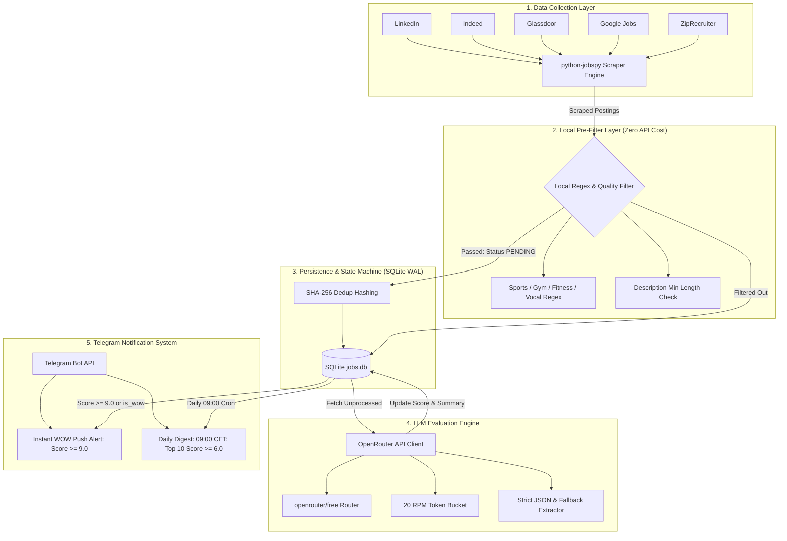
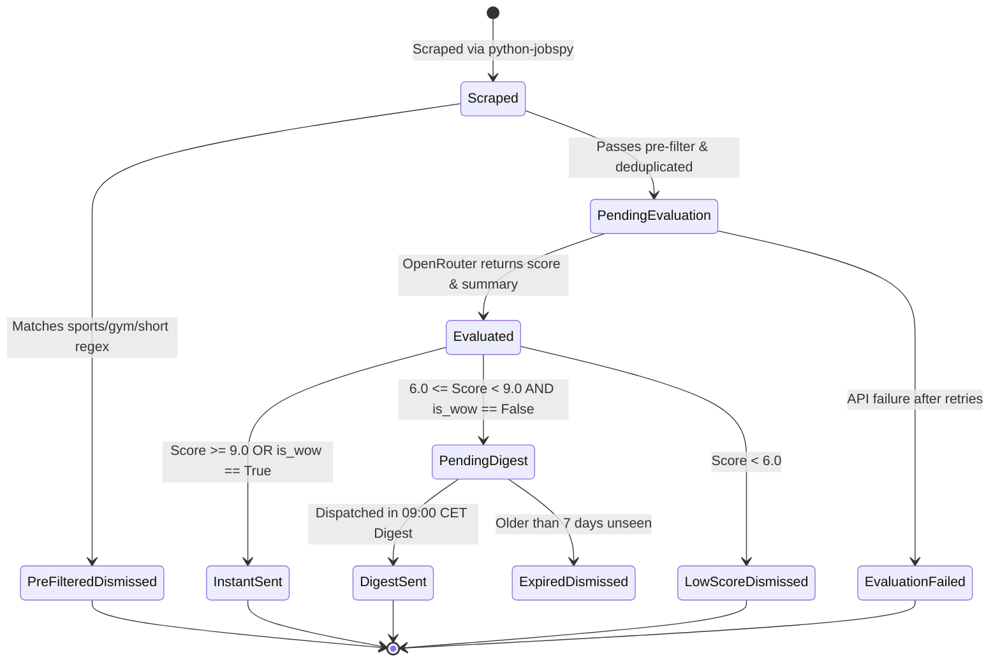

# Architecture & Technical Design Specification: Coaching Job Monitor Daemon

**Author:** Code Worker  
**Date:** October 15, 2026  
**Status:** Approved / Ready for Implementation  
**Target System:** Python 3.11+, Linux / Self-Hosted Daemon  
**Repository Path:** `docs/superpowers/specs/2026-10-15-jobspy-coach-daemon-design.md`

---

## 1. Executive Summary & Intent

### 1.1 Business Context & Candidate Profile
The **Coaching Job Monitor Daemon** (`jobspy-coach`) is an automated, self-hosted job discovery and intelligent evaluation engine tailored for an experienced professional coach.

* **Target Candidate Profile:**
  * **Role Domains:** Executive Coaching, Leadership Coaching, Business Coaching, Career Coaching, Life Coaching, and Corporate Learning & Development (L&D Specialist / L&D Manager / Leadership Development Facilitator).
  * **Candidate Background:** certified professional coach.
  * **Languages:** Configurable via local profile (supports multilingual evaluation).
  * **Work Preferences:** Remote (EU / Global) or Hybrid / Onsite within major Polish tech & business hubs (Warsaw, Kraków, Wrocław, Gdańsk, Poznań, Katowice, Remote Poland).

### 1.2 Core Problem & Value Proposition
Standard job alerts (LinkedIn notifications, Indeed alerts) flood candidate inboxes with massive noise:
1. **Sports & Fitness Spam:** Searching for "Coach" or "Trener" returns thousands of irrelevant postings for swimming coaches, tennis instructors, gym/fitness trainers, and vocal/drama coaches.
2. **Geographic Inconsistencies:** Many "Remote" roles are restricted by legal jurisdiction (e.g., US-only, UK-only) or incompatible time zones.
3. **Cross-Board Duplicates:** The same vacancy is frequently cross-posted to LinkedIn, Indeed, Glassdoor, and ZipRecruiter with differing URLs and formatting.
4. **Information Overload:** Reviewing 50+ descriptions daily causes search fatigue, causing candidates to miss rare, high-paying, high-alignment "dream" vacancies.

### 1.3 Architectural Solution
`jobspy-coach` solves this by running an autonomous 24/7 daemon pipeline:
* **Multi-Board Aggregation:** Leverages `python-jobspy` to scrape LinkedIn, Indeed, Glassdoor, Google Jobs, and ZipRecruiter across EU/Global remote queries and Polish regional queries within a rolling 48-hour window.
* **Deterministic Local Pre-Filtering:** Instant regex-based rejection of athletic, sports, fitness, vocal, and artistic roles, plus stub description checks. Drops ~60-80% of noise without spending API tokens.
* **Intelligent LLM Evaluation:** Evaluates candidates using OpenRouter's free router (`openrouter/free`) with candidate persona context, scoring match quality from 1.0 to 10.0, evaluating "WOW" criteria, and generating a concise 1–2 sentence Ukrainian executive summary.
* **Local State Machine & Deduplication:** SQLite database in Write-Ahead Logging (WAL) mode with normalized SHA-256 deduplication hashing to ensure zero duplicate notifications across multiple scrapers.
* **Dual-Tier Telegram Notification:**
  * **Instant WOW Alerts:** Instant Telegram push with action buttons for exceptional vacancies (score $\ge 9.0$ or flagged `is_wow`).
  * **Daily Morning Digest:** Top 10 unseen viable postings (score $\ge 6.0$) sent at 09:00 CET / Europe-Warsaw time.
* **Zero-Cost Baseline:** Operates entirely within free-tier OpenRouter models and local compute, requiring zero recurring SaaS subscription fees.

---

## 2. High-Level Architecture & Lifecycle

### 2.1 System Architecture Diagram



### 2.2 Job Posting State Machine

Every discovered job transitions through a well-defined state machine:



---

## 3. Data Collection Pipeline (JobSpy Scraper)

### 3.1 Scraper Technology & Configuration
The data collection component utilizes `python-jobspy` (`jobspy`), an open-source library that aggregates listings directly from job boards without requiring paid enterprise APIs.

* **Target Job Boards:**
  * `linkedin`
  * `indeed`
  * `glassdoor`
  * `google`
  * `zip_recruiter`
* **Time Horizon:** `hours_old=48` (captures new postings while giving a 2-day buffer for weekend runs).
* **Location & Mode Strategy:**
  1. **Poland Regional:** Target onsite, hybrid, and local remote jobs within Poland.
     * Locations: `"Poland"`, `"Warsaw"`, `"Krakow"`, `"Wroclaw"`.
  2. **EU / Global Remote:** Target cross-border English and Ukrainian remote postings.
     * Locations: `"Remote"`, `"European Union"`, `"Europe"`.
* **Search Queries:**
  * `"Executive Coach"`
  * `"Leadership Coach"`
  * `"Business Coach"`
  * `"Career Coach"`
  * `"Life Coach"`
  * `"Learning and Development Specialist"`
  * `"L&D Specialist"`
  * `"Leadership Development Manager"`
  * `"Trener Biznesu"` (Polish: Business Trainer)
  * `"Coach Kariery"` (Polish: Career Coach)
  * `"Коуч"` (Ukrainian: Coach)

### 3.2 Query Batching & Search Matrix
To avoid combinatorial explosion and excessive request volumes, queries are grouped into structured execution plans:

| Query ID | Search Term | Location | Board List | Country Code |
| :--- | :--- | :--- | :--- | :--- |
| `Q-PL-ENG` | "Executive Coach" OR "Leadership Coach" | "Poland" | LinkedIn, Indeed, Glassdoor, Google | `poland` |
| `Q-PL-BIZ` | "Trener Biznesu" OR "Business Coach" | "Poland" | LinkedIn, Indeed, Glassdoor | `poland` |
| `Q-PL-LD` | "Learning and Development Specialist" | "Warsaw" | LinkedIn, Indeed, Glassdoor, Google | `poland` |
| `Q-EU-REM` | "Career Coach" OR "Life Coach" | "Europe" | LinkedIn, Indeed, Google, ZipRecruiter | `null` (is_remote=True) |
| `Q-GL-REM` | "Executive Coach" OR "Leadership Coach" | "Remote" | LinkedIn, Indeed, Google | `usa` / `worldwide` |

### 3.3 Rate Limiting & Resilience Engineering
Scraping public job portals is prone to HTTP 429 (Too Many Requests), Cloudflare challenges, and network timeouts. The scraper applies defensive design principles:

1. **Per-Board Error Isolation:**
   Each board in `scrape_jobs(site_name=[...])` is isolated in a `try...except` wrapper. If LinkedIn blocks an IP or returns HTTP 429, the error is logged as a warning, and Indeed/Glassdoor continue uninterrupted.
2. **Dynamic Jitter & Request Pacing:**
   Between successive query executions, the scraper introduces randomized delays:
   $$\Delta t = \text{random.uniform}(4.0, 9.0) \text{ seconds}$$
3. **Transient Retry with Exponential Backoff:**
   Network connection drops or temporary HTTP 5xx responses trigger up to 3 retries with exponential backoff ($2^n \times 3\text{s}$).
4. **Canonical URL Normalization:**
   Job URLs frequently contain ephemeral tracking tokens (`utm_source`, `refId`, `trackingId`, `jobSearchId`). The scraper strips all query parameters down to canonical job URLs to ensure stable hashing.

---

## 4. Deterministic Local Pre-Filtering

Before any candidate job description is passed to an LLM, it must pass deterministic local filters. This reduces API consumption by up to 80% and eliminates sports/fitness false positives.

### 4.1 Regular Expression Exclusion Rules
A job title or short description containing athletic, physical training, musical, or entertainment coaching terms is immediately rejected.

```python
# Compiled regex for non-applicable coaching domains (Case-Insensitive)
EXCLUSION_TITLE_REGEX = re.compile(
    r"\b("
    # Sports & Athletics
    r"swim|swimming|pływania|pływanie|basen|"
    r"tennis|tenis|tenisa|padel|squash|"
    r"gym|fitness|siłowni|siłownia|kulturystyk|workout|crossfit|"
    r"soccer|football|piłka|piłki|piłkars|futsal|"
    r"basketball|koszykówk|koszykówka|volleyball|siatkówk|"
    r"gymnastics|gimnastyk|acrobatics|akrobatyk|"
    r"hockey|hokej|skating|łyżw|rolk|"
    r"running|bieganie|athletics|lekkoatletyk|"
    r"martial\s*arts|karate|judo|boxing|boks|mma|wrestling|zapasy|"
    r"climbing|wspinaczk|ski|skiing|snowboard|narciar|"
    r"yoga|joga|pilates|"
    r"horse\s*riding|jeździectw|hipoterap|"
    # Arts, Voice & Performance
    r"vocal|singing|śpiew|głos|voice|"
    r"acting|drama|teatr|theatre|acting|"
    r"dance|taniec|tańca|choreograph|"
    # Esports & Gaming
    r"esport|esports|gaming|valorant|league\s*of\s*legends|cs:go|dota|"
    # Dog / Animal training
    r"dog|puppy|pies|psa|treser|zwierząt"
    r")\b",
    re.IGNORECASE | re.UNICODE
)
```

### 4.2 Quality & Length Thresholds
* **Minimum Description Length:** If the job description contains fewer than 150 characters or fewer than 30 words, it is classified as a broken stub and rejected.
* **Non-Target Technical Role Filter:** Titles such as "Agile Coach", "Scrum Master", or "DevOps Coach" may be evaluated if desired, but pure technical delivery roles without leadership/people development scope are flagged for review.

### 4.3 Pre-Filter Outcome Telemetry
When a job is dropped by the pre-filter, its record is still persisted in SQLite with:
* `pre_filtered = 1`
* `pre_filter_reason = "EXCLUDED_TITLE_REGEX: 'swimming'"`
* `notification_status = 'dismissed'`

This audit trail allows validating that legitimate roles are not inadvertently discarded.

---

## 5. LLM Evaluation Engine (OpenRouter)

### 5.1 Model Selection & API Integration
* **Provider:** OpenRouter (`https://openrouter.ai/api/v1`)
* **Default Model:** `openrouter/free` (OpenRouter's free meta-router, which routes to top available free instruct models such as `meta-llama/llama-3.3-70b-instruct:free`, `mistralai/mistral-7b-instruct:free`, or `qwen/qwen-2.5-72b-instruct:free`).
* **Environment Configuration:** Configurable via `OPENROUTER_MODEL` in `.env` (fallback allows testing with paid high-accuracy models like `anthropic/claude-3.5-sonnet` if desired).
* **Rate Limits:** Strictly throttled to 20 Requests Per Minute (RPM) via an internal leaky bucket limiter to comply with OpenRouter free-tier quotas.

### 5.2 Candidate Persona & Evaluation Prompt

```text
SYSTEM PROMPT:
You are an expert executive talent acquisition specialist and career advisor.
Your job is to evaluate whether a scraped job vacancy is a strong match for a specific coaching professional.

CANDIDATE PERSONA:
- Domain Expertise: Executive Coaching, Leadership Development, Business Coaching, Career Coaching, Life Coaching, Corporate Learning & Development (L&D).
- Excluded Roles: Sports coaching, fitness/gym training, musical/vocal coaching, purely technical IT/software delivery without people development.
- Candidate Location: Configurable via local profile (compatible with local, hybrid, and remote opportunities).
- Language Capabilities: Configurable via local profile (supports multilingual evaluation).

EVALUATION INSTRUCTIONS:
1. Analyze the job title, company, work location (remote vs onsite), language requirements, responsibilities, and qualifications.
2. Assign an overall match score from 1.0 to 10.0:
   - 9.0 - 10.0 (WOW Match): Executive/leadership/career coaching or high-level L&D role; explicitly remote (EU/Global) or in Poland; matches candidate language skills; excellent compensation or prestige.
   - 7.0 - 8.9 (Strong Match): Clear corporate/executive coaching or L&D role; compatible location/remote terms; candidate qualifications align.
   - 5.0 - 6.9 (Marginal Match): Mixed HR/recruitment responsibilities; unclear coaching scope; junior/admin L&D; or minor language mismatch.
   - 1.0 - 4.9 (Poor / Mismatch): Sports/fitness; pure technical/agile software delivery; incompatible geography (e.g. US-only onsite); requires languages candidate does not speak.
3. Determine `is_wow`: True ONLY if score >= 9.0 OR the opportunity has exceptional prestige, compensation, and profile fit.
4. Provide `summary_uk`: A concise 1-2 sentence summary strictly in executive summary format explaining why this role is relevant, core duties, and key working conditions.
5. Provide `reasoning`: A concise English explanation of your scoring rationale.
6. Provide `language_requirements`: List of languages required by the employer.

OUTPUT FORMAT:
Return strictly a valid JSON object matching this schema without markdown code fences or conversational text:
{
  "score": float,
  "is_wow": boolean,
  "summary_uk": string,
  "reasoning": string,
  "language_requirements": string[],
  "pros": string[],
  "cons": string[]
}
```

### 5.3 Pydantic Output Validation Schema

```python
from pydantic import BaseModel, Field
from typing import List

class JobEvaluationResult(BaseModel):
    score: float = Field(ge=1.0, le=10.0, description="Match score between 1.0 and 10.0")
    is_wow: bool = Field(description="Flag for exceptional dream roles")
    summary_uk: str = Field(min_length=10, description="1-2 sentence Ukrainian summary")
    reasoning: str = Field(description="Brief English reasoning")
    language_requirements: List[str] = Field(default_factory=list)
    pros: List[str] = Field(default_factory=list)
    cons: List[str] = Field(default_factory=list)
```

### 5.4 Error Handling & Fallback JSON Extractor
LLMs frequently wrap JSON in markdown blocks (` ```json ... ``` `) or append conversational greetings. The evaluator employs a two-tier extraction pipeline:
1. `json.loads(response_text.strip())`
2. If failed, regex match `re.search(r"\{.*\}", response_text, re.DOTALL)`
3. If JSON parsing or Pydantic validation fails, the prompt is retried once with a strict formatting nudge.
4. Persistent failures are recorded with `eval_status = 'failed'` and logged without halting daemon execution.

---

## 6. Storage Engine & State Machine (SQLite)

### 6.1 Database Configuration & Pragmas
SQLite is chosen for its zero-operational overhead, embeddability, and ACID reliability. The engine initializes every connection with:
* `PRAGMA journal_mode = WAL;` (Write-Ahead Logging permits concurrent readers alongside a writer)
* `PRAGMA busy_timeout = 5000;` (Waits up to 5 seconds during lock contention rather than throwing `OperationalError`)
* `PRAGMA synchronous = NORMAL;` (High performance while maintaining durability)
* `PRAGMA foreign_keys = ON;`

### 6.2 Deduplication Key Specification
Cross-board postings are deduplicated using a deterministic SHA-256 hash calculated over normalized canonical fields:

$$\text{dedup\_hash} = \text{SHA256}(\text{norm}(\text{company}) + \text{":"} + \text{norm}(\text{title}) + \text{":"} + \text{norm}(\text{location}))$$

* **Normalization Rules:**
  1. Convert all characters to lowercase.
  2. Strip corporate suffixes (`sp. z o.o.`, `inc`, `llc`, `ltd`, `gmbh`, `sa`, `corp`).
  3. Strip punctuation and excessive whitespace.
  4. If a canonical Job Board ID (e.g., LinkedIn Job ID `urn:li:jobPosting:123456`) exists, store it as secondary index `external_id`.

### 6.3 Relational Schema (DDL)

```sql
CREATE TABLE IF NOT EXISTS jobs (
    id INTEGER PRIMARY KEY AUTOINCREMENT,
    dedup_hash TEXT UNIQUE NOT NULL,
    site TEXT NOT NULL,
    external_id TEXT,
    job_url TEXT NOT NULL,
    job_url_direct TEXT,
    title TEXT NOT NULL,
    company TEXT NOT NULL,
    location TEXT NOT NULL,
    job_type TEXT,
    date_posted DATE,
    salary_min REAL,
    salary_max REAL,
    salary_currency TEXT,
    salary_interval TEXT,
    description TEXT NOT NULL,
    is_remote INTEGER NOT NULL DEFAULT 0,
    
    -- Pre-filter outcome
    pre_filtered INTEGER NOT NULL DEFAULT 0,
    pre_filter_reason TEXT,
    
    -- LLM Evaluation
    eval_status TEXT NOT NULL DEFAULT 'unprocessed', -- unprocessed, evaluated, failed, skipped
    eval_score REAL,
    eval_is_wow INTEGER DEFAULT 0,
    eval_summary_uk TEXT,
    eval_reasoning TEXT,
    eval_languages TEXT, -- JSON array
    eval_pros TEXT,      -- JSON array
    eval_cons TEXT,      -- JSON array
    eval_error TEXT,
    evaluated_at DATETIME,
    
    -- Notification Lifecycle
    notification_status TEXT NOT NULL DEFAULT 'pending', -- pending, instant_sent, digest_sent, dismissed
    instant_sent_at DATETIME,
    digest_sent_at DATETIME,
    
    created_at DATETIME NOT NULL DEFAULT CURRENT_TIMESTAMP,
    updated_at DATETIME NOT NULL DEFAULT CURRENT_TIMESTAMP
);

CREATE INDEX IF NOT EXISTS idx_jobs_dedup_hash ON jobs(dedup_hash);
CREATE INDEX IF NOT EXISTS idx_jobs_eval_status ON jobs(eval_status);
CREATE INDEX IF NOT EXISTS idx_jobs_notif_status ON jobs(notification_status);
CREATE INDEX IF NOT EXISTS idx_jobs_eval_score ON jobs(eval_score);
CREATE INDEX IF NOT EXISTS idx_jobs_date_posted ON jobs(date_posted);

CREATE TABLE IF NOT EXISTS scrape_runs (
    id INTEGER PRIMARY KEY AUTOINCREMENT,
    started_at DATETIME NOT NULL,
    completed_at DATETIME,
    query_count INTEGER NOT NULL DEFAULT 0,
    jobs_found INTEGER NOT NULL DEFAULT 0,
    jobs_new INTEGER NOT NULL DEFAULT 0,
    jobs_prefiltered INTEGER NOT NULL DEFAULT 0,
    errors_count INTEGER NOT NULL DEFAULT 0,
    status TEXT NOT NULL -- running, completed, failed
);
```

---

## 7. Telegram Notification Strategy

### 7.1 Bot Integration & Formatting
* **Library:** `httpx` asynchronous/synchronous client directly invoking Telegram Bot API (`https://api.telegram.org/bot<TOKEN>/sendMessage`).
* **Format:** Telegram HTML (`parse_mode="HTML"`). All dynamic user/job inputs are strictly escaped with `html.escape()` to avoid parse failures.
* **Inline Keyboards:** Every message includes an inline button providing a direct 1-click link to the vacancy.

### 7.2 Instant WOW Alert Template

An instant notification is dispatched immediately following evaluation if:
$$\text{eval\_score} \ge 9.0 \quad \text{OR} \quad \text{eval\_is\_wow} == \text{True}$$

```html
🚨 <b>WOW JOB ALERT | Топ-Вакансія Коучингу</b>
⭐️ <b>Оцінка: 9.5 / 10</b>

💼 <b>Посада:</b> Executive & Leadership Coach
🏢 <b>Компанія:</b> Global Tech Advisory
📍 <b>Локація:</b> Remote (EU & Poland) | Повна зайнятість
💰 <b>Вилка:</b> €80,000 - €105,000 / year
🌐 <b>Мови:</b> English (Fluent), Polish (Plus)

💡 <b>Про вакансію:</b>
Компанія шукає сертифікованого executive-коуча для роботи з топ-менеджментом стартапів. 100% віддалена робота в європейському часовому поясі з річним контрактом B2B.

🎯 <b>Чому це WOW:</b>
Ідеальний збіг за профілем бізнес-коучингу, високий рівень автономії, міжнародна команда та чудова компенсація.

[Кнопка: 🚀 Відгукнутися / Відкрити вакансію]
```

### 7.3 Daily Digest Template

* **Schedule:** Every morning at **09:00 CET** (Warsaw Time / `Europe-Warsaw`).
* **Selection Criteria:**
  * `eval_score >= 6.0`
  * `notification_status == 'pending'`
  * Ordered by `eval_score DESC`
  * Capped at Top 10 vacancies.

```html
☕️ <b>Ранковий Дайджест Вакансій Коучингу | 15.10.2026</b>
Знайдено нових актуальних позицій: <b>5</b>

1. ⭐️ <b>8.8/10</b> — <b>Senior L&D Specialist</b>
   🏢 Santander Bank Polska | 📍 Warsaw (Hybrid)
   💡 Розробка програм розвитку лідерства для керівників підрозділів.
   🔗 <a href="...">Переглянути вакансію</a>

2. ⭐️ <b>8.2/10</b> — <b>Career Transition Coach</b>
   🏢 Right Management | 📍 Remote (Poland)
   💡 Індивідуальні сесії кар'єрного консультування та адаптації.
   🔗 <a href="...">Переглянути вакансію</a>

3. ⭐️ <b>7.5/10</b> — <b>Business Coach & Trainer</b>
   🏢 Allegro | 📍 Poznań / Remote
   💡 Фасилітація воркшопів та коучинг внутрішніх лідерів.
   🔗 <a href="...">Переглянути вакансію</a>

<i>Всі позиції збережено в базі. Бажаємо продуктивного дня!</i>
```

### 7.4 Message Splitting & Telegram Constraints
* **Length Guard:** Telegram messages are strictly bounded to 4,096 characters. The digest generator checks rendered character counts; if a digest exceeds 3,800 characters, it automatically splits into sequential part 1 / part 2 messages.
* **Rate Limits:** Telegram enforces a 30 msg/sec global limit and 1 msg/sec per direct chat. The notifier sleeps 1.0 second between consecutive messages to avoid HTTP 429 blocks.

---

## 8. Daemon Architecture & CLI Interface

### 8.1 Modular Directory Structure

```text
jobspy-coach/
├── docs/
│   └── superpowers/
│       └── specs/
│           └── 2026-10-15-jobspy-coach-daemon-design.md
├── src/
│   ├── __init__.py
│   ├── config.py                 # Pydantic BaseSettings & .env parsing
│   ├── cli.py                    # Typer / Argparse CLI entrypoints
│   ├── storage/
│   │   ├── __init__.py
│   │   ├── db.py                 # SQLite WAL connection & migrations
│   │   └── repository.py         # CRUD operations & state updates
│   ├── scraper/
│   │   ├── __init__.py
│   │   ├── jobspy_scraper.py     # python-jobspy query runner & jitter
│   │   └── query_catalog.py      # Predefined queries & locations
│   ├── filters/
│   │   ├── __init__.py
│   │   └── pre_filter.py         # Regex exclusion & stub length filter
│   ├── evaluator/
│   │   ├── __init__.py
│   │   ├── llm_evaluator.py      # OpenRouter API client & rate limiter
│   │   └── schemas.py            # Pydantic validation schemas
│   ├── notifier/
│   │   ├── __init__.py
│   │   ├── telegram_notifier.py  # Bot API client & HTML builder
│   │   └── templates.py          # Message templates (WOW, Digest)
│   └── scheduler/
│       ├── __init__.py
│       └── daemon.py             # Periodic scrape loop & 09:00 digest cron
├── tests/
│   ├── __init__.py
│   ├── conftest.py               # Shared test fixtures & in-memory DB
│   ├── test_pre_filter.py        # Regex inclusion/exclusion suite
│   ├── test_storage.py           # Deduplication & SQLite state transitions
│   ├── test_evaluator.py         # LLM JSON parsing & fallback mocks
│   ├── test_scraper.py           # JobSpy error isolation & jitter tests
│   └── test_notifier.py          # Telegram HTML escaping & formatting
├── .env.example                  # Fully documented environment template
├── pyproject.toml                # Dependencies & package configuration
└── README.md
```

### 8.2 CLI Commands Specification
The application provides a unified CLI via `jobspy-coach` (or `python -m src.cli`):

1. **`jobspy-coach run`**
   Starts the long-running daemon process. Executes an initial scrape & eval on launch, sets up recurring scraping intervals (e.g. every 6 hours), and registers the 09:00 CET daily digest timer.
2. **`jobspy-coach scrape [--dry-run]`**
   Executes a single one-shot scraping cycle across all configured queries. In `--dry-run` mode, displays scraped results to standard output without committing to SQLite.
3. **`jobspy-coach evaluate [--limit N] [--dry-run]`**
   Pulls unprocessed jobs from the database and runs them through the OpenRouter LLM evaluator. In `--dry-run` mode, outputs evaluations to console without saving to DB or sending alerts.
4. **`jobspy-coach digest [--dry-run]`**
   Compiles and sends the Daily Digest for all currently pending qualifying jobs ($score \ge 6.0$). In `--dry-run` mode, prints the formatted Telegram HTML payload to the terminal.
5. **`jobspy-coach test-telegram`**
   Sends a ping test message to `TELEGRAM_CHAT_ID` and verifies bot authentication and HTML rendering.
6. **`jobspy-coach stats`**
   Outputs tabular counts of jobs stored, pre-filtered, evaluated, WOW alerts sent, and digest notifications pending.

### 8.3 Environment Configuration (`.env.example`)

```ini
# ==============================================================================
# JobSpy Coach Monitor Daemon - Configuration Environment
# ==============================================================================

# Application & Environment
APP_ENV=production
LOG_LEVEL=INFO
TIMEZONE=Europe/Warsaw

# Storage
DB_PATH=data/jobs.db

# OpenRouter LLM Configuration
# Default free model router: 'openrouter/free'
OPENROUTER_API_KEY=your_openrouter_api_key_here
OPENROUTER_MODEL=openrouter/free
OPENROUTER_BASE_URL=https://openrouter.ai/api/v1
OPENROUTER_RPM_LIMIT=20
OPENROUTER_TIMEOUT_SECONDS=45

# Telegram Bot Credentials
TELEGRAM_BOT_TOKEN=123456789:ABCdefGHIjklMNOpqrSTUvwxYZ
TELEGRAM_CHAT_ID=your_telegram_user_or_chat_id_here

# Scheduler Configuration
SCRAPE_INTERVAL_HOURS=6
DIGEST_TIME_CET=09:00
HOURS_OLD_WINDOW=48

# Scraper Concurrency & Anti-Ban Jitter
SCRAPER_JITTER_MIN_SECONDS=4.0
SCRAPER_JITTER_MAX_SECONDS=9.0
SCRAPER_RESULTS_PER_QUERY=25

# Evaluation Thresholds
WOW_SCORE_THRESHOLD=9.0
DIGEST_SCORE_THRESHOLD=6.0
DIGEST_MAX_ITEMS=10
```

---

## 9. Error Handling, Resilience & Edge Cases

| Failure Mode / Edge Case | Impact | Mitigation Strategy |
| :--- | :--- | :--- |
| **Job Board 429 / Cloudflare Challenge** | Single board fails (e.g. LinkedIn). | **Error Isolation:** Scraper wraps each board in individual `try/except`. LinkedIn failure logs `WARNING` while Indeed/Glassdoor proceed. |
| **OpenRouter 429 (Rate Limit)** | Free router exceeds 20 RPM limit. | **Leaky Bucket & Exponential Backoff:** Automatic sleep for $\Delta t = 2^n \times 5\text{s}$, up to 3 retries. If persistent, pause evaluation until next cycle. |
| **OpenRouter 503 / Model Unreachable** | Free model is temporarily down. | **Graceful Recovery:** Job remains in `eval_status = 'unprocessed'` and is re-attempted during the next daemon cycle. |
| **LLM Hallucinates Markdown Fences** | JSON parse fails (`json.loads`). | **Fallback Extractor:** Regex extractor captures innermost `{...}` JSON block. |
| **Telegram API 429 / Flood Control** | Telegram blocks rapid message sends. | **Message Pacing:** Enforce minimum 1.0 second delay between consecutive notifications. Respect `retry_after` response header. |
| **Telegram Message Length Overflow** | Digest exceeds 4096 character limit. | **Safe Chunking:** Split digest into discrete message chunks at item boundaries ($\le 3800$ chars each). |
| **SQLite Busy Timeout / Lock Contention** | Reader and writer collide. | **WAL Mode & Busy Timeout:** WAL mode enables concurrent readers. `busy_timeout = 5000` ms instructs SQLite to wait 5 seconds before erroring. |
| **Process Termination (SIGINT / SIGTERM)** | Daemon killed by user or systemd. | **Graceful Shutdown:** Trap signals, complete currently writing DB transaction, and exit cleanly. |

---

## 10. Testing Strategy & Quality Assurance

### 10.1 Test Matrix & Methodology
The project enforces Test-Driven Development (TDD) across all modules:

1. **Pre-Filter Unit Tests (`test_pre_filter.py`):**
   * Verifies exclusion regex correctly identifies and drops sports roles:
     * English: `"Swimming Coach"`, `"Head Tennis Coach"`, `"Fitness Instructor"`, `"Vocal Coach"`, `"Dog Agility Coach"`.
     * Polish: `"Trener personalny"`, `"Instruktor pływania"`, `"Trener piłki nożnej"`, `"Trener wokalny"`.
   * Verifies legitimate roles pass without interference:
     * `"Executive Coach"`, `"Leadership Coach"`, `"Career Coach"`, `"Trener Biznesu"`, `"L&D Specialist"`, `"Corporate Coach"`.
   * Verifies minimum description length filters stubs (< 150 chars).

2. **Storage & Deduplication Tests (`test_storage.py`):**
   * Verifies SHA-256 deduplication handles case-insensitivity, company suffix variations, and URL parameter stripping.
   * Verifies atomic state transitions: `unprocessed` $\to$ `evaluated` $\to$ `instant_sent` $\to$ `digest_sent`.
   * Verifies SQLite WAL mode and concurrency locks.

3. **LLM Evaluator Tests (`test_evaluator.py`):**
   * Mocks OpenRouter responses with valid JSON, markdown-wrapped JSON, and broken syntax.
   * Tests 20 RPM rate limiter throttle under burst loads.
   * Tests Pydantic validation rules and Ukrainian summary presence.

4. **Telegram Notifier Tests (`test_notifier.py`):**
   * Verifies HTML tag escaping for job titles containing `<` or `&`.
   * Tests message chunking logic when digest payload exceeds 4,096 characters.
   * Verifies inline keyboard button generation with direct URLs.

5. **End-to-End Pipeline Dry-Run Test:**
   * Runs the complete pipeline with mocked external services (JobSpy, OpenRouter, Telegram) to verify end-to-end data integrity from scraping through notification.

---

## 11. Deployment & Systemd Operations

### 11.1 Systemd Service Unit (`/etc/systemd/system/jobspy-coach.service`)

```ini
[Unit]
Description=Coaching Job Monitor Daemon (jobspy-coach)
After=network.target

[Service]
Type=simple
User=btema2
WorkingDirectory=/home/btema2/smart-things/code/jobspy-coach
EnvironmentFile=/home/btema2/smart-things/code/jobspy-coach/.env
ExecStart=/home/btema2/smart-things/code/jobspy-coach/.venv/bin/python -m src.cli run
Restart=always
RestartSec=30
StandardOutput=journal
StandardError=journal

[Install]
WantedBy=multi-user.target
```

### 11.2 Operational Commands
* **Start Service:** `sudo systemctl start jobspy-coach`
* **Enable on Boot:** `sudo systemctl enable jobspy-coach`
* **View Logs:** `journalctl -u jobspy-coach -f`
* **Manual One-Shot Scrape:** `python -m src.cli scrape`
* **Manual Test Alert:** `python -m src.cli test-telegram`

---

## 12. Verification & Acceptance Criteria Checklist

- [x] **Executive Summary & Profile:** Clear candidate definition (certified professional coach, UKR/PL/EN languages, Executive/Career/L&D domains).
- [x] **Multi-Board Scraper:** Integrated with `python-jobspy` covering LinkedIn, Indeed, Glassdoor, Google Jobs, ZipRecruiter across Poland & EU Remote.
- [x] **Local Pre-Filtering:** Robust regex exclusion for sports, gym, fitness, vocal, and short stubs.
- [x] **LLM Evaluation:** OpenRouter free router (`openrouter/free`), 1–10 scoring, `is_wow` criteria, Ukrainian summary, 20 RPM throttle.
- [x] **SQLite State Machine:** WAL mode, `busy_timeout 5000`, SHA-256 deduplication hashing, complete lifecycle tracking.
- [x] **Telegram Alerts:** Instant WOW alerts ($\ge 9.0$) with inline action buttons, daily 09:00 CET digest, HTML escaping, 4096-char guard.
- [x] **CLI & Modularity:** Full suite of commands (`run`, `scrape`, `evaluate`, `digest`, `test-telegram`, `--dry-run`) with modular project layout.
- [x] **Test Strategy:** Unit, edge case, and integration test coverage with mocked external dependencies.
